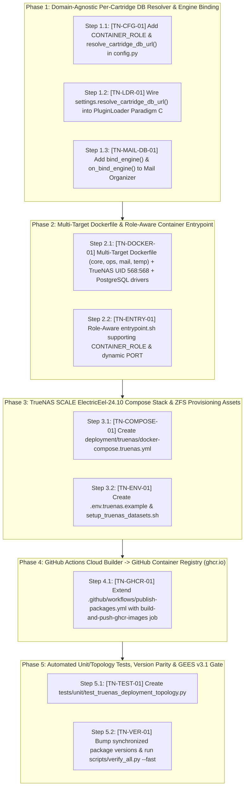

# TrueNAS SCALE (`ElectricEel-24.10.0.2`) Multi-Container & `ghcr.io` Deployment — Exhaustive Phased Implementation Plan (`v1.0.0`)

```
Document ID             : IMPLEMENTATION-PLAN-TRUENAS-DEPLOY-2026-001
Version                 : 1.0.0 (Initial Exhaustive Phased Step-by-Step Blueprint with Code Markers)
Date                    : October 20, 2026
Author                  : Mahendra GURAV
Location                : /plan/Deployment-Git-Docker-TrueNAS/ImplementPlan/IMPLEMENTATION_PLAN_TRUENAS_SCALE_DEPLOYMENT_v1.0.md
Governing Specification : ../TRUENAS_SCALE_GIT_GHCR_DEPLOYMENT_MASTER_PLAN_v1.0.md (v1.0.0)
Engineering Standard    : /ENGINEERING_EXCELLENCE_STANDARD_v3.0.md (GEES v3.1)
Target Platform         : TrueNAS SCALE ElectricEel-24.10.0.2 (Native Docker Compose + ZFS Datasets)
Target Branch           : intent-router
Execution Status        : AWAITING USER REVIEW & EXPLICIT "GO" (Zero production code modified until approval)
```

---

## Document Control & Revision History

| Version | Date | Author | Summary of Phased Implementation Scope |
| :--- | :--- | :--- | :--- |
| **`1.0.0`** | 2026-10-20 | Mahendra GURAV | Initial 5-phase, step-by-step implementation blueprint translating `TRUENAS_SCALE_GIT_GHCR_DEPLOYMENT_MASTER_PLAN_v1.0.md` into concrete file additions, surgical backward-compatible config hooks, exact line-range `[CODE-MARKER]` anchors, GitHub Actions `ghcr.io` image build workflow, TrueNAS SCALE Compose YAML, and GEES v3.1 verification gates. |

---

## 0. Live Codebase Alignment & Architectural Self-Check Report

Before drafting this step-by-step implementation plan, we conducted a line-by-line read-only inspection of the live codebase (`core_platform/`, `apps/`, `deployment/`, `.github/workflows/`, and `tests/unit/test_architectural_boundaries.py`). Below are the **4 key codebase findings** and how this plan leverages them with **zero breaking changes**:

1. **GEES v3.1 Microkernel Domain Isolation (`test_architectural_boundaries.py`):**
   * [`tests/unit/test_architectural_boundaries.py`](file:///d:/IntentRouter_Release100/tests/unit/test_architectural_boundaries.py#L120-L200) enforces that `core_platform/` must **never** hardcode domain cartridge names (`mail_organizer`, `temperature_marker`).
   * **Design Alignment:** Instead of adding cartridge-named fields in [`core_platform/app/config.py`](file:///d:/IntentRouter_Release100/core_platform/app/config.py), we add a 100% domain-agnostic `CARTRIDGE_DATABASE_URLS: Dict[str, str]` setting and a dynamic `resolve_cartridge_db_url(app_id: str)` method on `PlatformSettings` that automatically inspects `CARTRIDGE_DB_URL_<APP_ID_UPPER>` or `<APP_ID_UPPER>_DATABASE_URL` at runtime for **any** current or future cartridge (`[CODE-MARKER: TN-CFG-01]`).
2. **Existing Paradigm A & Paradigm C Database Wiring in `PluginLoader` (`loader.py:173-193`):**
   * Live inspection of [`core_platform/app/plugin_engine/loader.py`](file:///d:/IntentRouter_Release100/core_platform/app/plugin_engine/loader.py#L173-L193) confirmed that `PluginLoader.load_all()` **already** supports both **Paradigm A (Shared Platform Database)** and **Paradigm C (Dedicated Custom SQL Database via `db_mgr.create_custom_factory(app_id, custom_url)`)**!
   * Currently, line 177 only checks `getattr(instance, "custom_database_url", None)`.
   * **Design Alignment:** By updating line 177 to `custom_url = getattr(instance, "custom_database_url", None) or settings.resolve_cartridge_db_url(app_id)` and calling `DatabaseMigrationHelper.initialize_metadata_tables` on the custom engine (`[CODE-MARKER: TN-LDR-01]`), any cartridge immediately gains Admin-selectable dedicated database support with a 6-line change!
3. **Engine Rebinding Parity Between `temperature_marker` and `mail_organizer`:**
   * [`TemperatureMarkerApplication`](file:///d:/IntentRouter_Release100/apps/temperature_marker/plugin.py#L92-L95) and [`DatabaseService`](file:///d:/IntentRouter_Release100/apps/temperature_marker/database/db_service.py#L122-L126) already implement `on_bind_engine(engine)` and `bind_engine(engine)`.
   * [`MailOrganizerApplication`](file:///d:/IntentRouter_Release100/apps/mail_organizer/plugin.py#L84-L100) and [`MailDatabaseService`](file:///d:/IntentRouter_Release100/apps/mail_organizer/database/db_service.py#L78-L125) reference `bind_engine(engine)` in `get_instance()` (line 87), but `on_bind_engine()` on `MailOrganizerApplication` and `bind_engine()` on `MailDatabaseService` were not yet defined.
   * **Design Alignment:** In **Phase 1 (`[CODE-MARKER: TN-MAIL-DB-01]`)**, we add `bind_engine(self, engine: Engine) -> None` to `MailDatabaseService` and `on_bind_engine(self, engine: Any) -> None` to `MailOrganizerApplication` so both cartridges behave identically under Shared DB (Paradigm A) and Dedicated DB (Paradigm C).
4. **PostgreSQL Driver (`psycopg2-binary`) Already Declared in `pyproject.toml`:**
   * [`pyproject.toml`](file:///d:/IntentRouter_Release100/pyproject.toml#L40-L45) already declares `psycopg2-binary>=2.9.0` and `pymysql>=1.1.0` under `[project.optional-dependencies] all-databases`, and [`DatabaseConnectionFactory._create_engine()`](file:///d:/IntentRouter_Release100/core_platform/app/db/connection_factory.py#L115-L125) already normalizes `postgresql://` and `postgres://` URLs to `postgresql+psycopg2://`.
   * **Design Alignment:** In **Phase 2 (`[CODE-MARKER: TN-DOCKER-01]`)**, our multi-stage `Dockerfile` installs `[all-databases]` into `/venv` so every `ghcr.io` container image supports SQLite WAL, PostgreSQL 16, and MySQL out of the box on TrueNAS SCALE.

---

## 1. Master Code Marker Index (`[CODE-MARKER]`)

Every step in this implementation plan is tracked by a unique `[CODE-MARKER]` anchor:

| Code Marker ID | Phase | Target File Path | Target Class / Function / Line Range | Change Type |
| :--- | :---: | :--- | :--- | :--- |
| **`[CODE-MARKER: TN-CFG-01]`** | Phase 1 | [`core_platform/app/config.py`](file:///d:/IntentRouter_Release100/core_platform/app/config.py#L65-L83) | `PlatformSettings` (`CONTAINER_ROLE`, `OPS_DATABASE_URL`, `CARTRIDGE_DATABASE_URLS`, `resolve_cartridge_db_url`) | Additive Config (existing file) |
| **`[CODE-MARKER: TN-LDR-01]`** | Phase 1 | [`core_platform/app/plugin_engine/loader.py`](file:///d:/IntentRouter_Release100/core_platform/app/plugin_engine/loader.py#L172-L194) | `PluginLoader.load_all` (Resolve `settings.resolve_cartridge_db_url(app_id)` & init tables on Paradigm C engine) | Additive Hook (existing file) |
| **`[CODE-MARKER: TN-MAIL-DB-01]`** | Phase 1 | [`apps/mail_organizer/database/db_service.py`](file:///d:/IntentRouter_Release100/apps/mail_organizer/database/db_service.py#L120-L130) & [`apps/mail_organizer/plugin.py`](file:///d:/IntentRouter_Release100/apps/mail_organizer/plugin.py#L95-L105) | `MailDatabaseService.bind_engine` & `MailOrganizerApplication.on_bind_engine` | Additive Method (existing file) |
| **`[CODE-MARKER: TN-DOCKER-01]`** | Phase 2 | [`deployment/docker/Dockerfile`](file:///d:/IntentRouter_Release100/deployment/docker/Dockerfile#L1-L79) | Multi-target stages (`base-runtime`, `core-runtime`, `ops-control`, `cartridge-mail-organizer`, `cartridge-temperature-marker`) + TrueNAS `568:568` user | Upgrade Dockerfile |
| **`[CODE-MARKER: TN-ENTRY-01]`** | Phase 2 | [`deployment/docker/entrypoint.sh`](file:///d:/IntentRouter_Release100/deployment/docker/entrypoint.sh#L1-L27) | Role-aware bootstrap (`CONTAINER_ROLE`: `core`, `ops_control`, `cartridge_mail_organizer`, `cartridge_temperature_marker`, `unified`) | Upgrade Entrypoint |
| **`[CODE-MARKER: TN-COMPOSE-01]`** | Phase 3 | `deployment/truenas/docker-compose.truenas.yml` | Complete TrueNAS SCALE `ElectricEel-24.10.0.2` Multi-Container YAML (`postgres-shared`, `release100-core`, `release100-ops`, `app-mail-organizer`, `app-temperature-marker`, `cloudflared`, plus optional per-cartridge DB profile) | **New File** |
| **`[CODE-MARKER: TN-ENV-01]`** | Phase 3 | `deployment/truenas/.env.truenas.example` & `deployment/truenas/setup_truenas_datasets.sh` | TrueNAS SCALE environment template + ZFS dataset & `568:568` ACL provisioning helper script | **New Files** |
| **`[CODE-MARKER: TN-GHCR-01]`** | Phase 4 | [`.github/workflows/publish-packages.yml`](file:///d:/IntentRouter_Release100/.github/workflows/publish-packages.yml#L33-L116) | Add Job 2 (`build-and-push-ghcr-images`) building & pushing all 4 container targets to `ghcr.io/meetmahendra/*` with Buildx GHA cache | Extend CI Workflow |
| **`[CODE-MARKER: TN-TEST-01]`** | Phase 5 | `tests/unit/test_truenas_deployment_topology.py` | Unit & integration test suite verifying `resolve_cartridge_db_url`, Paradigm A vs. Paradigm C binding, multi-target Dockerfile stages, and `docker-compose.truenas.yml` structure | **New Test File** |
| **`[CODE-MARKER: TN-VER-01]`** | Phase 5 | [`pyproject.toml`](file:///d:/IntentRouter_Release100/pyproject.toml), `apps/*/pyproject.toml`, `*/__init__.py` | Synchronized semantic version bump & `MANIFEST-GUARD` verification | Version Parity |

---

## 2. Phased Execution Workflow & Integrity Protocol

Implementation is divided into **5 sequential phases (Phases 1–5)**. Each phase will be executed step-by-step and verified with a **Post-Phase Integrity Check** (`pytest` + `git diff` verification) to guarantee zero regressions before moving to the next phase:



---

## Phase 1: Domain-Agnostic Per-Cartridge Database Resolver & Engine Binding

> **Objective:** Enable the Admin to choose either a **Single Shared Database Container** (`DATABASE_URL`) for Core, Ops, and all Cartridges **OR** **Dedicated Per-Cartridge Database Containers** (`CARTRIDGE_DB_URL_<APP_ID>` / `<APP_ID>_DATABASE_URL`), while keeping `core_platform/` 100% free of hardcoded cartridge names (`AST-GUARD` compliant).

### Step 1.1: Add `CONTAINER_ROLE` & `resolve_cartridge_db_url()` in `PlatformSettings` (`[CODE-MARKER: TN-CFG-01]`)
* **Target File:** [`core_platform/app/config.py`](file:///d:/IntentRouter_Release100/core_platform/app/config.py#L65-L83)
* **Exact Changes:**
  1. Update the `from typing import ...` import on line 24 to include `Dict`:
     ```python
     from typing import Dict, List, Literal, Optional
     ```
  2. Immediately below `DB_MAX_OVERFLOW` (line 75), add:
     ```python
     # [CODE-MARKER: TN-CFG-01] Container Role & Per-Component Database Overrides
     CONTAINER_ROLE: str = Field(
         default="unified",
         description="Container execution role: unified | core | ops_control | cartridge",
     )
     CORE_DATABASE_URL: str = Field(
         default="",
         description="Optional dedicated database URL override for Core Platform tables",
     )
     OPS_DATABASE_URL: str = Field(
         default="",
         description="Optional dedicated database URL override for Ops Control Plane",
     )
     CARTRIDGE_DATABASE_URLS: Dict[str, str] = Field(
         default_factory=dict,
         description="Optional mapping of cartridge app_id -> dedicated database connection URL",
     )
     ```
  3. Add two typed helper methods on `PlatformSettings` (with full return type annotations required by `test_function_signatures_have_type_annotations`):
     ```python
     def resolve_primary_db_url(self) -> str:
         """Return the active primary database URL for the current container role."""
         if self.CONTAINER_ROLE == "ops_control" and self.OPS_DATABASE_URL.strip():
             return self.OPS_DATABASE_URL.strip()
         if self.CORE_DATABASE_URL.strip():
             return self.CORE_DATABASE_URL.strip()
         return self.DATABASE_URL

     def resolve_cartridge_db_url(self, app_id: str) -> Optional[str]:
         """Resolve an optional dedicated database URL for a cartridge without hardcoding app names in Core.

         Checks (in order):
         1. CARTRIDGE_DATABASE_URLS dict entry for app_id
         2. Environment variable CARTRIDGE_DB_URL_<APP_ID_UPPER>
         3. Environment variable <APP_ID_UPPER>_DATABASE_URL
         Returns None when the cartridge should share the primary DATABASE_URL (Single DB installation).
         """
         norm_id = app_id.strip().lower().replace("-", "_")
         if norm_id in self.CARTRIDGE_DATABASE_URLS and self.CARTRIDGE_DATABASE_URLS[norm_id].strip():
             return self.CARTRIDGE_DATABASE_URLS[norm_id].strip()
         upper_id = norm_id.upper()
         env_val = (
             os.environ.get(f"CARTRIDGE_DB_URL_{upper_id}", "").strip()
             or os.environ.get(f"{upper_id}_DATABASE_URL", "").strip()
         )
         return env_val if env_val else None
     ```

### Step 1.2: Wire `settings.resolve_cartridge_db_url(app_id)` into `PluginLoader` (`[CODE-MARKER: TN-LDR-01]`)
* **Target File:** [`core_platform/app/plugin_engine/loader.py`](file:///d:/IntentRouter_Release100/core_platform/app/plugin_engine/loader.py#L172-L194)
* **Exact Changes:**
  1. In `PluginLoader.load_all()` (lines 173–188), resolve `custom_url` from either the cartridge instance attribute OR `settings.resolve_cartridge_db_url(app_id)`, and initialize metadata tables on the dedicated engine when Paradigm C is active:
     ```python
     # ── Pluggable Polyglot Database Management Integration (GEES v2.0) ──
     try:
         from core_platform.app.config import settings
         from core_platform.app.db.manager import get_db_manager
         from core_platform.app.db.migrations import DatabaseMigrationHelper
         db_mgr = get_db_manager()

         # [CODE-MARKER: TN-LDR-01]
         custom_url: Optional[str] = (
             getattr(instance, "custom_database_url", None)
             or settings.resolve_cartridge_db_url(app_id)
         )
         meta = instance.get_metadata()
         if custom_url:
             # Paradigm C: Dedicated Custom SQL Database via Core Factory
             custom_factory = db_mgr.create_custom_factory(app_id, custom_url)
             if meta is not None:
                 DatabaseMigrationHelper.initialize_metadata_tables(
                     engine=custom_factory.get_engine(),
                     metadata_list=[meta],
                     enable_sqlite_wal=True,
                 )
             instance.on_bind_engine(custom_factory.get_engine())
             logger.info("[PluginLoader] Paradigm C (Dedicated DB): Registered factory for '%s'", app_id)
         elif meta is not None:
             # Paradigm A: Core-Facilitated Shared Platform Database
             db_mgr.register_cartridge_metadata(app_id, meta)
             instance.on_bind_engine(db_mgr.get_engine())
             logger.info("[PluginLoader] Paradigm A (Core-Facilitated): Registered metadata for '%s'", app_id)
     ```

### Step 1.3: Add `bind_engine()` & `on_bind_engine()` to `mail_organizer` (`[CODE-MARKER: TN-MAIL-DB-01]`)
* **Target Files:**
  1. [`apps/mail_organizer/database/db_service.py`](file:///d:/IntentRouter_Release100/apps/mail_organizer/database/db_service.py#L120-L130)
  2. [`apps/mail_organizer/plugin.py`](file:///d:/IntentRouter_Release100/apps/mail_organizer/plugin.py#L95-L105)
* **Exact Changes:**
  1. In [`MailDatabaseService`](file:///d:/IntentRouter_Release100/apps/mail_organizer/database/db_service.py#L120-L126), add `bind_engine(self, engine: Engine) -> None` right after `__init__`:
     ```python
     # [CODE-MARKER: TN-MAIL-DB-01]
     def bind_engine(self, engine: Engine) -> None:
         """Bind or reconfigure the SQLAlchemy engine for this cartridge service."""
         self.engine = engine
         self.SessionFactory = sessionmaker(bind=self.engine)
         self._init_neuro_symbolic_schema()
     ```
  2. In [`MailOrganizerApplication`](file:///d:/IntentRouter_Release100/apps/mail_organizer/plugin.py#L95-L105), add `on_bind_engine(self, engine: Any) -> None` and `get_metadata(self) -> Any` (matching `TemperatureMarkerApplication`):
     ```python
     # [CODE-MARKER: TN-MAIL-DB-01]
     def get_metadata(self) -> Any:
         """Return SQLAlchemy MetaData for core-facilitated or dedicated schema creation."""
         from apps.mail_organizer.database.models import Base
         return Base.metadata

     def on_bind_engine(self, engine: Any) -> None:
         """Dynamically bind or update the database engine (Paradigm A & Paradigm C)."""
         if engine is not None and hasattr(self, "db_service") and self.db_service is not None:
             self.db_service.bind_engine(engine)
     ```

* **Post-Phase 1 Verification Gate:**
  * Run `pytest tests/unit/test_architectural_boundaries.py` and `mypy core_platform apps`.

---

## Phase 2: Multi-Target `Dockerfile` & Role-Aware Container Entrypoint

> **Objective:** Upgrade [`deployment/docker/Dockerfile`](file:///d:/IntentRouter_Release100/deployment/docker/Dockerfile) and [`deployment/docker/entrypoint.sh`](file:///d:/IntentRouter_Release100/deployment/docker/entrypoint.sh) so a single unified build pipeline produces the 4 specialized container images (`release100-core`, `release100-ops`, `release100-mail-organizer`, `release100-temperature-marker`) running under TrueNAS SCALE's non-root `apps` user (`UID=568, GID=568`) with full PostgreSQL (`psycopg2-binary`), MySQL (`pymysql`), and SQLite WAL support.

### Step 2.1: Upgrade `deployment/docker/Dockerfile` with Multi-Target Stages & TrueNAS `568:568` User (`[CODE-MARKER: TN-DOCKER-01]`)
* **Target File:** [`deployment/docker/Dockerfile`](file:///d:/IntentRouter_Release100/deployment/docker/Dockerfile#L1-L79)
* **Exact Changes:**
  1. **Stage 1 (`builder`):**
     * Install `gcc`, `libpq-dev`, `libgl1`, `libglib2.0-0`.
     * Install `core_platform/requirements.txt` PLUS `psycopg2-binary>=2.9.0` and `pymysql>=1.1.0` into `/venv` so PostgreSQL and MySQL containers on TrueNAS SCALE work out of the box without missing driver errors.
  2. **Stage 2 (`base-runtime`):**
     * Create the non-root `kiosk` group and user with configurable `PUID=${PUID:-568}` and `PGID=${PGID:-568}` (defaulting to `568:568`, the standard TrueNAS SCALE `apps` UID/GID).
     * Pre-create `/opt/release100/data`, `/opt/release100/logs/audit_partitions`, and `/opt/release100/.local_credentials` owned by `568:568`.
  3. **Build Targets (Sharing 100% of `base-runtime` layers):**
     * **`target: core-runtime`** (`ghcr.io/meetmahendra/release100-core`): Sets `ENV CONTAINER_ROLE=core ORCHESTRATOR_PORT=8002 MCP_SERVER_PORT=8001`.
     * **`target: ops-control`** (`ghcr.io/meetmahendra/release100-ops`): Sets `ENV CONTAINER_ROLE=ops_control ORCHESTRATOR_PORT=8003 ENABLED_APPLICATIONS="[]"`.
     * **`target: cartridge-mail-organizer`** (`ghcr.io/meetmahendra/release100-mail-organizer`): Sets `ENV CONTAINER_ROLE=cartridge_mail_organizer ORCHESTRATOR_PORT=8011 ENABLED_APPLICATIONS='["mail_organizer"]'`.
     * **`target: cartridge-temperature-marker`** (`ghcr.io/meetmahendra/release100-temperature-marker`): Sets `ENV CONTAINER_ROLE=cartridge_temperature_marker ORCHESTRATOR_PORT=8012 ENABLED_APPLICATIONS='["temperature_marker"]'`.
     * **`target: runtime` (Default final stage for backward compatibility):** Retains `CONTAINER_ROLE=unified ORCHESTRATOR_PORT=8002` so any existing single-container `docker build` works without changes.

### Step 2.2: Upgrade `deployment/docker/entrypoint.sh` for Multi-Container Roles (`[CODE-MARKER: TN-ENTRY-01]`)
* **Target File:** [`deployment/docker/entrypoint.sh`](file:///d:/IntentRouter_Release100/deployment/docker/entrypoint.sh#L1-L27)
* **Exact Changes:**
  1. Inspect `CONTAINER_ROLE` (`unified` | `core` | `ops_control` | `cartridge_mail_organizer` | `cartridge_temperature_marker`) and `PORT` / `ORCHESTRATOR_PORT`:
     * Automatically map `PORT` $\rightarrow$ `ORCHESTRATOR_PORT` if `PORT` is set.
     * When `CONTAINER_ROLE=ops_control`, set `ENABLED_APPLICATIONS='[]'` so the out-of-band Ops Control Plane container never runs background cartridge pollers or webhook relays.
     * When `CONTAINER_ROLE=cartridge_mail_organizer`, default `ENABLED_APPLICATIONS='["mail_organizer"]'` and `ORCHESTRATOR_PORT=${PORT:-8011}`.
     * When `CONTAINER_ROLE=cartridge_temperature_marker`, default `ENABLED_APPLICATIONS='["temperature_marker"]'` and `ORCHESTRATOR_PORT=${PORT:-8012}`.
     * Run `alembic upgrade head` (when `RUN_MIGRATIONS=${RUN_MIGRATIONS:-true}`) and `exec uvicorn core_platform.main:app --host 0.0.0.0 --port "${ORCHESTRATOR_PORT:-8002}"`.

---

## Phase 3: TrueNAS SCALE (`ElectricEel-24.10.0.2`) Compose Stack & ZFS Dataset Provisioning Assets

> **Objective:** Create the dedicated `deployment/truenas/` directory containing the ready-to-paste `docker-compose.truenas.yml` for TrueNAS SCALE's **"Install via YAML"** UI, the `.env.truenas.example` configuration template, and a ZFS dataset/ACL provisioning helper script.

### Step 3.1: Create `deployment/truenas/docker-compose.truenas.yml` (`[CODE-MARKER: TN-COMPOSE-01]`)
* **Target File:** `deployment/truenas/docker-compose.truenas.yml` *(New File)*
* **Exact Contents & Architecture:**
  1. **Default Active Services (Booted automatically on `docker compose up -d` / TrueNAS Install via YAML):**
     * `postgres-shared` (`postgres:16-alpine`, `user: "568:568"`, health-checked via `pg_isready`, backed by `${TRUENAS_APPS_PATH:-/mnt/tank/apps/release100}/postgres`).
     * `release100-core` (`ghcr.io/meetmahendra/release100-core:${IMAGE_TAG:-intent-router}`, ports `8002:8002` & `8001:8001`).
     * `release100-ops` (`ghcr.io/meetmahendra/release100-ops:${IMAGE_TAG:-intent-router}`, port `8003:8003`, out-of-band DevOps `/ops/tenants` control plane).
     * `app-mail-organizer` (`ghcr.io/meetmahendra/release100-mail-organizer:${IMAGE_TAG:-intent-router}`, port `8011:8011`).
     * `app-temperature-marker` (`ghcr.io/meetmahendra/release100-temperature-marker:${IMAGE_TAG:-intent-router}`, port `8012:8012`).
     * `cloudflared` (`cloudflare/cloudflared:latest`, outbound zero-trust tunnel).
  2. **Optional Per-Cartridge Dedicated Database Containers (Activated via Compose `profiles: ["per-cartridge-db"]`):**
     * `postgres-mail` (`postgres:16-alpine` mounted to `${TRUENAS_APPS_PATH}/postgres_mail`) — used when the Admin sets `MAIL_ORGANIZER_DATABASE_URL` to run Mail Organizer on its own isolated database container.
     * `postgres-temp` (`postgres:16-alpine` mounted to `${TRUENAS_APPS_PATH}/postgres_temp`) — used when the Admin sets `TEMPERATURE_MARKER_DATABASE_URL` to run Temperature Marker on its own isolated database container.

### Step 3.2: Create `deployment/truenas/.env.truenas.example` & `deployment/truenas/setup_truenas_datasets.sh` (`[CODE-MARKER: TN-ENV-01]`)
* **Target Files:**
  1. `deployment/truenas/.env.truenas.example` *(New File)* — Complete documented environment variable file for TrueNAS SCALE with synthetic placeholder values (`mock_gemini_test_key_12345`, etc., 100% compliant with `SECRET-GUARD`).
  2. `deployment/truenas/setup_truenas_datasets.sh` *(New File)* — Idempotent shell script that can be run once on TrueNAS SCALE (via SSH or TrueNAS Shell) to create `/mnt/<pool>/apps/release100/{data,logs,creds,models,postgres}` and apply `chown -R 568:568` permissions.

---

## Phase 4: GitHub Actions Cloud Builder $\rightarrow$ GitHub Container Registry (`ghcr.io`)

> **Objective:** Extend [`.github/workflows/publish-packages.yml`](file:///d:/IntentRouter_Release100/.github/workflows/publish-packages.yml) so every push to `intent-router` or `main` (or manual `workflow_dispatch`) automatically builds and publishes the 4 Docker images to `ghcr.io/meetmahendra/*` at **\$0.00 cost** without adding a single byte to the Git repository.

### Step 4.1: Add `build-and-push-ghcr-images` Job to `.github/workflows/publish-packages.yml` (`[CODE-MARKER: TN-GHCR-01]`)
* **Target File:** [`.github/workflows/publish-packages.yml`](file:///d:/IntentRouter_Release100/.github/workflows/publish-packages.yml#L33-L116)
* **Exact Changes:**
  1. Keep Job 1 (`build-and-publish` — PEP 503 wheel index on GitHub Pages) 100% intact.
  2. Add Job 2 (`build-and-push-ghcr-images`):
     * `needs: build-and-publish`
     * `runs-on: ubuntu-latest`
     * `permissions: contents: read, packages: write`
     * Matrix strategy over the 4 targets:
       - `{ image: "release100-core", target: "core-runtime" }`
       - `{ image: "release100-ops", target: "ops-control" }`
       - `{ image: "release100-mail-organizer", target: "cartridge-mail-organizer" }`
       - `{ image: "release100-temperature-marker", target: "cartridge-temperature-marker" }`
     * Logs into `ghcr.io` via `docker/login-action@v3` using `${{ github.actor }}` and `${{ secrets.GITHUB_TOKEN }}`.
     * Extracts version from `pyproject.toml` and builds/pushes via `docker/build-push-action@v6` with tags:
       - `ghcr.io/${owner_lower}/${matrix.image}:${TARGET_CHANNEL}` (e.g., `:intent-router` or `:main`)
       - `ghcr.io/${owner_lower}/${matrix.image}:${PACKAGE_VERSION}` (e.g., `:3.0.28`)
       - `ghcr.io/${owner_lower}/${matrix.image}:latest` (when on `main`)
     * Uses GitHub Actions layer cache (`cache-from: type=gha,scope=${{ matrix.target }}`, `cache-to: type=gha,mode=max,scope=${{ matrix.target }}`) for fast ~45s incremental builds.

---

## Phase 5: Automated Unit/Topology Verification, Version Parity & GEES v3.1 Gate

> **Objective:** Verify every component of the TrueNAS SCALE deployment topology via automated unit tests, increment synchronized package versions across the monorepo, and pass Tier 1 & Tier 2 verification gates.

### Step 5.1: Create `tests/unit/test_truenas_deployment_topology.py` (`[CODE-MARKER: TN-TEST-01]`)
* **Target File:** `tests/unit/test_truenas_deployment_topology.py` *(New Test File)*
* **Exact Test Cases:**
  1. `test_resolve_cartridge_db_url_shared_default()`: Verifies that when no cartridge-specific env var is set, `settings.resolve_cartridge_db_url("mail_organizer")` and `settings.resolve_cartridge_db_url("temperature_marker")` return `None` (Shared DB Mode / Paradigm A).
  2. `test_resolve_cartridge_db_url_per_cartridge_override(monkeypatch)`: Verifies that setting `MAIL_ORGANIZER_DATABASE_URL` or `CARTRIDGE_DB_URL_TEMPERATURE_MARKER` dynamically resolves the isolated DB URL for that specific cartridge while leaving other cartridges on the shared DB.
  3. `test_plugin_loader_paradigm_c_dedicated_engine_binding(tmp_path, monkeypatch)`: Verifies that `PluginLoader.load_all()` creates a dedicated `DatabaseConnectionFactory` via `DatabaseManager.create_custom_factory()`, initializes the cartridge's tables on the isolated SQLite/RDBMS engine, and calls `on_bind_engine()` on both `mail_organizer` and `temperature_marker`.
  4. `test_truenas_docker_compose_yaml_structural_validity()`: Parses `deployment/truenas/docker-compose.truenas.yml` via `yaml.safe_load()` and asserts:
     - All 6 core services (`postgres-shared`, `release100-core`, `release100-ops`, `app-mail-organizer`, `app-temperature-marker`, `cloudflared`) exist.
     - Non-root TrueNAS `apps` UID/GID (`568:568`) is configured.
     - `ghcr.io/meetmahendra/` image URIs and `/health` probes are defined.
     - Optional `per-cartridge-db` profile services (`postgres-mail`, `postgres-temp`) are valid.
  5. `test_dockerfile_multi_target_stages_and_entrypoint()`: Verifies `deployment/docker/Dockerfile` defines `core-runtime`, `ops-control`, `cartridge-mail-organizer`, and `cartridge-temperature-marker` build targets, and `publish-packages.yml` defines the `build-and-push-ghcr-images` matrix job.

### Step 5.2: Synchronized Version Bump & Pre-Commit Verification Gate (`[CODE-MARKER: TN-VER-01]`)
* **Target Files:**
  * [`pyproject.toml`](file:///d:/IntentRouter_Release100/pyproject.toml#L8) & [`core_platform/app/__init__.py`](file:///d:/IntentRouter_Release100/core_platform/app/__init__.py)
  * `apps/mail_organizer/pyproject.toml` & `apps/mail_organizer/__init__.py`
  * `apps/temperature_marker/pyproject.toml` & `apps/temperature_marker/__init__.py`
* **Verification Execution:**
  1. **Tier 1 (Targeted Iteration):** `pytest tests/unit/test_truenas_deployment_topology.py -v`
  2. **Tier 2 (Fast Pre-Commit Staging Gate):** `python scripts/verify_all.py --fast` (verifying `AST-GUARD`, `TYPE-GUARD` `mypy --strict`, `UI-GUARD`, `NODE-GUARD`, `SECRET-GUARD`, and `MANIFEST-GUARD`).
  3. Present `git status` and commit diff to USER for explicit **"go"** before pushing to `intent-router` (which will immediately trigger the live GitHub Actions build to publish the images to `ghcr.io`).
