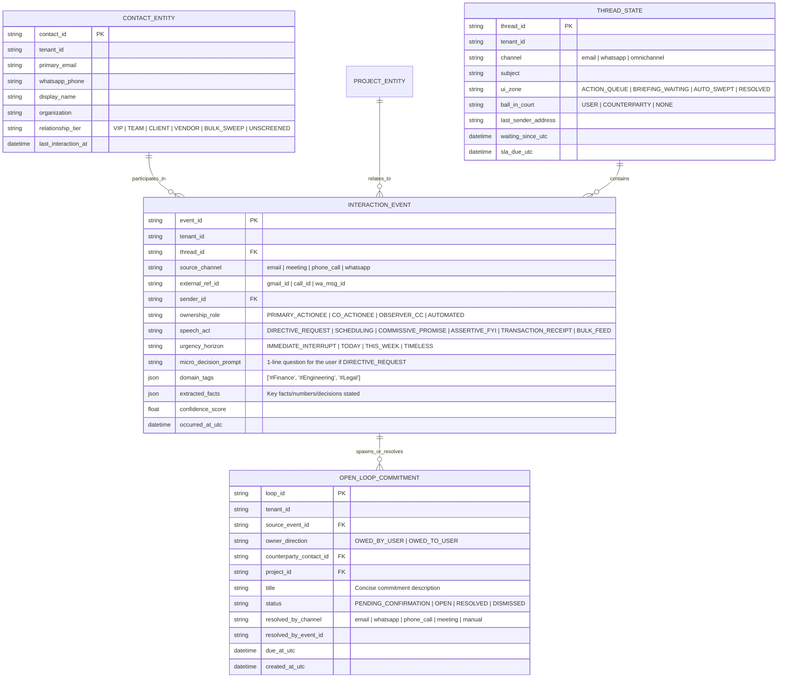
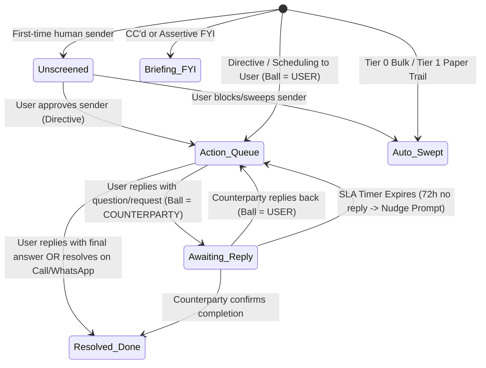

# Next-Generation Mail Triage & Omnichannel Executive Context Engine: Research, Strategy & Technical Architecture Specification

```
Document Reference : MT-OMNI-SPEC-2026-V1.0
Version            : 1.0.0
Status             : Draft Architectural & Product Specification (For Review & Iteration)
Author             : Mahendra GURAV
License            : Apache License, Version 2.0
Location           : /plan/improvement/mailTriage/MAIL_TRIAGE_AND_OMNICHANNEL_CONTEXT_MASTER_SPEC_v1.0.md
Scope              : Mail Organizer Cartridge, MCP Orchestrator, System 1 (Jev) & System 2 (Gemini) Pipeline,
                     and Future Omnichannel Context Sensors (Meetings, Phone Calls, WhatsApp)
Governed By        : Global Engineering Excellence Standard (GEES v3.1)
```

---

## Table of Contents

1. [Executive Summary & Core Product Thesis](#1-executive-summary--core-product-thesis)
2. [Scientific & Engineering Challenges (Why 40 Years of Email Tools Failed)](#2-scientific--engineering-challenges-why-40-years-of-email-tools-failed)
3. [Competitive Landscape, Legal Barriers & Our Sovereign Moat](#3-competitive-landscape-legal-barriers--our-sovereign-moat)
4. [Target Clients, Use Cases & Commercial Value Proposition](#4-target-clients-use-cases--commercial-value-proposition)
5. [Strategic Proposals (What We Are Building)](#5-strategic-proposals-what-we-are-building)
6. [The "HOW" — Part 1: Granular Database Schema & Omnichannel Memory Graph](#6-the-how--part-1-granular-database-schema--omnichannel-memory-graph)
7. [The "HOW" — Part 2: The 3-Tier Cognitive Triage Pipeline (Heuristics ➔ Jev ➔ Gemini)](#7-the-how--part-2-the-3-tier-cognitive-triage-pipeline-heuristics--jev--gemini)
8. [The "HOW" — Part 3: Thread State Machine & Micro-Decision Drafting Loop](#8-the-how--part-3-thread-state-machine--micro-decision-drafting-loop)
9. [The "HOW" — Part 4: Redefined Polling, Bounded Deferral & Pre-Meeting Briefings](#9-the-how--part-4-redefined-polling-bounded-deferral--pre-meeting-briefings)
10. [The "HOW" — Part 5: Intelligent MCP Orchestrator & Dynamic Tool Scoping](#10-the-how--part-5-intelligent-mcp-orchestrator--dynamic-tool-scoping)
11. [The "HOW" — Part 6: Future Omnichannel Bot Plug-In Architecture (Meetings, Calls, WhatsApp)](#11-the-how--part-6-future-omnichannel-bot-plug-in-architecture-meetings-calls-whatsapp)
12. [Phased Implementation Roadmap & Verification Criteria](#12-phased-implementation-roadmap--verification-criteria)

---

## 1. Executive Summary & Core Product Thesis

Most AI email tools on the market today are **net-negative wrappers**: they apply naive single-dimension labels (`@Action`, `@Financial`, `@Urgent`), pre-generate 3-paragraph generic ChatGPT replies without knowing what the user actually wants to decide, and extract dozens of "zombie tasks" from routine emails. Instead of saving time, they force the user to audit multiple folders, delete bad drafts, and pay inflated LLM API bills.

### Our Core Thesis
To build a product that high-value clients gladly pay for every month, we must shift the paradigm from an **"Autonomous Folder Sorter"** to a **"Decision-First Omnichannel Chief of Staff"** governed by three foundational laws:

1. **Granular in the Database, Simple on the Screen:**
   - **Internally (Database/Memory):** Extract rich, multi-dimensional metadata (Speech Act, Social Ownership, Urgency Horizon, Project Entities, Open-Loop Commitments) for high-precision search, MCP querying, and cross-channel correlation.
   - **Externally (User View):** Expose **only 3 simple priority zones** (`1. Action Queue`, `2. Daily Briefing / Waiting-On`, `3. Auto-Swept Bulk`) so the human never has to check 10 different folders.
2. **Decision-First Drafting (Never Draft Before the User Decides):**
   - Background polling must **never** call a generative LLM to guess a reply. Instead, it identifies the **Decision Question** and asks the user on WhatsApp/UI (*"Rahul asks to move release to Thursday. Approve?"*). Once the user gives a 3-second response (*"Yes, if QA signs off"*), Gemini generates the polished reply.
3. **Omnichannel Context Unification (Email + Meetings + Phone Calls + WhatsApp):**
   - Email does not live in a vacuum. By designing our storage layer around **Universal Interaction Events** and **Open-Loop Commitments**, decisions made in a Zoom meeting, phone call, or WhatsApp chat automatically resolve pending email tasks and ground future email drafts.

---

## 2. Scientific & Engineering Challenges (Why 40 Years of Email Tools Failed)

Decades of research at **MIT, IBM Research, Microsoft Research, Xerox PARC, CMU, UC Irvine, and Stanford** proved that email organization is a "wicked problem" due to 8 fundamental cognitive and technical barriers:

```
┌──────────────────────────────────────────────────────────────────────────────────────────────────────────┐
│                         THE 8 SCIENTIFIC & TECHNICAL CHALLENGES OF EMAIL TRIAGE                          │
├────┬──────────────────────────────────┬──────────────────────────────────────────────────────────────────┤
│ #  │ Challenge & Research Source      │ Why Naive AI Solutions Fail                                      │
├────┼──────────────────────────────────┼──────────────────────────────────────────────────────────────────┤
│ C1 │ The Folder Fallacy               │ Moving emails into 7–10 category folders slows retrieval down.   │
│    │ (Whittaker et al., IBM, CHI '11) │ Users pay a "Double Cognitive Tax": guessing which folder the    │
│    │                                  │ AI chose and checking 10 places instead of 1.                    │
├────┼──────────────────────────────────┼──────────────────────────────────────────────────────────────────┤
│ C2 │ Prospective Memory Failure       │ Humans keep emails in the main Inbox as "Externalized Working    │
│    │ ("Out of Sight, Out of Mind")    │ Memory" (visual cues). When AI auto-moves human mail into        │
│    │ (Malone, MIT; Sidner, Lotus)     │ secondary labels, users forget the obligation exists.            │
├────┼──────────────────────────────────┼──────────────────────────────────────────────────────────────────┤
│ C3 │ Asymmetric Error Cost &          │ Cost(False Negative) >> 1,000 x Cost(False Positive). If an AI   │
│    │ The 99% Trust Collapse           │ hides just 1 critical client email in an archive/FYI folder,     │
│    │ (Horvitz & Amershi, MSR)         │ user trust collapses and they manually "shadow-audit" all        │
│    │                                  │ folders daily—creating MORE work than having no AI.              │
├────┼──────────────────────────────────┼──────────────────────────────────────────────────────────────────┤
│ C4 │ The "Urgent Invoice" Paradox     │ Flat taxonomies mix Topic (@Financial), Urgency (@Urgent), and   │
│    │ (Orthogonal Axis Conflation)     │ Workflow (@Action) in one mutually exclusive list. An unpaid     │
│    │                                  │ server bill labeled @Financial gets archived and causes outage.  │
├────┼──────────────────────────────────┼──────────────────────────────────────────────────────────────────┤
│ C5 │ The Decision Gap in AI Drafting  │ An LLM reading "Can we delay until Thursday?" cannot see inside  │
│    │ (Hancock et al., Stanford HCI)   │ the user's head (Yes/No). Unguided AI drafts are hollow          │
│    │                                  │ platitudes that take longer to delete/edit than typing 10 words. │
├────┼──────────────────────────────────┼──────────────────────────────────────────────────────────────────┤
│ C6 │ Cross-Channel Blindness          │ 50%+ of email requests are answered on WhatsApp, Slack, or a     │
│    │ & "Zombie Tasks"                 │ phone call. An email-only AI sees no email reply and keeps       │
│    │ (Mark & Iqbal, UC Irvine / MSR)  │ nagging the user about tasks already resolved offline.           │
├────┼──────────────────────────────────┼──────────────────────────────────────────────────────────────────┤
│ C7 │ Temporal Context Drift           │ Urgency is not in the static text at arrival time. A flight      │
│    │ (Dumais & Bennett, MSR)          │ pass or a report from "David" is 0% urgent on Monday, 100%       │
│    │                                  │ urgent 10 mins before meeting David on Wednesday, 0% on Friday.  │
├────┼──────────────────────────────────┼──────────────────────────────────────────────────────────────────┤
│ C8 │ Attention Fragmentation          │ Every real-time notification costs 23 mins 15 secs of focus      │
│    │ (Gloria Mark, UC Irvine;         │ recovery. Trickling alerts all day destroys deep work instead    │
│    │ Eric Horvitz, MSR)               │ of batching via "Bounded Deferral" at natural breakpoints.       │
└────┴──────────────────────────────────┴──────────────────────────────────────────────────────────────────┘
```

### Additional Legal & Platform Challenges (For Omnichannel Expansion)
- **C9. OS & Platform API Lockdowns:** Apple (iOS) and Google (Android) prohibit third-party apps from recording raw cellular calls without VoIP routing or external hardware mics; Meta restricts personal WhatsApp scraping (requiring WhatsApp Business Cloud API, companion device pairing, or local bridge).
- **C10. Wiretapping & Data Privacy Laws (CIPA, GDPR, DPDP):** Multi-tenant cloud SaaS startups face severe legal liability when recording third-party calls or meetings in the cloud without explicit two-party consent.

---

## 3. Competitive Landscape, Legal Barriers & Our Sovereign Moat

| Competitor / Category | Core Mechanism | Strengths | Critical Weaknesses / Why They Fail Clients |
| :--- | :--- | :--- | :--- |
| **SaneBox** | Server-side IMAP statistical folder mover (`@SaneLater`, `@SaneNews`). | Works with any mail client; zero UI migration. | Blind statistical rules; suffers from "Out of Sight, Out of Mind"; zero generative intelligence or cross-channel awareness. |
| **Superhuman** | High-speed keyboard-driven proprietary mail client (`Cmd+K`). | Sub-100ms UI speed; split inboxes. | $30/mo per user; forces leaving native Gmail/Outlook; AI still relies on manual user keystrokes; zero WhatsApp/Call awareness. |
| **Shortwave** | AI-native Gmail replacement with thread summaries & search. | Good conversational search across email history. | Locked into proprietary web UI; auto-summaries add visual clutter; email-only silo. |
| **Fyxer AI** | 8-label Gmail/Outlook plugin (`1. To Respond` .. `8. Marketing`) + meeting bot. | Strong workflow-state labeling (`To Respond` vs `Awaiting Reply`). | Pre-generates unguided drafts before user decides (Decision Gap); cloud-hosted privacy friction; no WhatsApp orchestrator. |
| **HEY (37signals)** | Opinionated protocol (`Screener`, `Imbox`, `The Feed`, `Paper Trail`). | Brilliant cognitive separation + First-Time Sender Screener. | Requires abandoning `@company.com` Gmail/Outlook; zero AI or cross-channel automation. |
| **Lindy AI** | Cloud autonomous agent builder with triggers & actions. | Flexible workflow triggers across SaaS tools. | Expensive per-credit cloud burn; high hallucination risk on autonomous multi-step loops; cloud data custody issues. |
| **Gong.io / Chorus** | Enterprise Revenue Intelligence (Email + Zoom + VoIP Calls). | True omnichannel correlation across calls, meetings, and email. | **$1,200–$1,600/seat/year**; built exclusively for B2B sales reps; heavy enterprise surveillance footprint. |
| **Limitless (Rewind) / Granola** | Local audio/screen recorder + meeting notes + calendar. | Captures offline audio and meeting context well. | Passive memory tool; does not actively triage inbox, manage Gmail labels, or orchestrate replies via WhatsApp. |
| **Microsoft Copilot / Google Gemini** | Native workspace sidebars inside M365 / Google Workspace. | First-party access to Docs, Mail, Calendar, Meet/Teams. | Trapped in a single vendor walled garden; zero WhatsApp integration; passive sidebar rather than proactive Chief of Staff. |

### Our Unfair Competitive Moat (Release100)
1. **Sovereign Customer-Controlled Edge Runtime:** Runs on the client's own infrastructure/node (or private tenant vault with BYOK). Because audio transcripts, WhatsApp chats, and emails stay in the client's legal custody, we bypass the multi-tenant cloud wiretapping/GDPR roadblocks that paralyze cloud startups.
2. **WhatsApp-First Bi-Directional Control Loop:** Executives live on WhatsApp, not inside a custom email dashboard. Delivering micro-decisions and pre-meeting briefs directly on WhatsApp with 1-reply execution is 10x faster than opening a desktop app.
3. **Hybrid System 1 (Jev) + System 2 (Gemini) Economics:** By handling 85%+ of sorting via deterministic headers + sub-400ms Jev probes, our LLM operating cost is **~80% lower** than pure-LLM agents like Lindy.

---

## 4. Target Clients, Use Cases & Commercial Value Proposition

### 4.1 Primary Target Client Segments (High Willingness-to-Pay)

| Segment | Persona | Daily Pain Point | Why They Pay for Release100 |
| :--- | :--- | :--- | :--- |
| **1. Founders, CEOs & Managing Partners** | Boutique agencies, law firms, VC funds, consulting firms, SMB owners (10–250 employees). | 150+ emails/day, 6 back-to-back Zoom calls, 50 WhatsApp threads. Constantly dropping balls or forgetting commitments made on calls. | Acts as a $5,000/mo human Chief of Staff for a fraction of the cost—briefing them before every call and turning email replies into 3-second WhatsApp taps. |
| **2. Operations & Plant / Fleet Directors** | Manufacturing, logistics, supply chain, hospitality directors (existing Release100 Kiosk clients). | On the shop floor or mobile all day; cannot sit at a desktop triaging vendor invoices, urgent escalations, and shift reports. | Seamless synergy with `temperature_marker` and shop-floor alerts; full triage and vendor response management from WhatsApp. |
| **3. High-Ticket Account Executives & Deal Makers** | Real estate brokers, wealth managers, enterprise sales leads, M&A advisors. | Deals move across Email, WhatsApp, and Phone Calls. Missing a single client follow-up costs $10k–$100k in commission. | Automatic "Waiting On" SLA tracking + cross-channel commitment memory ensures zero dropped deals. |
| **4. Privacy-Strict Enterprises (Legal, Healthcare, FinTech)** | General Counsel, Medical Directors, Financial Advisors. | Legally barred from connecting cloud SaaS bots (Fyxer, Lindy, Superhuman) to confidential client communications. | Sovereign deployment + AES-256-GCM BYOK + SHA-256 FDA/ISO audit trail satisfies strict compliance. |

### 4.2 High-ROI Client Use Cases
1. **The "Morning & Evening Commute Triage":** Client receives a crisp WhatsApp briefing of the 4 emails needing their decision, replies with short voice/text intents (*"1: approve, 2: ask for 10% discount, 3: schedule for Friday"*), and clears their entire action queue in 90 seconds.
2. **The "10-Minute Pre-Meeting Dossier":** Ten minutes before a client Zoom or phone call, the user gets a WhatsApp message summarizing the last 3 emails, open invoices, and what was promised on the last call.
3. **The "Zero-Audit Bulk Sweep":** Newsletters, marketing, and routine receipts are swept out of the inbox with a daily 1-line WhatsApp receipt + First-Time Sender Screener, guaranteeing zero missed human emails.
4. **The "Forgotten Follow-Up Radar":** User sends a proposal on Monday. By Thursday, the client hasn't replied. The system surfaces: *"Client X hasn't replied to your proposal in 72h. Send a polite nudge?"*

---

## 5. Strategic Proposals (What We Are Building)

### Proposal 1: The "Granular Internally, Simple Externally" Two-Layer Model
- **External Layer (3 User-Facing Views / Gmail Label Prefixes):**
  1. `1_Action_Queue` (Requires **your** decision, reply, or scheduling confirmation—stays visible in Inbox).
  2. `2_Briefing_And_Waiting` (`FYI` updates where you are CC'd, plus `Awaiting Reply` threads where the ball is in someone else's court).
  3. `3_Auto_Swept` (100%-confidence machine bulk: `Paper Trail` receipts/invoices, `Notifications`, and `The Feed` newsletters).
- **Internal Layer (Rich Multi-Dimensional Database Metadata):**
  - Every message is tagged in SQLite with orthogonal attributes: `speech_act`, `ownership_role`, `urgency_horizon`, `domain_tags`, `extracted_entities`, `open_loop_status`, and `resolution_channel`.

### Proposal 2: The First-Time Sender Screener & Daily Sweep Receipt (Solving Trust Collapse)
- **Rule of Iron Trust:** The system is **forbidden** from auto-archiving an email from a human sender unless that sender (or rule) has been approved.
- **First-Time Sender Screener:** When a new human sender emails for the first time and isn't obvious machine bulk (`List-Unsubscribe`), flag them in the daily briefing: `[Always Allow] [Just Once] [Always Sweep]`.
- **Daily Sweep Receipt:** Include a 1-line summary in the daily digest: *"🧹 Swept 22 newsletters & 3 receipts. (Reply 'show sweep' to inspect)."*

### Proposal 3: Decision-First Drafting (Solving the Decision Gap & Token Bleed)
- **Eliminate blind drafting during background polling.**
- Instead, Jev + a lightweight extractor identifies the **Core Question / Micro-Decision** (e.g., *"Wants to move deadline to Friday"*).
- Draft generation (Gemini System 2) is triggered **only on-demand** after the user provides their intent (or for simple 1-click deterministic acknowledgments).

### Proposal 4: The Unified Open-Loop & Episodic Context Graph
- Replace the isolated `pm_tasks` table with a **Universal Open-Loop Commitment Ledger** (`open_loops`) and **Episodic Interaction Graph** (`interaction_events`).
- Every channel (`email`, `calendar`, `whatsapp`, `meeting_bot`, `phone_call`) writes to and resolves loops in this single shared ledger.

---

## 6. The "HOW" — Part 1: Granular Database Schema & Omnichannel Memory Graph

To support both today's Mail Organizer and tomorrow's Meeting/Call/WhatsApp bots, we define four core tables in the cartridge/context database:



### Why This Schema Is Transformational
1. **Cross-Channel Identity (`CONTACT_ENTITY`):** Links `rahul@client.com` to `+919876543210` (WhatsApp/Phone).
2. **Screener Memory (`relationship_tier`):** Once a sender is marked `VIP` or `BULK_SWEEP`, Tier 0 handles them in **0ms** forever.
3. **Ball-in-Court Tracking (`THREAD_STATE`):** Explicitly tracks whether `ball_in_court` is `USER` (`1_Action_Queue`) or `COUNTERPARTY` (`2_Briefing_Waiting` / Awaiting Reply) and when `waiting_since_utc` started.
4. **Cross-Channel Loop Resolution (`OPEN_LOOP_COMMITMENT`):** A commitment spawned by `source_channel="email"` can be marked `status="RESOLVED"` with `resolved_by_channel="phone_call"`.

---

## 7. The "HOW" — Part 2: The 3-Tier Cognitive Triage Pipeline (Heuristics ➔ Jev ➔ Gemini)

Here is the exact execution flow when a new email arrives during polling:

```
┌────────────────────────────────────────────────────────────────────────────────────────────────────────┐
│                            TIER 0: DETERMINISTIC PROTOCOL & GRAPH ENGINE                               │
│                                  (Latency: < 2ms | Cost: $0.0000)                                      │
├────────────────────────────────────────────────────────────────────────────────────────────────────────┤
│ 1. Thread Self-Reply Check:                                                                            │
│    • Did the USER send this message (from mobile/web)?                                                 │
│    • YES ➔ Transition Thread: `ball_in_court = COUNTERPARTY`, `ui_zone = BRIEFING_WAITING`. STOP.      │
│                                                                                                        │
│ 2. Sender Relationship Lookup (`CONTACT_ENTITY`):                                                      │
│    • If sender `relationship_tier == BULK_SWEEP` ➔ `ui_zone = AUTO_SWEPT`. STOP.                       │
│    • If sender `relationship_tier == VIP` ➔ Set `is_vip = True`.                                       │
│                                                                                                        │
│ 3. RFC Header & MIME Protocol Fingerprinting:                                                          │
│    • Has `List-Unsubscribe` OR `Precedence: bulk/list` (and not VIP):                                  │
│      ➔ `speech_act = BULK_FEED`, `ui_zone = AUTO_SWEPT`. STOP (Zero AI calls!).                        │
│    • Has `Auto-Submitted: auto-replied` OR `X-Autoreply`:                                              │
│      ➔ `speech_act = ASSERTIVE_FYI`, `ownership_role = AUTOMATED`, `ui_zone = AUTO_SWEPT`. STOP.       │
│    • Has MIME `text/calendar` (`.ics` attachment):                                                     │
│      ➔ Tag `is_calendar_mime = True`.                                                                  │
│                                                                                                        │
│ 4. Recipient Graph Disambiguation (`To:` vs `Cc:`):                                                    │
│    • User email in `Cc:` or `Bcc:` only ➔ `ownership_role = OBSERVER_CC` (Hard-lock: No Drafting!).    │
│    • User email sole address in `To:` ➔ `ownership_role = PRIMARY_ACTIONEE`.                           │
│    • User email in `To:` with >1 others ➔ `ownership_role = CO_ACTIONEE`.                              │
└───────────────────────────────────────────────────┬────────────────────────────────────────────────────┘
                                                    │ (Only Human / Unresolved Mail Proceeds ~50% of vol)
                                                    ▼
┌────────────────────────────────────────────────────────────────────────────────────────────────────────┐
│                      TIER 1: JEV SYSTEM 1 MULTI-QUESTION SINGLE-PASS CLASSIFIER                        │
│                              (Latency: ~300ms | Cost: Microkernel Fixed)                               │
├────────────────────────────────────────────────────────────────────────────────────────────────────────┤
│ Single HTTP POST to Jev `/systemone` with 4 orthogonal questions in one payload:                       │
│   • Q1 (`speech_act`):                                                                                 │
│       - `@Directive_Request` (Asks user for a decision, answer, approval, or task)                     │
│       - `@Scheduling_Meet`   (Proposes meeting time, reschedule, or calendar coordination)             │
│       - `@Commissive_Promise`(Sender promises they will deliver something to user)                     │
│       - `@Assertive_FYI`     (Status update, report, or info sharing; no reply needed)                 │
│       - `@Transaction_Paper` (Invoice, receipt, billing statement, order confirmation)                 │
│       - `@Bulk_Marketing`    (Cold outreach, newsletter, promotional pitch)                            │
│   • Q2 (`urgency_horizon`):                                                                            │
│       - `@Immediate` (< 4 hours / production blocker / emergency)                                      │
│       - `@Today`     (Needs response within 24 hours)                                                  │
│       - `@This_Week` (Normal business cadence)                                                         │
│       - `@Timeless`  (Archival / no time pressure)                                                     │
│   • Q3 (`domain_category`):                                                                            │
│       - `@Finance_Billing` | `@Engineering_Ops` | `@Legal_Contract` | `@Client_Sales` | `@General`     │
│   • Q4 (`commitment_signal`):                                                                          │
│       - `@Concrete_Deliverable` (Contains a specific multi-step deliverable or deadline)               │
│       - `@Simple_Or_None`       (Standard correspondence or no external task)                          │
└───────────────────────────────────────────────────┬────────────────────────────────────────────────────┘
                                                    │
                                                    ▼
┌────────────────────────────────────────────────────────────────────────────────────────────────────────┐
│                           DETERMINISTIC ZONE SYNTHESIZER & COGNITIVE GATE                              │
├────────────────────────────────────────────────────────────────────────────────────────────────────────┤
│ • Case A: `speech_act in (@Transaction_Paper, @Bulk_Marketing)` AND `urgency_horizon != @Immediate`:   │
│   ➔ `ui_zone = AUTO_SWEPT`, Apply Label `3_Auto_Swept/Paper_Trail` or `Feed`. ZERO GEMINI CALLS.       │
│                                                                                                        │
│ • Case B: `ownership_role == OBSERVER_CC` OR `speech_act == @Assertive_FYI`:                           │
│   ➔ `ui_zone = BRIEFING_WAITING`, `ball_in_court = NONE`. Queue for Daily Briefing. ZERO GEMINI CALLS. │
│                                                                                                        │
│ • Case C: `speech_act == @Commissive_Promise`:                                                         │
│   ➔ `ui_zone = BRIEFING_WAITING`, `ball_in_court = COUNTERPARTY`. Track in `open_loops` (`OWED_TO_USER`).│
│                                                                                                        │
│ • Case D: `speech_act in (@Directive_Request, @Scheduling_Meet)` AND `role in (PRIMARY, CO_ACTIONEE)`: │
│   ➔ `ui_zone = ACTION_QUEUE`, `ball_in_court = USER`. Proceed to Tier 2 Micro-Decision Extraction!     │
└───────────────────────────────────────────────────┬────────────────────────────────────────────────────┘
                                                    │ (Only ~10-15% of total inbox volume reaches Tier 2!)
                                                    ▼
┌────────────────────────────────────────────────────────────────────────────────────────────────────────┐
│                        TIER 2: GEMINI SYSTEM 2 MICRO-DECISION & CONTEXT SYNTHESIS                      │
├────────────────────────────────────────────────────────────────────────────────────────────────────────┤
│ • Does NOT write a blind 3-paragraph essay draft!                                                      │
│ • Queries `INTERACTION_EVENT` & `OPEN_LOOP_COMMITMENT` for recent context with this sender/project.    │
│ • Extracts a crisp 1-line `micro_decision_prompt` + 2–3 quick reply options:                           │
│     Example: "Rahul asks to delay v3 release to Thursday due to QA bug."                               │
│     Options: ["1. Approve Thursday", "2. Keep Tuesday", "3. Ask for bug details"]                      │
│ • If `speech_act == @Scheduling_Meet`: Fetches Google Calendar Free/Busy slots and attaches 3 open     │
│   windows to the micro-decision prompt.                                                                │
└────────────────────────────────────────────────────────────────────────────────────────────────────────┘
```

### Exact Jev Multi-Question Payload Contract (`Tier 1`)
Because Jev natively supports evaluating multiple questions in a single pass, we replace multiple classifier calls with one atomic request:

```json
{
  "model": "jev-latest",
  "state": "From: rahul@acme.com\nTo: mahendra@company.com\nSubject: Q3 Server Invoice & Deployment\nBody: Hi Mahendra, attached is the Q3 invoice. Also, can we push Friday's deployment to Monday morning?",
  "questions": {
    "speech_act": {
      "type": "choice",
      "instructions": "Identify the primary communicative obligation placed on the recipient.",
      "criteria": {
        "@Directive_Request": "Sender asks recipient for a decision, reply, approval, or action",
        "@Scheduling_Meet": "Sender proposes a meeting time or calendar invite coordination",
        "@Commissive_Promise": "Sender commits themselves to delivering something in the future",
        "@Assertive_FYI": "Informational update or report requiring no reply",
        "@Transaction_Paper": "Pure receipt, paid invoice, or automated statement requiring no action",
        "@Bulk_Marketing": "Newsletter, promotion, or cold outreach"
      }
    },
    "urgency_horizon": {
      "type": "choice",
      "instructions": "Determine the time sensitivity of the message.",
      "criteria": {
        "@Immediate": "Critical emergency, outage, or deadline within 4 hours",
        "@Today": "Requires response or decision today",
        "@This_Week": "Standard business priority this week",
        "@Timeless": "No deadline or archival reference"
      }
    },
    "domain_tag": {
      "type": "choice",
      "instructions": "Primary business domain of the email.",
      "criteria": {
        "@Finance": "Billing, invoices, payments, taxes, budgets",
        "@Engineering": "Code, servers, deployments, bugs, architecture",
        "@Commercial": "Clients, sales, contracts, partnerships",
        "@Operations": "Logistics, HR, facilities, general admin"
      }
    }
  }
}
```
*Notice how this resolves the "Urgent Invoice" paradox:* The email above is classified simultaneously as `speech_act = @Directive_Request` (so it goes to `1_Action_Queue`, **not** buried in an archive!), `urgency_horizon = @Today`, and `domain_tag = @Finance`!

---

## 8. The "HOW" — Part 3: Thread State Machine & Micro-Decision Drafting Loop

### 8.1 The Thread State Machine ("Whose Court is the Ball In?")



### 8.2 The Micro-Decision Drafting Loop (WhatsApp & Web UI)

Instead of generating unguided drafts during polling, here is the exact human-in-the-loop interaction:

```
┌──────────────────────────────────────────────────────────────────────────────────┐
│ STEP 1: Bounded Briefing Delivered to User on WhatsApp                           │
│                                                                                  │
│ 📋 *Action Queue (2 Decisions Needed)*                                           │
│                                                                                  │
│ *1. Rahul Sharma* (Engineering) — _14m ago_                                      │
│ ❓ Wants to push v3 deployment from Friday to Monday morning.                    │
│ 💡 _Context: Yesterday's standup noted 2 open QA bugs._                          │
│ 👉 Reply: `1A` (Approve Mon) | `1B` (Keep Fri) | or type `1 <your instruction>`  │
│                                                                                  │
│ *2. Stripe Billing* (Finance) — _1h ago_                                         │
│ ❓ Payment of $420 failed on card ending 4412.                                   │
│ 👉 Reply: `2A` (Forward to Finance) | `2B` (Mark Done)                           │
│                                                                                  │
│ 🧹 _Swept 18 newsletters & 3 receipts. 4 FYI updates queued for 5 PM digest._    │
└────────────────────────────────────────┬─────────────────────────────────────────┘
                                         │
                                         │ User types on WhatsApp (takes 4 seconds):
                                         │ "1 ok for monday, but tell him freeze code by friday 5pm"
                                         ▼
┌──────────────────────────────────────────────────────────────────────────────────┐
│ STEP 2: Gemini System 2 Generates Grounded Draft Using User's Exact Will         │
│                                                                                  │
│ ✉️ *Draft Prepared for Rahul Sharma:*                                            │
│ "Hi Rahul, Monday morning works for the v3 deployment. Please ensure the team    │
│ completes the code freeze by Friday at 5:00 PM so QA can run final verification."│
│                                                                                  │
│ 👉 Reply `send` to dispatch, or type edits.                                      │
└──────────────────────────────────────────────────────────────────────────────────┘
```

**Why Clients Love This:**
- **Zero wasted tokens** on emails the user doesn't want to reply to.
- **Zero deleting generic AI essays**—the draft is generated *from* the user's explicit decision.
- **Takes 4 seconds** on WhatsApp while walking between meetings.

---

## 9. The "HOW" — Part 4: Redefined Polling, Bounded Deferral & Pre-Meeting Briefings

### 9.1 Decoupled Producer-Consumer Poller
We replace the monolithic poller with a 2-stage pipeline:
1. **Stage 1: Lightweight Delta Fetcher (`poll_producer`)**
   - Uses Gmail `history.list` (incremental `startHistoryId` watermark) or `messages.list` delta.
   - Fetches headers (`From`, `To`, `Cc`, `Subject`, `Date`, `Message-ID`, `In-Reply-To`, `List-Unsubscribe`, `Auto-Submitted`) + snippet/body.
   - Runs **Tier 0 Deterministic Engine** immediately.
   - Writes remaining unresolved human messages to a local `inbound_triage_queue` table.
2. **Stage 2: Rate-Paced Jev Consumer (`triage_consumer`)**
   - Pops items from `inbound_triage_queue`, executes the **single-pass Jev probe (Tier 1)**, updates `THREAD_STATE` and `INTERACTION_EVENT`, and applies the Gmail label (`1_Action_Queue`, `2_Briefing_Waiting`, or `3_Auto_Swept`).

### 9.2 Eric Horvitz's "Bounded Deferral" Notification Policy
Instead of pinging the user's WhatsApp every time the poller runs:
- **Immediate Interrupt (`IMMEDIATE_INTERRUPT`):** Pushed to WhatsApp **immediately** ONLY if `urgency_horizon == @Immediate` OR (`is_vip == True` AND `speech_act == @Directive_Request`).
- **Scheduled Cognitive Breakpoints (Briefing Windows):** All other `1_Action_Queue` and `2_Briefing_Waiting` items are held in the buffer and delivered in consolidated briefings at user-configured times (e.g., **09:00 AM, 01:30 PM, 05:30 PM**) or whenever the user sends `"Brief me"` / `"Poll now"`.

### 9.3 Just-in-Time Pre-Meeting Context Engine (Solving Temporal Context Drift)
A background lightweight cron checks Google Calendar every 5 minutes for upcoming meetings starting in `T - 10 minutes`:
1. Extracts external attendee emails (`attendees[]`).
2. Queries `INTERACTION_EVENT` and `OPEN_LOOP_COMMITMENT` for those contacts/domains across **all channels** (`email`, `whatsapp`, `phone_call`, `meeting`).
3. If any recent interactions or open loops exist, sends a **Pre-Meeting Cheat Sheet** to the user's WhatsApp 10 minutes before the call starts!

---

## 10. The "HOW" — Part 5: Intelligent MCP Orchestrator & Dynamic Tool Scoping

When the user sends a natural language query on WhatsApp or the Web Assistant, dumping 25 MCP tools into Gemini wastes ~1,200 tokens per turn and causes tool-selection hallucinations.

### 10.1 Two-Stage MCP Query Orchestration

```mermaid
flowchart LR
    Query([User WhatsApp Message]) --> FastCheck{Quick Command\nRegex Match?}
    FastCheck -->|"1A", "send", "poll now"| DirectExec[Deterministic Handler\n0ms, 0 LLM tokens]
    FastCheck -->|Natural Language Query| JevRouter[Jev Intent Router\n<300ms]

    JevRouter -->|Intent: Action_And_Drafts| ScopeA["Expose 4 Tools:\n• get_action_queue\n• prepare_reply_draft\n• dispatch_approved_draft\n• resolve_open_loop"]
    JevRouter -->|Intent: Search_And_Paper_Trail| ScopeB["Expose 3 Tools:\n• search_interactions\n• query_paper_trail\n• get_contact_dossier"]
    JevRouter -->|Intent: Calendar_And_Followups| ScopeC["Expose 3 Tools:\n• get_waiting_on_threads\n• check_calendar_slots\n• send_followup_nudge"]

    ScopeA & ScopeB & ScopeC --> Gemini[Gemini System 2\nWith Scoped MCP Tools]
    Gemini --> MCP[Stateless MCP Server\nCQRS Read/Write Enforcement]
```

### 10.2 CQRS MCP Tool Catalog (Read vs. Write Separation)

| Tool Name | CQRS Type | Purpose | Safety Gate |
| :--- | :--- | :--- | :--- |
| `get_action_queue` | **Query (Read)** | Returns open `1_Action_Queue` items with micro-decision prompts. | Auto-executable |
| `get_waiting_on_list` | **Query (Read)** | Returns threads where `ball_in_court == COUNTERPARTY` sorted by age. | Auto-executable |
| `get_contact_360_dossier` | **Query (Read)** | Returns unified timeline (Emails + Calls + Meetings + WhatsApp) for a person/company. | Auto-executable |
| `search_paper_trail` | **Query (Read)** | Searches invoices, receipts, and contracts by vendor/date/amount. | Auto-executable |
| `stage_guided_reply` | **Command (Stage)** | Takes user's short decision instruction and generates a ready-to-send draft. | Stages in DB/Gmail Drafts |
| `resolve_loop_cross_channel` | **Command (State)** | Marks an email/task resolved (*"Already spoke to him on phone"*). | Reversible audit log |
| `dispatch_email_reply` | **Command (Write)** | Actually sends an email over SMTP/Gmail API. | **Requires explicit user confirmation (`send`)** |

---

## 11. The "HOW" — Part 6: Future Omnichannel Bot Plug-In Architecture (Meetings, Calls, WhatsApp)

Because Release100 is built on the **4-Plane Microkernel Architecture**, future context bots are added as independent Plane 4 cartridges (or edge companion daemons) that publish standardized `InteractionEventPayload` events onto the Kernel Event Bus:

```
┌──────────────────────────────────────────────────────────────────────────────────────────────────────────┐
│                         FUTURE OMNICHANNEL CARTRIDGE PLUG-IN ARCHITECTURE                                │
├──────────────────────────┬────────────────────────────────────────┬──────────────────────────────────────┤
│ Cartridge / Sensor       │ Ingestion Mechanism (Legal & Technical)│ Output to Shared Context Graph       │
├──────────────────────────┼────────────────────────────────────────┼──────────────────────────────────────┤
│ 1. `mail_organizer`      │ Gmail OAuth2 API + Google Calendar API │ Writes `INTERACTION_EVENT` (email)   │
│    (Phase 1 - Now)       │ incremental delta poller.              │ & spawns/resolves `OPEN_LOOP`.       │
├──────────────────────────┼────────────────────────────────────────┼──────────────────────────────────────┤
│ 2. `whatsapp_monitor`    │ Meta Cloud API (Business) OR local     │ Extracts commitments made in chat;   │
│    (Phase 2)             │ sovereign WhatsApp Web/Companion sync. │ auto-resolves matching email loops!  │
├──────────────────────────┼────────────────────────────────────────┼──────────────────────────────────────┤
│ 3. `meeting_bot`         │ Local desktop loopback audio capture   │ Diarizes speakers; extracts          │
│    (Phase 3)             │ (WASAPI/CoreAudio - zero bot joining   │ `extracted_facts` & `OPEN_LOOP`      │
│                          │ call!) + Whisper/Gemini Audio.         │ commitments per attendee email.      │
├──────────────────────────┼────────────────────────────────────────┼──────────────────────────────────────┤
│ 4. `call_monitor`        │ VoIP/SIP webhook, Android local call   │ Links caller E.164 phone number in   │
│    (Phase 4)             │ recorder folder watcher, or hardware   │ `CONTACT_ENTITY` to their email;     │
│                          │ mic sync (Plaud/Limitless style).      │ updates thread state & open loops.   │
└──────────────────────────┴────────────────────────────────────────┴──────────────────────────────────────┘
```

### Why Local Desktop Audio Loopback (`meeting_bot`) Beats Cloud Bots
- Competitors like Otter.ai, Fireflies, and Fyxer send a creepy visible bot (`"Fyxer Notetaker has joined the meeting"`) into Zoom/Teams calls—which makes clients uncomfortable and gets blocked by corporate IT.
- Because Release100 can run a lightweight local companion on the user's machine (like `AI-ProjectManager`'s tray app), it can capture system audio locally with **zero visible bot in the meeting** and **100% local data sovereignty**.

---

## 12. Phased Implementation Roadmap & Verification Criteria

To transition cleanly from our current baseline to this architecture without breaking existing functionality, we execute in **4 disciplined phases**:

### Phase 1: Stop the Bleeding & Establish the 3-Tier Triage Core (Immediate Priority)
1. **Remove Unconditional `pm_extract` from the Pipeline:** Stop calling Gemini on every email during polling.
2. **Implement Tier 0 Deterministic Header & Social Graph Filter:** Catch `List-Unsubscribe`, `Auto-Submitted`, self-sent replies (`Awaiting Reply`), and `To:` vs `Cc:` role assignment in 0ms.
3. **Upgrade Jev to Multi-Question Single-Pass Probe (Tier 1):** Classify `speech_act`, `urgency_horizon`, and `domain_tag` in one ~300ms call.
4. **Implement the 3-Zone Label Mapper:** Map outputs cleanly into `1_Action_Queue`, `2_Briefing_Waiting`, and `3_Auto_Swept`.

### Phase 2: Thread State Machine & Decision-First Drafting Loop
1. **Build `THREAD_STATE` & `OPEN_LOOP_COMMITMENT` Tables:** Track `ball_in_court` (`USER` vs `COUNTERPARTY`) and `waiting_since_utc`.
2. **Replace Blind Drafting with Micro-Decision Prompts:** Extract the 1-line decision question + quick-reply codes (`1A`, `1B`) for `1_Action_Queue` items.
3. **Wire Interactive WhatsApp Reply-to-Draft:** When user replies `"1A"` or `"1 <instruction>"`, invoke Gemini System 2 to stage/send the grounded reply.

### Phase 3: Trust Guarantees, Bounded Deferral & Pre-Meeting Briefs
1. **First-Time Sender Screener & `CONTACT_ENTITY` Memory:** Quarantine unknown human senders once; remember user preference forever.
2. **Daily Sweep Receipt & Bounded Deferral Scheduler:** Deliver consolidated briefings at scheduled windows instead of trickle noise.
3. **10-Minute Pre-Meeting Context Dossier:** Connect Calendar poller to `INTERACTION_EVENT` history to push pre-call cheat sheets to WhatsApp.

### Phase 4: Scoped MCP Server & Omnichannel Sensor Plug-Ins
1. **Dynamic MCP Tool Scoper:** Use Jev to route WhatsApp natural language queries to 3–4 scoped CQRS tools.
2. **Kernel Event Bus Contracts for Omnichannel Sensors:** Standardize `InteractionEventPayload` so `whatsapp_monitor`, `meeting_bot`, and `call_monitor` plug directly into the same commitment graph.
