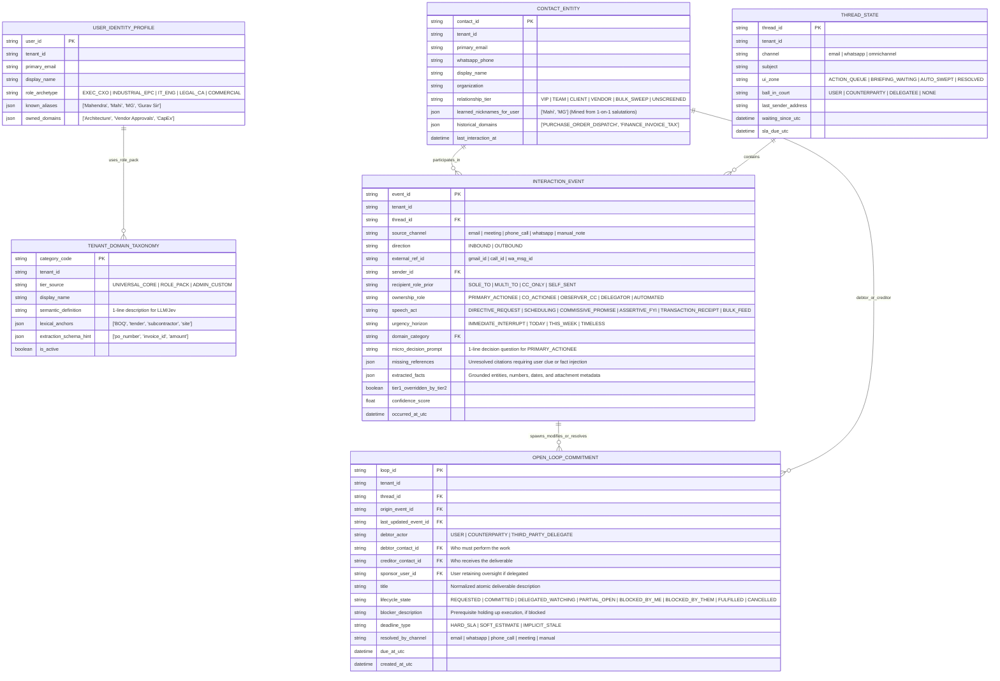
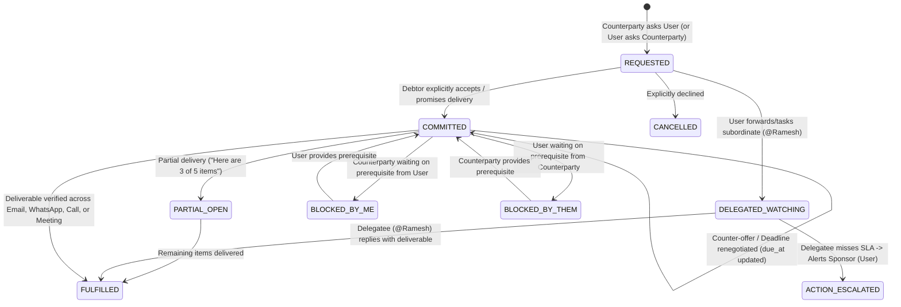
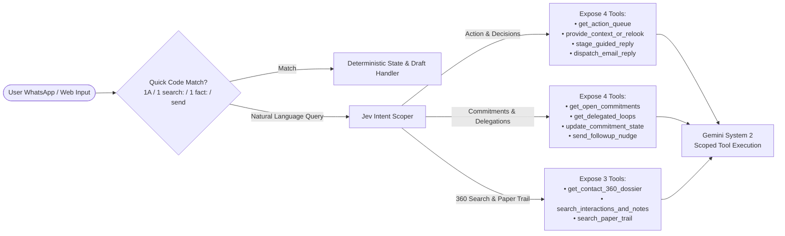

# Next-Generation Mail Triage & Omnichannel Executive Context Engine: Research, Strategy & Technical Architecture Specification

```
Document Reference : MT-OMNI-SPEC-2026-V1.1
Version            : 1.1.0 (Supersedes v1.0.0; v1.0.0 preserved in repository history)
Status             : Revised Architectural & Product Specification
Author             : Mahendra GURAV
License            : Apache License, Version 2.0
Location           : /plan/improvement/mailTriage/MAIL_TRIAGE_AND_OMNICHANNEL_CONTEXT_MASTER_SPEC_v1.1.md
Scope              : Mail Organizer Cartridge, MCP Orchestrator, System 1 (Jev) & System 2 (Gemini) Pipeline,
                     Commitment Ledger Engine, Role-Adaptive Taxonomy, and Omnichannel Context Sensors
Governed By        : Global Engineering Excellence Standard (GEES v3.1)
```

---

## Revision History (v1.0.0 $\rightarrow$ v1.1.0)

| Change ID | Section(s) Updated | Summary of Architectural & Editorial Revision |
| :--- | :--- | :--- |
| **REV-01** | `Sections 1, 3, 4` | **Professional Engineering Tone & Objective Market Analysis:** Replaced subjective/promotional phrasing with neutral enterprise terminology. Accurately credited mature single-channel email tools while defining their architectural limits (channel silos and cloud data custody). |
| **REV-02** | `Sections 6, 7` | **Dynamic Recipient Ownership Promotion (`CO_ACTIONEE` / `OBSERVER_CC` $\rightarrow$ `PRIMARY_ACTIONEE`):** Changed Tier 0 `To:/Cc:` header counts to a *baseline prior* that is promoted to `PRIMARY_ACTIONEE` when the body directly addresses the user by name, alias, `@mention`, or owned domain responsibility. |
| **REV-03** | `Sections 6, 7` | **3-Layer Nickname & Alias Resolution Engine:** Added `USER_IDENTITY_PROFILE` (seeded + explicit aliases), per-sender 1-on-1 salutation mining (`CONTACT_ENTITY.learned_nicknames_for_user`), and thread-turn pronoun fallback. |
| **REV-04** | `Sections 5, 6, 7, 12` | **Role-Adaptive Dynamic `domain_category` Taxonomy & Admin Audit Loop:** Replaced static domain enums with a 3-layer DB registry (`TENANT_DOMAIN_TAXONOMY`) using a "Top-5 Shortlist $\rightarrow$ Jev Classify" pattern. Kept taxonomy 100% invisible to end-users and governed via Tenant Admin & Platform periodic audits. |
| **REV-05** | `Sections 5, 6, 7, 8` | **Deep Commitment Ledger Engine:** Replaced the superficial single-enum `commitment_signal` with a multi-stage Language-Action state machine supporting `0..N` atomic operations per message, Request vs. Promise distinction, Delegation Triangles (`DELEGATED_WATCHING`), Partial Fulfillment, Conditional Blocks, and Outbound Self-Reply promise tracking. |
| **REV-06** | `Section 5.5` | **LLM Native Intelligence vs. Deterministic System Contracts:** Added explicit architectural boundaries defining where to rely on pretrained LLM semantic knowledge versus where strict database schemas and rules are mandatory. |
| **REV-07** | `Sections 7, 8, 10` | **Comprehensive Tier 2 Pipeline & Missing-Reference HITL Loop:** Upgraded Tier 2 (Gemini) to a 4-stage pipeline (`360° Context Assembly` $\rightarrow$ `Bounded Local Research` $\rightarrow$ `Synthesis & Tier-1 Audit/Override` $\rightarrow$ `Self-Verification Gate`) plus an explicit **Missing-Reference Resolution & Fact-Capture Loop** when internal search finds no match. |

---

## Table of Contents

1. [Executive Summary & Core Architectural Thesis](#1-executive-summary--core-architectural-thesis)
2. [Scientific & Engineering Challenges (40 Years of HCI & Systems Research)](#2-scientific--engineering-challenges-40-years-of-hci--systems-research)
3. [Competitive Landscape, Regulatory Constraints & Architectural Differentiation](#3-competitive-landscape-regulatory-constraints--architectural-differentiation)
4. [Target Enterprise Segments, Operational Use Cases & Value Model](#4-target-enterprise-segments-operational-use-cases--value-model)
5. [Strategic Proposals & Core Design Principles](#5-strategic-proposals--core-design-principles)
6. [The "HOW" — Part 1: Granular Database Schema, Alias Graph & Commitment Ledger](#6-the-how--part-1-granular-database-schema-alias-graph--commitment-ledger)
7. [The "HOW" — Part 2: The 3-Tier Cognitive Pipeline & Deep Context Synthesis](#7-the-how--part-2-the-3-tier-cognitive-pipeline--deep-context-synthesis)
8. [The "HOW" — Part 3: Thread/Commitment State Machines & Micro-Decision Loop](#8-the-how--part-3-threadcommitment-state-machines--micro-decision-loop)
9. [The "HOW" — Part 4: Redefined Polling, Bounded Deferral & Pre-Meeting Dossiers](#9-the-how--part-4-redefined-polling-bounded-deferral--pre-meeting-dossiers)
10. [The "HOW" — Part 5: Scoped CQRS MCP Orchestrator](#10-the-how--part-5-scoped-cqrs-mcp-orchestrator)
11. [The "HOW" — Part 6: Omnichannel Sensor Plug-In Architecture (Meetings, Calls, WhatsApp)](#11-the-how--part-6-omnichannel-sensor-plug-in-architecture-meetings-calls-whatsapp)
12. [Phased Implementation Roadmap & Verification Governance](#12-phased-implementation-roadmap--verification-governance)

---

## 1. Executive Summary & Core Architectural Thesis

Established email productivity platforms—such as Superhuman, Shortwave, SaneBox, and Fyxer AI—have demonstrated strong utility in single-inbox sorting, keyboard-driven triage, and style-matched reply drafting. However, enterprise professionals and operational leaders continue to experience severe coordination overhead due to two structural limitations in current tools:
1. **Single-Channel Isolation:** Existing email tools operate exclusively inside the inbox silo. They have no visibility into commitments negotiated, modified, or resolved across WhatsApp, phone calls, or live meetings—leading to stale follow-up reminders ("zombie tasks") and incomplete context when drafting replies.
2. **Pre-Decision Drafting & Multi-Folder Fragmentation:** Systems that sort messages into numerous topical folders increase visual scan time, while systems that pre-generate full email replies during background polling consume substantial LLM token budgets before the user's actual decision is known.

### Core Architectural Thesis
To deliver measurable operational reliability for enterprise and professional users, the Mail Organizer must evolve from a **Single-Channel Folder Sorter** into a **Sovereign Omnichannel Commitment & Context Engine** governed by four foundational principles:

1. **Granular in the Database, Simple on the Screen:**
   - **Internal Storage Layer:** Capture multi-dimensional metadata (Speech Act, Dynamic Ownership Role, Urgency Horizon, Role-Adaptive Domain Taxonomy, Contact Alias Maps, and Atomic Commitment Ledger Operations) for high-precision retrieval, timer automation, and MCP querying.
   - **External User Layer:** Expose **only 3 workflow views** (`1_Action_Queue`, `2_Briefing_Waiting`, `3_Auto_Swept`) so the end-user never manages complex folder trees or internal taxonomy tags.
2. **Decision-First Drafting (Capture Intent Before Generation):**
   - Background polling never invokes a frontier LLM to write speculative multi-paragraph replies. Instead, the pipeline extracts the **Core Decision Question** (plus any missing factual references) and presents compact decision options on WhatsApp or the Web UI. Full draft generation executes only after the user supplies their decision.
3. **True Commitment Lifecycle Management:**
   - Rather than treating an email as a static task, the system models the full **Language-Action Commitment Lifecycle**—distinguishing unaccepted requests from binding promises, tracking third-party delegations (`DELEGATED_WATCHING`), handling partial or conditional fulfillments, and recording promises made by the user in outbound replies.
4. **Omnichannel Context Unification Under Customer Data Sovereignty:**
   - By persisting all communication channels (Email, WhatsApp, Meetings, Phone Calls) as standardized `INTERACTION_EVENT` records linked to `OPEN_LOOP_COMMITMENT` entries within the tenant's sovereign runtime, cross-channel decisions automatically update inbox state without exposing confidential data to third-party multi-tenant clouds.

---

## 2. Scientific & Engineering Challenges (40 Years of HCI & Systems Research)

Research across **MIT, IBM Research, Microsoft Research, Xerox PARC, Carnegie Mellon University, UC Irvine, and Stanford** identifies 8 core cognitive and systems engineering challenges in email and task triage:

```
┌──────────────────────────────────────────────────────────────────────────────────────────────────────────┐
│                         THE 8 SCIENTIFIC & TECHNICAL CHALLENGES OF EMAIL TRIAGE                          │
├────┬──────────────────────────────────┬──────────────────────────────────────────────────────────────────┤
│ #  │ Challenge & Research Source      │ Engineering & Cognitive Implication                              │
├────┼──────────────────────────────────┼──────────────────────────────────────────────────────────────────┤
│ C1 │ The Folder Fallacy               │ Sorting messages into 7–15 topic folders increases retrieval     │
│    │ (Whittaker et al., IBM, CHI '11) │ latency. Users incur a cognitive tax predicting which category   │
│    │                                  │ the classifier selected and auditing multiple locations.         │
├────┼──────────────────────────────────┼──────────────────────────────────────────────────────────────────┤
│ C2 │ Prospective Memory Failure       │ Professionals use the primary Inbox as externalized working      │
│    │ ("Out of Sight, Out of Mind")    │ memory. Auto-archiving actionable human correspondence into      │
│    │ (Malone, MIT; Sidner, Lotus)     │ secondary folders causes obligations to be forgotten.            │
├────┼──────────────────────────────────┼──────────────────────────────────────────────────────────────────┤
│ C3 │ Asymmetric Error Cost &          │ Cost(False Negative) >> 1,000 x Cost(False Positive). A single   │
│    │ The 99% Trust Collapse           │ critical message hidden in a low-priority folder forces the user │
│    │ (Horvitz & Amershi, MSR)         │ to manually audit all filtered folders daily.                    │
├────┼──────────────────────────────────┼──────────────────────────────────────────────────────────────────┤
│ C4 │ Orthogonal Axis Conflation       │ Single-label schemes conflate Topic (Finance), Urgency (Today),  │
│    │ ("Urgent Invoice" Paradox)       │ and Workflow Action (Directive). A payment failure labeled only  │
│    │ (Bellotti et al., Xerox PARC)    │ as "Finance" risks being treated as a passive receipt.           │
├────┼──────────────────────────────────┼──────────────────────────────────────────────────────────────────┤
│ C5 │ The Decision Gap in AI Drafting  │ An LLM reading "Can we shift delivery to Thursday?" lacks the    │
│    │ (Hancock et al., Stanford HCI)   │ user's private business decision. Pre-generated drafts require   │
│    │                                  │ heavy rewriting when the user's decision differs from the guess. │
├────┼──────────────────────────────────┼──────────────────────────────────────────────────────────────────┤
│ C6 │ Cross-Channel State Blindness    │ A large fraction of email requests are resolved via WhatsApp,    │
│    │ & "Zombie Tasks"                 │ phone calls, or live meetings. Email-only trackers continue      │
│    │ (Mark & Iqbal, UC Irvine / MSR)  │ surfacing follow-up alerts for issues already settled offline.   │
├────┼──────────────────────────────────┼──────────────────────────────────────────────────────────────────┤
│ C7 │ Temporal Context Drift           │ Information relevance shifts over time. A project brief or       │
│    │ (Dumais & Bennett, MSR)          │ vendor quote has low urgency on Monday, peak relevance 10 mins   │
│    │                                  │ before a scheduled call with that vendor, and archival value     │
│    │                                  │ afterward.                                                       │
├────┼──────────────────────────────────┼──────────────────────────────────────────────────────────────────┤
│ C8 │ Attention Fragmentation          │ Unfiltered real-time notifications disrupt deep focus. Systems   │
│    │ (Gloria Mark, UC Irvine;         │ must distinguish true immediate blockers from routine items      │
│    │ Eric Horvitz, MSR)               │ best delivered via Bounded Deferral at scheduled intervals.      │
└────┴──────────────────────────────────┴──────────────────────────────────────────────────────────────────┘
```

### Regulatory & Platform Constraints (Omnichannel Expansion)
- **C9. OS & Platform Sandboxing:** Mobile operating systems (iOS/Android) restrict third-party apps from accessing raw cellular call audio without VoIP routing, Android local recorder integration, or external hardware capture; Meta restricts personal WhatsApp scraping, requiring either the official WhatsApp Business Cloud API or a user-controlled local companion bridge.
- **C10. Two-Party Consent & Data Protection Laws (CIPA, GDPR, DPDP):** Multi-tenant cloud SaaS vendors face strict legal compliance barriers when ingesting third-party call audio or private messaging threads into centralized cloud storage.

---

## 3. Competitive Landscape, Regulatory Constraints & Architectural Differentiation

| Product / Category | Primary Mechanism | Core Strengths | Architectural Boundaries & Enterprise Limitations |
| :--- | :--- | :--- | :--- |
| **SaneBox** | Server-side IMAP statistical folder routing (`@SaneLater`, `@SaneNews`). | Client-agnostic; zero UI migration required. | Statistical header/sender routing without semantic comprehension, commitment tracking, or cross-channel state awareness. |
| **Superhuman** | High-speed keyboard-centric mail client (`Cmd+K`) with split inboxes. | Sub-100ms interface responsiveness; polished UX. | Requires adopting a proprietary email client; single-channel (email only); cloud-hosted metadata. |
| **Shortwave** | AI-native Gmail interface with thread summarization and semantic search. | Strong multi-thread conversational search across email history. | Requires switching from native Gmail/Outlook web UI; restricted to email channel. |
| **Fyxer AI** | 8-label Gmail/Outlook integration (`To Respond`, `Awaiting Reply`, etc.) + meeting notetaker. | Effective workflow-state labeling inside native Gmail/Outlook. | Generates drafts prior to capturing user decision; relies on visible cloud bot joining video calls; lacks WhatsApp orchestration. |
| **HEY (37signals)** | Opinionated email service (`Screener`, `Imbox`, `The Feed`, `Paper Trail`). | Strong cognitive separation and First-Time Sender Screener. | Requires migrating email hosting/domains; no AI triage or cross-channel integration. |
| **Lindy AI** | Cloud workflow and autonomous agent platform. | Broad SaaS connector library and trigger-based automation. | Usage-based cloud credit consumption; multi-tenant cloud custody unsuitable for sovereign deployments. |
| **Gong.io / Chorus** | Enterprise Revenue Intelligence (Email + Video Meetings + VoIP). | Mature cross-channel correlation across calls, meetings, and email. | High enterprise licensing cost ($1,200–$1,600/seat/year); tailored specifically to sales pipeline inspection rather than personal executive triage. |
| **Limitless / Granola** | Local audio/meeting capture and personal memory indexing. | Captures meeting context via local audio loopback without visible bots. | Passive recall utility; does not manage inbox workflows, commitment SLAs, or WhatsApp-driven response execution. |
| **Microsoft Copilot / Google Gemini** | Native workspace assistants embedded in M365 and Google Workspace. | First-party integration with native documents, calendar, and mail. | Bound to a single cloud ecosystem; lacks WhatsApp/telephony integration and proactive cross-channel commitment tracking. |

### Release100 Architectural Differentiation
1. **Customer-Controlled Sovereign Runtime:** Deployed within the client's infrastructure or isolated tenant vault with Bring-Your-Own-Key (BYOK) encryption. Keeping transcripts, messages, and embeddings within customer custody resolves multi-tenant cloud compliance blockers.
2. **Bi-Directional WhatsApp & Web Control Loop:** Delivers concise decision prompts, missing-reference queries, and pre-meeting dossiers directly to WhatsApp, allowing users to resolve inbox bottlenecks and trigger grounded drafts via short text replies.
3. **3-Tier Hybrid Compute Economics:** Combines deterministic protocol rules (Tier 0) and a fast local 0.5B model (Tier 1 Jev) to filter ~85% of routine volume locally, reserving comprehensive context assembly and frontier LLM reasoning (Tier 2 Gemini) for the ~15% of messages that require deep synthesis.

---

## 4. Target Enterprise Segments, Operational Use Cases & Value Model

### 4.1 Target Client Segments

| Segment | Representative Roles | Operational Environment | Core Value Delivered |
| :--- | :--- | :--- | :--- |
| **1. Executive Leadership & Managing Partners** | Founders, CEOs, Managing Partners in advisory, legal, accounting, and consulting firms. | High daily volume across email, back-to-back client meetings, and WhatsApp coordination. | Prevents dropped commitments across channels, provides pre-meeting context briefs, and compresses email replies into rapid micro-decisions. |
| **2. Industrial, EPC & Operations Directors** | Plant heads, construction directors, supply chain and logistics leaders. | Mobile/on-site workflows where sitting at a desktop inbox is impractical; frequent vendor BOQ, PO, and escalation threads. | Native event-bus integration with operational cartridges (e.g., `temperature_marker`) and full mobile triage via WhatsApp. |
| **3. Account Executives & Commercial Leads** | B2B commercial directors, wealth advisors, procurement leads, M&A managers. | Multi-party negotiations spanning email proposals, WhatsApp follow-ups, and phone discussions. | Automated tracking of inbound/outbound promises, delegated tasks, and overdue counterparty responses. |
| **4. Regulated & Privacy-Sensitive Organizations** | Legal practices, healthcare administration, financial services, defense/IP-sensitive R&D. | Strict data governance policies prohibiting third-party SaaS access to confidential correspondence. | Local/sovereign execution, AES-256-GCM credential encryption, and cryptographic SHA-256 audit trails. |

### 4.2 Core Operational Use Cases
1. **Batch Micro-Decision Triage:** At scheduled intervals, the user receives a structured summary of actionable items with concrete options (`1A`, `1B`, or custom instruction), clearing pending decisions without reading long threads.
2. **Pre-Meeting 360° Dossier:** Ten minutes prior to a calendar event, the system synthesizes recent emails, WhatsApp messages, open commitments, and pending invoices involving the meeting participants.
3. **Zero-Audit Bulk Filtering with Screener Protection:** Automated newsletters and transactional receipts are swept into archival views with a daily summary receipt, while first-time human senders are surfaced once for explicit routing approval.
4. **Delegation & Counterparty SLA Radar:** Tracks promises owed to the user (*"Vendor promised revised quote by Thursday"*) and tasks delegated by the user to team members (*"@Ramesh please send tax certificate"*), alerting the user only if the deadline slips.

---

## 5. Strategic Proposals & Core Design Principles

### 5.1 Principle 1: "Granular in the Database, Simple on the Screen"
- **User-Facing Simplicity (3 Workflow Zones):**
  1. `1_Action_Queue`: Messages where the user is the primary decision-maker or action owner (`ball_in_court = USER`).
  2. `2_Briefing_Waiting`: Informational updates (`OBSERVER_CC` / `ASSERTIVE_FYI`), threads awaiting counterparty response (`ball_in_court = COUNTERPARTY`), and tasks delegated to team members (`DELEGATED_WATCHING`).
  3. `3_Auto_Swept`: Machine-generated bulk mail, newsletters, and passive transactional receipts (`Paper_Trail` / `Feed`).
- **Database Granularity:**
  - Internally, the system stores orthogonal dimensions (`speech_act`, `ownership_role`, `urgency_horizon`, `domain_category`, `extracted_facts`, and `OPEN_LOOP_COMMITMENT` records).
  - **Strict Taxonomy Invisibility to End-Users:** End-users never view, configure, or manage internal `domain_category` codes. Role taxonomy selection, `GENERAL_UNCLASSIFIED` drift analysis, and periodic classification audits are restricted to the **Tenant Admin Console** (with optional anonymized audit exports to the Platform team for continuous role-pack refinement).

### 5.2 Principle 2: First-Time Sender Screener & Daily Sweep Receipt
- **Human Sender Protection:** The pipeline never auto-archives correspondence from an unscreened human address.
- **First-Time Sender Screener:** Unrecognized human senders are flagged in the briefing with one-time routing controls (`[Allow to Inbox]`, `[Once]`, `[Always Sweep]`).
- **Daily Sweep Receipt:** Every consolidated briefing includes a compact audit line summarizing swept volume so the user maintains complete confidence without manually inspecting archival folders.

### 5.3 Principle 3: Decision-First Drafting & Explicit Context-Gap Resolution
- **No Speculative Background Drafting:** Polling identifies *whether* a decision is required and *what* the decision question is, deferring full draft composition until the user responds.
- **Missing-Reference Resolution (Anti-Hallucination Gate):** When an actionable email references a prior artifact or conversation (*"regarding Invoice #402"* or *"as Ramesh mentioned last week"*) that yields zero matches in local cross-channel search, the system explicitly notifies the user on the triage card and offers two resolution paths:
  - **Path A (Search Clue Refinement):** The user supplies a search hint (*"Check emails from SteelCorp in March"*), triggering a targeted re-search and updated synthesis.
  - **Path B (Direct Fact Injection & Memorization):** The user states the missing context directly (*"Ramesh quoted ₹45,000 on phone"*), which the system uses immediately for drafting and persists as a permanent `MANUAL_CONTEXT_NOTE` in `INTERACTION_EVENT`.

### 5.4 Principle 4: Full Language-Action Commitment Ledger
Instead of a flat task list or a single per-email label, the system implements a **Relational Commitment Ledger** capable of representing:
- **Request vs. Binding Commitment:** Distinguishing an unaccepted ask (`REQUESTED`) from an agreed promise (`COMMITTED`).
- **Multi-Operation Messages:** Extracting `0..N` independent commitment transitions from a single message (e.g., closing one past loop while opening two new obligations).
- **Delegation Triangles:** Tracking **`Debtor` (Doer)**, **`Creditor` (Beneficiary)**, and **`Sponsor` (User)** when the user delegates an inbound request to a subordinate or colleague (`DELEGATED_WATCHING`).
- **Counter-Offers, Partial Fulfillment & Conditional Blocks:** Updating deadlines when counterparties propose new dates, splitting partially fulfilled deliverables (`PARTIAL_OPEN`), and linking dependencies (`BLOCKED_BY_ME` / `BLOCKED_BY_COUNTERPARTY`).
- **Outbound User Promise Capture:** Scanning the user's own sent emails and WhatsApp replies so promises made or delegated by the user are automatically tracked.

### 5.5 Principle 5: Architectural Division Between LLM Native Knowledge and System Contracts
To avoid over-engineering prompts while maintaining deterministic software reliability, the architecture enforces a strict boundary:

| Dimension | Rely on Native Frontier LLM Knowledge (Zero Rigid Rules) | Enforce Strict System Schemas & Code Contracts |
| :--- | :--- | :--- |
| **Language & Nuance** | Understanding natural English/multilingual phrasing, indirect politeness, tone, and domain concepts. | Mapping comprehension output into fixed database columns (`status`, `due_at_utc`, `ball_in_court`) required by SQL queries and cron timers. |
| **Draft Composition** | Writing natural, context-appropriate replies once the user's decision and facts are provided. | Enforcing CQRS dispatch gates (`stage_guided_reply` vs. `dispatch_email_reply`) so no message is sent without approval. |
| **Compute & Cost Control** | Deep synthesis and conflict resolution on the ~15% of complex human correspondence (Tier 2 Gemini). | Tier 0 header protocols and Tier 1 constrained Top-5 candidate lists so a small 0.5B local model (Jev) accurately filters 85% of traffic. |
| **Private World State** | Reasoning over the assembled 360° dossier passed in the prompt window. | Resolving private organizational truths unknown to pretrained models: user nicknames (`"Mahi"` $\rightarrow$ Mahendra), VIP tiers, and cross-channel events. |

---

## 6. The "HOW" — Part 1: Granular Database Schema, Alias Graph & Commitment Ledger

The storage architecture comprises six core relational tables managed within the tenant's database:



---

## 7. The "HOW" — Part 2: The 3-Tier Cognitive Pipeline & Deep Context Synthesis

### 7.1 End-to-End Pipeline Architecture

```
┌────────────────────────────────────────────────────────────────────────────────────────────────────────┐
│                      TIER 0: DETERMINISTIC PROTOCOL, ALIAS & SHORTLIST ENGINE                          │
│                                  (Latency: < 5ms | Cost: $0.0000)                                      │
├────────────────────────────────────────────────────────────────────────────────────────────────────────┤
│ 1. Direction & Outbound Self-Reply Check:                                                              │
│    • If `direction == OUTBOUND` (sent by User from mobile/desktop):                                    │
│      ➔ Set `THREAD_STATE.ball_in_court = COUNTERPARTY`, `ui_zone = BRIEFING_WAITING`.                  │
│      ➔ Do NOT drop! Route to Lightweight Outbound Commitment Check (captures promises made by User     │
│        or delegations like "@Ramesh please handle").                                                   │
│                                                                                                        │
│ 2. Sender Relationship Lookup (`CONTACT_ENTITY`):                                                      │
│    • If `relationship_tier == BULK_SWEEP` ➔ `ui_zone = AUTO_SWEPT`. STOP.                              │
│    • If `relationship_tier == VIP` ➔ Flag `is_vip = True`.                                             │
│                                                                                                        │
│ 3. RFC Header & MIME Protocol Fingerprinting:                                                          │
│    • Has `List-Unsubscribe` OR `Precedence: bulk/list` (and not VIP) ➔ `ui_zone = AUTO_SWEPT`. STOP.   │
│    • Has `Auto-Submitted: auto-replied` ➔ `ownership_role = AUTOMATED`, `ui_zone = AUTO_SWEPT`. STOP.  │
│                                                                                                        │
│ 4. Recipient Prior & Nickname/Alias Vocative Detection:                                                │
│    • Compute `recipient_role_prior` from headers (`SOLE_TO`, `MULTI_TO`, `CC_ONLY`).                   │
│    • If `SOLE_TO`: Mine opening salutation (`Hi <Token>,`) ➔ update `learned_nicknames_for_user`.      │
│    • Scan body opening/mentions against `USER_IDENTITY_PROFILE.known_aliases` + sender's               │
│      `learned_nicknames_for_user` + `owned_domains`:                                                   │
│      ➔ If direct vocative/mention match found, set `vocative_direct_hit = True` (promotes `MULTI_TO`   │
│        or `CC_ONLY` to `PRIMARY_ACTIONEE` candidate!).                                                 │
│                                                                                                        │
│ 5. Role-Adaptive Domain Candidate Shortlisting (40+ Taxonomies ➔ Top 5):                               │
│    • Combine `CONTACT_ENTITY.historical_domains` + BM25 lexical match against active                   │
│      `TENANT_DOMAIN_TAXONOMY.lexical_anchors` to select Top 5 candidate categories for this message.   │
└───────────────────────────────────────────────────┬────────────────────────────────────────────────────┘
                                                    │ (Unresolved Human Mail Proceeds ~50% of volume)
                                                    ▼
┌────────────────────────────────────────────────────────────────────────────────────────────────────────┐
│                      TIER 1: JEV SYSTEM 1 MULTI-QUESTION SINGLE-PASS CLASSIFIER                        │
│                              (Latency: ~300ms | Cost: Local / Fixed)                                   │
├────────────────────────────────────────────────────────────────────────────────────────────────────────┤
│ Context Header Injected: User Aliases + `recipient_role_prior` + `vocative_direct_hit` + Last Turn.    │
│ Single HTTP POST to Jev `/systemone` evaluating 5 compact questions:                                   │
│   • Q1 (`ownership_role`): `PRIMARY_ACTIONEE` | `CO_ACTIONEE` | `OBSERVER_CC`                          │
│     (Promotes `CO_ACTIONEE`/`OBSERVER_CC` ➔ `PRIMARY_ACTIONEE` if body tasks user by name/alias/role)  │
│   • Q2 (`speech_act`): `@Directive_Request` | `@Scheduling_Meet` | `@Commissive_Promise` |             │
│                        `@Assertive_FYI` | `@Transaction_Paper` | `@Bulk_Marketing`                     │
│   • Q3 (`urgency_horizon`): `@Immediate` | `@Today` | `@This_Week` | `@Timeless`                       │
│   • Q4 (`domain_category`): Selects 1 from the Top 5 Shortlisted Role Categories (+ `@General_Other`)  │
│   • Q5 (`has_commitment_activity`): `@Yes_Commitment_Or_Task_Signal` | `@No_Commitment_Signal`         │
└───────────────────────────────────────────────────┬────────────────────────────────────────────────────┘
                                                    │
                                                    ▼
┌────────────────────────────────────────────────────────────────────────────────────────────────────────┐
│                           DETERMINISTIC ZONE SYNTHESIZER & COGNITIVE GATE                              │
├────────────────────────────────────────────────────────────────────────────────────────────────────────┤
│ • Case A: `speech_act in (@Transaction_Paper, @Bulk_Marketing)` AND `urgency_horizon != @Immediate`    │
│           AND `has_commitment_activity == @No`:                                                        │
│   ➔ `ui_zone = AUTO_SWEPT`. Apply label `3_Auto_Swept`. ZERO GEMINI CALLS.                             │
│                                                                                                        │
│ • Case B: `ownership_role == OBSERVER_CC` AND `speech_act == @Assertive_FYI`                           │
│           AND `has_commitment_activity == @No`:                                                        │
│   ➔ `ui_zone = BRIEFING_WAITING`, `ball_in_court = NONE`. Queue for digest. ZERO GEMINI CALLS.         │
│                                                                                                        │
│ • Case C: `ownership_role in (PRIMARY_ACTIONEE, CO_ACTIONEE)` OR `has_commitment_activity == @Yes`     │
│           OR `direction == OUTBOUND` (with commitment signal):                                         │
│   ➔ Proceed to TIER 2 (Gemini System 2 Deep Context & Commitment Pipeline)!                            │
└───────────────────────────────────────────────────┬────────────────────────────────────────────────────┘
                                                    │ (~15% of total inbox volume reaches Tier 2)
                                                    ▼
┌────────────────────────────────────────────────────────────────────────────────────────────────────────┐
│                 TIER 2: GEMINI SYSTEM 2 DEEP CONTEXT, RESEARCH & VERIFICATION PIPELINE                 │
├────────────────────────────────────────────────────────────────────────────────────────────────────────┤
│ • STAGE 2A — 360° Context Package Assembly (Deterministic Pre-Fetch):                                  │
│     Assembles full thread history, last 14 days of cross-channel events (WhatsApp, Call/Meeting notes) │
│     with this contact/organization, all open/recently closed `OPEN_LOOP_COMMITMENT` records,           │
│     attachment metadata, user aliases/role, and Calendar Free/Busy windows (if scheduling).            │
│                                                                                                        │
│ • STAGE 2B — Bounded Local Agentic Research (Reference Resolution):                                    │
│     Detects external citations in the message (e.g., "Invoice #402", "as Ramesh mentioned last week"). │
│     Executes targeted local FTS/SQL queries across emails, attachments, WhatsApp, and call logs.       │
│     If found: appends matched records to context.                                                      │
│     If NOT found (0 hits) AND user is `PRIMARY_ACTIONEE`: flags `missing_references` for HITL prompt.  │
│                                                                                                        │
│ • STAGE 2C — Synthesis, Tier-1 Audit/Override & Atomic Ledger Extraction:                              │
│     1. Audits Tier 1 Jev classifications and overrides any errors (`tier1_overridden_by_tier2 = True`).│
│     2. Extracts `0..N` structured `CommitmentLedgerOp` transactions (`REQUESTED`, `COMMITTED`,         │
│        `DELEGATED_WATCHING`, `PARTIAL_OPEN`, `BLOCKED`, `FULFILLED`, `MODIFIED`).                      │
│     3. Generates a concise 1-line `micro_decision_prompt` + concrete options (`1A`, `1B`).             │
│                                                                                                        │
│ • STAGE 2D — Grounding & Self-Verification Gate:                                                       │
│     Validates that every extracted date, monetary figure, and commitment operation is strictly         │
│     supported by the source text, deduplicates against existing open loops, and commits to SQLite.     │
└────────────────────────────────────────────────────────────────────────────────────────────────────────┘
```

---

### 7.2 How the 3-Layer Nickname & Ownership Promotion Works in Practice

Consider a common scenario: A sender places 6 colleagues in `To:` (or puts the user in `Cc:`) and writes:
> *"Team, the site inspection is complete. @Mahi, please approve the revised vendor BOQ by 4 PM today so we can release the PO."*

1. **Tier 0 Header Prior:** Sees 6 addresses in `To:` $\rightarrow$ sets `recipient_role_prior = MULTI_TO`.
2. **Tier 0 Alias Lookup:** Checks `USER_IDENTITY_PROFILE.known_aliases` (`["Mahendra", "Mahi", "MG"]`) and `CONTACT_ENTITY.learned_nicknames_for_user`. Detects `@Mahi` in an imperative sentence $\rightarrow$ sets `vocative_direct_hit = True`.
3. **Tier 1 & Tier 2 Resolution:** Both Jev and Gemini see `vocative_direct_hit = True` and promote `ownership_role` from `CO_ACTIONEE` to **`PRIMARY_ACTIONEE`**, routing the email directly into `1_Action_Queue` with a micro-decision card.

---

### 7.3 Role-Adaptive Taxonomy Governance (Admin-Managed, User-Invisible)

To ensure high classification precision across diverse industries without overwhelming the end-user or exceeding small-model context limits:
1. **Provisioning via Role Archetype Packs:** When a tenant admin provisions a user (e.g., *Industrial/EPC Director* vs. *Legal/Advisory Partner*), the system seeds `TENANT_DOMAIN_TAXONOMY` with 8 Universal Core categories plus 15–25 role-specific categories.
2. **Top-5 Dynamic Shortlisting for Tier 1:** For each incoming message, Tier 0 selects the 5 most probable categories using the sender's historical domain distribution and BM25 keyword anchors, passing only those 5 choices into the Jev `/systemone` payload.
3. **Tenant Admin & Platform Periodic Audit Loop:**
   - The end-user never sees or edits taxonomy codes.
   - Messages falling into `GENERAL_UNCLASSIFIED` or where `tier1_overridden_by_tier2 == True` are aggregated in the **Tenant Admin Audit View**.
   - During periodic audits, the Tenant Admin (or the Platform team via anonymized diagnostic telemetry) reviews drift clusters and refines lexical anchors or activates new domain categories silently.

---

### 7.4 Tier 2 Structured Output Contract (`Stage 2C & 2D`)

When a message enters Tier 2, Gemini receives the assembled **360° Context Dossier** and outputs a strictly validated Pydantic schema:

```json
{
  "tier1_audit": {
    "verified_ownership_role": "PRIMARY_ACTIONEE",
    "verified_speech_act": "DIRECTIVE_REQUEST",
    "verified_urgency_horizon": "TODAY",
    "verified_domain_category": "PURCHASE_ORDER_DISPATCH",
    "override_applied": true,
    "override_reason": "User ('Mahi') was explicitly tasked in paragraph 2 despite 5 recipients in To: header."
  },
  "missing_reference_check": {
    "has_unresolved_reference": true,
    "unresolved_citations": [
      {
        "citation_text": "as Ramesh agreed on the call last Tuesday",
        "searched_queries": ["Ramesh call Tuesday", "Ramesh discount BOQ"],
        "user_prompt_question": "Could not find a record of Ramesh's Tuesday call in Email/WhatsApp. Reply with a search hint (e.g., company/topic) to re-search, or state what Ramesh agreed to."
      }
    ]
  },
  "commitment_ledger_ops": [
    {
      "op_type": "FULFILL_EXISTING",
      "target_loop_id": "loop_981",
      "evidence_quote": "Attached is the signed site safety clearance certificate."
    },
    {
      "op_type": "OPEN_OR_UPDATE",
      "lifecycle_state": "REQUESTED",
      "debtor_actor": "USER",
      "creditor_email": "vendor@steelcorp.com",
      "title": "Approve revised vendor BOQ (#BOQ-884) for PO release",
      "due_at_utc": "2026-10-18T16:00:00Z",
      "deadline_type": "HARD_SLA",
      "evidence_quote": "@Mahi, please approve the revised vendor BOQ by 4 PM today"
    }
  ],
  "micro_decision": {
    "decision_needed": true,
    "prompt_summary": "SteelCorp delivered the safety certificate (closes #loop_981) and asks you (@Mahi) to approve revised #BOQ-884 by 4:00 PM today.",
    "options": [
      {"code": "1A", "label": "Approve #BOQ-884 & authorize PO"},
      {"code": "1B", "label": "Hold approval & ask for itemized rate breakdown"},
      {"code": "1C", "label": "Delegate review to @Ramesh"}
    ]
  },
  "grounding_verification": {
    "all_quotes_verified_in_source": true,
    "duplicate_loop_check_passed": true
  }
}
```

---

## 8. The "HOW" — Part 3: Thread/Commitment State Machines & Micro-Decision Loop

### 8.1 Dual State Machines: Thread Workflow vs. Commitment Lifecycle

The system separates **Thread UI Routing (`THREAD_STATE`)** from **Obligation Tracking (`OPEN_LOOP_COMMITMENT`)** because a single thread may contain multiple obligations moving at different speeds:



---

### 8.2 Interactive Micro-Decision & Missing-Reference Loop (WhatsApp & Web UI)

Here is how the user experiences both **Decision-First Drafting** and **Missing-Reference Resolution** on WhatsApp:

```
┌──────────────────────────────────────────────────────────────────────────────────┐
│ STEP 1: Consolidated Triage Card Delivered on WhatsApp                           │
│                                                                                  │
│ 📋 *Action Queue (1 Decision Needed)*                                            │
│                                                                                  │
│ *1. Vikram Desai (SteelCorp)* — _12m ago_                                        │
│ ✅ _Closed Loop:_ Attached signed Site Safety Certificate.                       │
│ ❓ *Ask:* Requests your approval on revised #BOQ-884 by 4:00 PM today.           │
│ ⚠️ *Missing Context:* Email cites _"the rate Ramesh agreed to last Tuesday"_,    │
│    but internal search found no match.                                           │
│                                                                                  │
│ 👉 *Reply Options:*                                                              │
│ • `1A` — Approve #BOQ-884 as submitted                                           │
│ • `1B` — Delegate to @Ramesh to verify & reply                                   │
│ • `1 search: <hint>` — Re-search internal records (e.g. `1 search: Apex Metals`) │
│ • `1 fact: <text>` — Provide fact & draft (e.g. `1 fact: rate is ₹4,200/ton`)    │
└────────────────────────────────────────┬─────────────────────────────────────────┘
                                         │
       ┌─────────────────────────────────┴─────────────────────────────────┐
       │ PATH A: User Refines Search                                       │ PATH B: User Injects Fact + Decision
       │ User replies: "1 search: check whatsapp chat with Ramesh Gupta"   │ User replies: "1 fact: Ramesh agreed ₹4,200/ton.
       ▼                                                                   │ Approve if BOQ matches that rate."
┌────────────────────────────────────────────────┐                         ▼
│ System re-runs Stage 2B targeted search,       │  ┌──────────────────────────────────────────────────────────────┐
│ finds WhatsApp note ("SteelCorp capped at      │  │ System saves `MANUAL_CONTEXT_NOTE` ("Agreed rate: ₹4,200/t") │
│ ₹4,200/ton"), and refreshes Card #1 with the   │  │ to DB for permanent memory, verifies BOQ attachment, and     │
│ verified rate comparison!                      │  │ stages the grounded reply draft for `send` confirmation!     │
└────────────────────────────────────────────────┘  └──────────────────────────────────────────────────────────────┘
```

---

## 9. The "HOW" — Part 4: Redefined Polling, Bounded Deferral & Pre-Meeting Dossiers

### 9.1 Decoupled Producer-Consumer Poller with Outbound Sync
1. **Stage 1: Incremental Delta Producer (`poll_producer`)**
   - Queries Gmail `history.list` (or `messages.list` delta) for **both `INBOX` and `SENT` messages**.
   - Executes **Tier 0 Deterministic Engine** in $<5\text{ ms}$ (filtering bulk/newsletters, updating `learned_nicknames_for_user` from 1-on-1 salutations, and computing Top-5 domain candidates).
   - Enqueues remaining human messages and outbound user replies into `inbound_triage_queue`.
2. **Stage 2: Rate-Paced Cognitive Consumer (`triage_consumer`)**
   - Processes queued messages through **Tier 1 (Jev)** and conditionally **Tier 2 (Gemini 4-Stage Pipeline)**.
   - Updates `THREAD_STATE`, `INTERACTION_EVENT`, and `OPEN_LOOP_COMMITMENT`, and synchronizes the 3 Gmail workflow labels (`1_Action_Queue`, `2_Briefing_Waiting`, `3_Auto_Swept`).

### 9.2 Bounded Deferral Notification Schedule
- **Immediate Interrupt (`IMMEDIATE_INTERRUPT`):** Delivered immediately to WhatsApp **only** when `urgency_horizon == TODAY/IMMEDIATE` on a critical blocker OR (`is_vip == True` AND `ownership_role == PRIMARY_ACTIONEE`).
- **Scheduled Briefing Windows:** All other actionable items, delegated SLA warnings, and `2_Briefing_Waiting` summaries are batched and delivered at user-defined windows (e.g., **09:00, 13:30, 17:30**) or on-demand via `"Brief me"`.

### 9.3 Just-in-Time Pre-Meeting 360° Dossier (`T - 10 Minutes`)
A lightweight calendar monitor checks upcoming events starting in 10 minutes:
1. Resolves attendee emails/phones against `CONTACT_ENTITY`.
2. Queries `INTERACTION_EVENT` (across Email, WhatsApp, Calls, Meetings, and `MANUAL_CONTEXT_NOTE` entries) and `OPEN_LOOP_COMMITMENT` (`REQUESTED`, `COMMITTED`, `DELEGATED_WATCHING`, `BLOCKED`).
3. Pushes a concise **Pre-Meeting Cheat Sheet** to WhatsApp listing open promises owed by/to the attendees and recent discussion facts.

---

## 10. The "HOW" — Part 5: Scoped CQRS MCP Orchestrator

To prevent context bloat and tool-selection errors during interactive WhatsApp or Web Assistant queries, the orchestrator routes requests through a fast intent scoper before exposing CQRS-separated MCP tools to Gemini:



### CQRS MCP Tool Catalog

| Tool Name | CQRS Type | Purpose | Safety & Governance Gate |
| :--- | :--- | :--- | :--- |
| `get_action_queue` | **Query (Read)** | Lists open `1_Action_Queue` items with micro-decision options and missing-reference alerts. | Auto-executable |
| `get_open_commitments` | **Query (Read)** | Filters `OPEN_LOOP_COMMITMENT` by direction (`USER`, `COUNTERPARTY`, `DELEGATEE`) and state (`COMMITTED`, `BLOCKED`, `PARTIAL_OPEN`). | Auto-executable |
| `get_contact_360_dossier` | **Query (Read)** | Synthesizes unified timeline (Emails, WhatsApp, Calls, Meetings, Manual Notes) for a contact or organization. | Auto-executable |
| `search_paper_trail` | **Query (Read)** | Searches invoices, BOQs, receipts, and attachment metadata by vendor, date, or identifier. | Auto-executable |
| `provide_context_or_relook` | **Command (Context)** | Executes either Path A (targeted re-search using user clue) or Path B (persisting a `MANUAL_CONTEXT_NOTE` and re-synthesizing). | Audited DB write |
| `stage_guided_reply` | **Command (Stage)** | Composes a grounded email draft from the user's explicit decision and verified context. | Stages only; zero external send |
| `update_commitment_state` | **Command (State)** | Transitions a loop (`FULFILLED`, `DELEGATED_WATCHING`, `MODIFIED`) when resolved offline. | Reversible SHA-256 audit log |
| `dispatch_email_reply` | **Command (Write)** | Dispatches a staged reply via Gmail/SMTP and updates `THREAD_STATE` + `OPEN_LOOP_COMMITMENT`. | **Requires explicit user confirmation (`send`)** |

---

## 11. The "HOW" — Part 6: Omnichannel Sensor Plug-In Architecture (Meetings, Calls, WhatsApp)

Built on the **Release100 4-Plane Microkernel Architecture**, additional communication channels plug in as independent Plane 4 cartridges or local edge companions publishing standardized `InteractionEventPayload` messages onto the Kernel Event Bus:

```
┌──────────────────────────────────────────────────────────────────────────────────────────────────────────┐
│                         OMNICHANNEL SENSOR CARTRIDGE PLUG-IN ARCHITECTURE                                │
├──────────────────────────┬────────────────────────────────────────┬──────────────────────────────────────┤
│ Cartridge / Sensor       │ Ingestion Mechanism (Legal & Technical)│ Shared Context & Ledger Impact       │
├──────────────────────────┼────────────────────────────────────────┼──────────────────────────────────────┤
│ 1. `mail_organizer`      │ Gmail OAuth2 API (INBOX + SENT deltas) │ Writes `INTERACTION_EVENT`, mines    │
│    (Phase 1)             │ + Google Calendar API.                 │ aliases, executes Commitment Ops.    │
├──────────────────────────┼────────────────────────────────────────┼──────────────────────────────────────┤
│ 2. `whatsapp_monitor`    │ Official Meta Cloud API (Business) OR  │ Captures chat commitments and fact   │
│    (Phase 2)             │ user-hosted companion bridge.          │ notes; resolves matching email loops.│
├──────────────────────────┼────────────────────────────────────────┼──────────────────────────────────────┤
│ 3. `meeting_companion`   │ Local desktop loopback audio capture   │ Diarizes speakers; extracts meeting  │
│    (Phase 3)             │ (WASAPI/CoreAudio — no external bot    │ facts & `OPEN_LOOP_COMMITMENT` items │
│                          │ participant required) + transcription. │ linked to attendee emails.           │
├──────────────────────────┼────────────────────────────────────────┼──────────────────────────────────────┤
│ 4. `call_monitor`        │ Enterprise VoIP/SIP webhook, Android   │ Maps E.164 phone numbers in          │
│    (Phase 4)             │ local call-recording watcher, or       │ `CONTACT_ENTITY` to email threads;   │
│                          │ hardware audio note sync.              │ updates loop states post-call.       │
└──────────────────────────┴────────────────────────────────────────┴──────────────────────────────────────┘
```

---

## 12. Phased Implementation Roadmap & Verification Governance

### Phase 1: 3-Tier Triage Core, Alias Resolution & Dynamic Role Taxonomy
1. **Decouple Speculative Drafting & Unconditional `pm_extract`:** Remove unconditional Gemini calls during background polling.
2. **Implement Tier 0 Protocol, Alias & Shortlist Engine:**
   - RFC bulk header filtering (`List-Unsubscribe`, `Auto-Submitted`).
   - `USER_IDENTITY_PROFILE` alias matching + 1-on-1 salutation mining (`learned_nicknames_for_user`).
   - `TENANT_DOMAIN_TAXONOMY` seeding (Universal + Role Packs) and Top-5 dynamic candidate shortlisting.
3. **Upgrade Tier 1 Jev Multi-Question Classifier:** Single-pass evaluation of `ownership_role` (with vocative promotion), `speech_act`, `urgency_horizon`, shortlisted `domain_category`, and `has_commitment_activity`.
4. **3-Zone Label Synchronizer & Tenant Admin Taxonomy Audit View:** Map threads into `1_Action_Queue`, `2_Briefing_Waiting`, and `3_Auto_Swept`, while surfacing `GENERAL_UNCLASSIFIED` drift metrics only in the Tenant Admin console.

### Phase 2: Deep Tier 2 Pipeline, Full Commitment Ledger & Missing-Reference HITL Loop
1. **Schema Migration:** Create `USER_IDENTITY_PROFILE`, `TENANT_DOMAIN_TAXONOMY`, `CONTACT_ENTITY`, `THREAD_STATE`, `INTERACTION_EVENT`, and `OPEN_LOOP_COMMITMENT`.
2. **Implement the 4-Stage Tier 2 Gemini Pipeline:**
   - Stage 2A (`360° Context Assembly`), Stage 2B (`Bounded Local Research` across threads/attachments), Stage 2C (`Synthesis, Tier-1 Override & Atomic Commitment Ledger Ops`), and Stage 2D (`Grounding Verification`).
3. **Outbound Self-Reply Commitment Capture:** Scan user-sent replies to record outbound promises (`COMMITTED`) and third-party delegations (`DELEGATED_WATCHING`).
4. **Interactive WhatsApp Decision & Missing-Reference Loop:** Support `1A`/`1B` decision codes, `1 search: <hint>` relook queries, and `1 fact: <text>` direct context injection (`MANUAL_CONTEXT_NOTE`).

### Phase 3: Trust Guarantees, Bounded Deferral & Pre-Meeting 360° Dossiers
1. **First-Time Sender Screener & Daily Sweep Receipt:** Protect unscreened human senders and append sweep audit summaries to briefings.
2. **Bounded Deferral Scheduler:** Deliver immediate alerts only for verified blockers/VIP directives; batch standard items into scheduled briefing windows.
3. **T-10 Minute Pre-Meeting Dossier Engine:** Automatically push cross-channel participant briefs and open commitment lists prior to calendar events.

### Phase 4: Scoped CQRS MCP Server & Omnichannel Sensor Cartridges
1. **Dynamic MCP Tool Scoper:** Route WhatsApp and Web Assistant natural-language queries through Jev to expose focused CQRS tool subsets.
2. **Omnichannel Event Bus Integration:** Connect `whatsapp_monitor`, `meeting_companion`, and `call_monitor` cartridges to publish standardized `InteractionEventPayload` events into the shared commitment graph.
