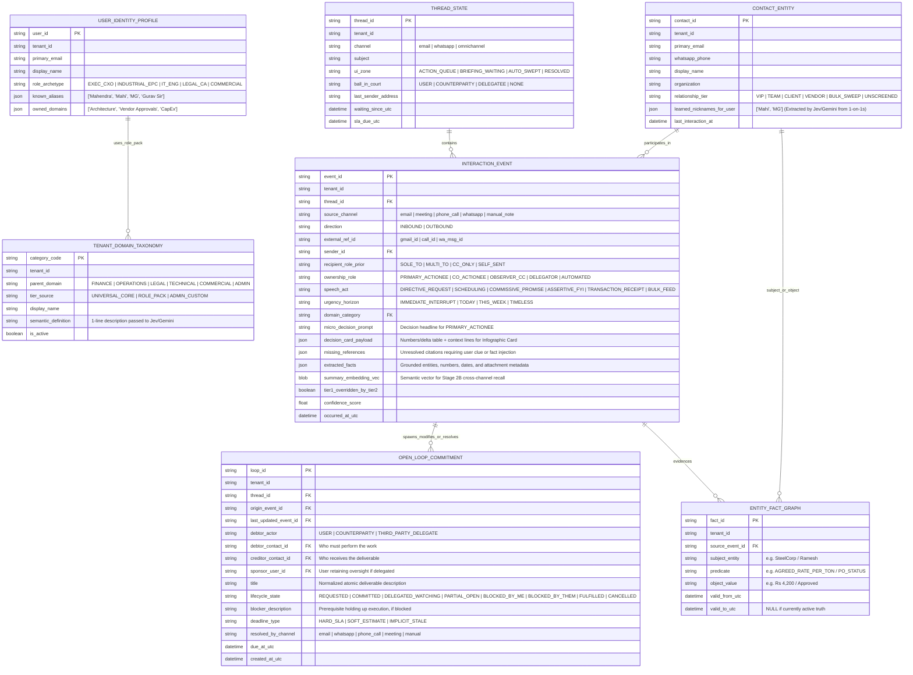
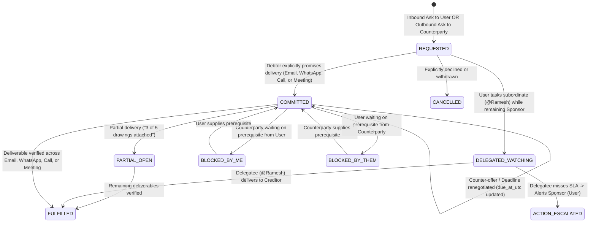
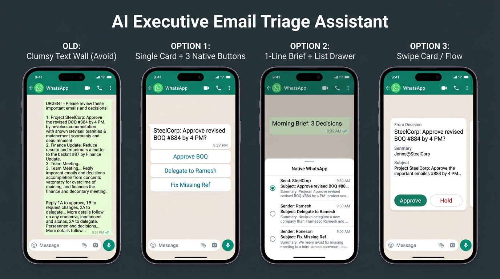
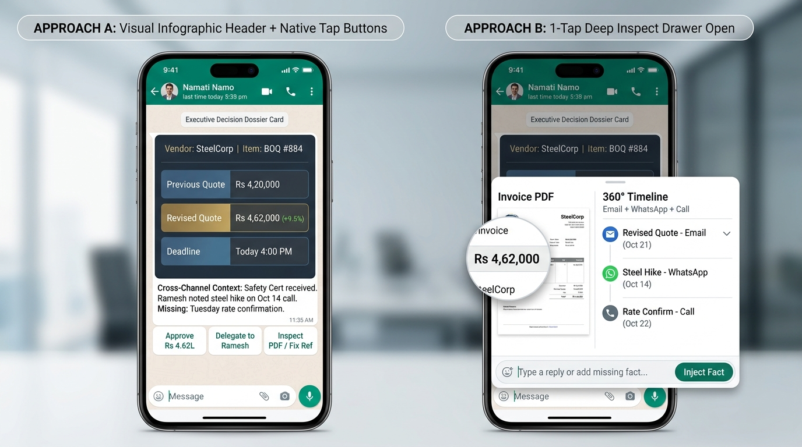
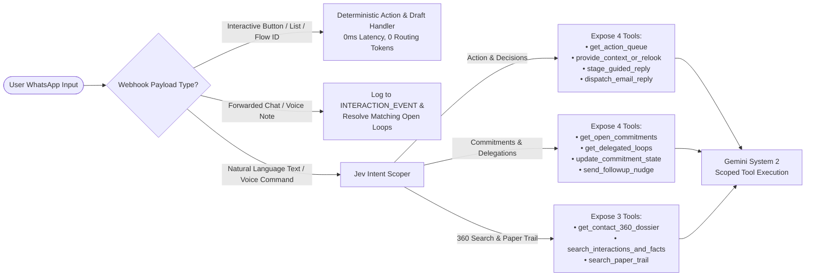

# Next-Generation Mail Triage & Omnichannel Executive Context Engine: Research, Strategy & Technical Architecture Specification

```
Document Reference : MT-OMNI-SPEC-2026-V1.2
Version            : 1.2.0 (Supersedes v1.1.0; v1.0.0 and v1.1.0 preserved in repository history)
Status             : Evidence-Grounded Architectural & Product Specification
Author             : Mahendra GURAV
License            : Apache License, Version 2.0
Location           : /plan/improvement/mailTriage/MAIL_TRIAGE_AND_OMNICHANNEL_CONTEXT_MASTER_SPEC_v1.2.md
Scope              : Mail Organizer Cartridge, MCP Orchestrator, System 1 (Jev) & System 2 (Gemini) Pipeline,
                     Neuro-Symbolic Commitment Ledger, Role-Adaptive Taxonomy, Mobile Rich UX, and Omnichannel Sensors
Governed By        : Global Engineering Excellence Standard (GEES v3.1)
```

---

## Cumulative Revision History (`v1.0.0` $\rightarrow$ `v1.1.0` $\rightarrow$ `v1.2.0`)

### Revisions in `v1.2.0` (Current Version)

| Change ID | Section(s) Updated | Summary of Architectural, Empirical & UX Revision |
| :--- | :--- | :--- |
| **REV-08** | `Section 6` | **Hybrid Neuro-Symbolic Storage Architecture:** Augmented the relational ER core (used for deterministic state transitions and SLA timers) with **Semantic Vector + FTS5 Hybrid Search** (`INTERACTION_EVENT`) and **Schema-Free Temporal Fact Triples (`ENTITY_FACT_GRAPH`)** `[14]`. |
| **REV-09** | `Sections 1, 3` | **Evidence-Verified Competitor Scope:** Clarified that while tools like Fyxer AI ingest scheduled video-meeting notes `[15]`, no existing email triage tool natively unifies Email with WhatsApp chats, cellular/ad-hoc phone calls, and a bi-directional commitment state machine. Added IBM CHI 2011 empirical folder-retrieval metrics (`58.82s` vs. `17.15s` / `13.96s`) `[1]`. |
| **REV-10** | `Sections 1, 3, 4` | **Hardened Multi-Tenant Cloud SaaS + On-Premise Parity:** Aligned deployment claims with Release100's native `tenancy` architecture—supporting both **Hardened Multi-Tenant Cloud SaaS** (with tenant-isolated schemas, AES-256-GCM vaults, and BYOK) and **Dedicated On-Premise / Private VPC** deployments. |
| **REV-11** | `All + Section 13` | **Formal Academic, Legal & Industry Citations (`[1]`–`[18]`):** Attached inline citation markers to all scientific claims, inbox volume statistics, legal statutes, and competitor features, backed by a verified bibliography in `Section 13`. |
| **REV-12** | `Sections 5, 8, 9, 11` | **WhatsApp Business Cloud API Capabilities on Existing Release100 Infrastructure:** Documented how Release100's built-in WhatsApp webhook (`whatsapp_webhook.py`) leverages **Interactive Reply Buttons**, **List Drawers**, **WhatsApp Flows**, **Voice Note commands**, **Meta "WhatsApp Coexistence"**, **"Forward-to-Bot" logging**, and **24-Hour Utility Template sessions** `[16]`. |
| **REV-13** | `Sections 2.2, 11.2` | **Two-Party Consent & Data Protection Impact Analysis (CIPA, GDPR, DPDP):** Added jurisdictional risk analysis (`0%` wiretapping risk on Email/WhatsApp; 1-Party vs. 2-Party call consent) and three technical controls: **Ephemeral In-Memory Audio Transcription (Zero Raw Audio Retention)**, **Admin Jurisdiction Policy Toggle**, and **Customer as Data Controller via BYOK** `[17, 18]`. |
| **REV-14** | `Sections 4.2, 5.3, 8.2, 10` | **Mobile UX Study & "Rich Executive Decision Dossier Card":** Replaced clumsy `1A`/`1B` multi-item text walls and empty 1-liners with a 2-stage mobile UX grounded in NN/g & Meta Conversational UX research `[13]`: **Stage 1 (1-Line Digest + Native List Drawer)** and **Stage 2 (Rendered Visual Infographic Header + 3 Native Tap Buttons + 1-Tap Deep Inspect Drawer)**, with embedded UI mockups. |
| **REV-15** | `Sections 5.4, 7.1, 11` | **Outbound User Promise Capture Across Call & Meeting Transcripts:** Extended outbound commitment and delegation capture beyond sent emails/WhatsApp to include **speaker-diarized User Utterances in Phone Call and Meeting Transcripts**. |
| **REV-16** | `Sections 1, 3, 5.5, 7.1, 12` | **Empirical Inbox Composition Facts vs. Target Engineering SLOs:** Replaced unverified traffic split assumptions with published empirical baselines (`62%–74%` machine/bulk/CC volume from Yahoo Labs/Stanford WWW '14 `[9]` and Radicati/SaneBox `[10]`), explicitly labeled internal pipeline splits as **Target Design Budgets (SLOs)**, and added a mandatory **Live Benchmark Telemetry Protocol** in `Section 12.2`. |
| **REV-17** | `Sections 6, 7.1, 7.2, 7.3` | **Simplified Zero-Regex Tier 0 & Direct Jev Domain/Alias Handling:** Stripped all brittle body-text regexes, keyword arrays (`lexical_anchors`), and pre-Jev embedding models out of Tier 0. Tier 0 now executes `<40 lines` of pure RFC header & DB primary-key lookups, while **Tier 1 (Jev)** directly evaluates the user's ~15 active role categories (or 6–8 coarse parent domains) and extracts salutation nicknames/vocatives in JSON. |

### Earlier Revisions in `v1.1.0`
- **REV-01 to REV-07:** Established professional engineering tone, dynamic `CO_ACTIONEE` $\rightarrow$ `PRIMARY_ACTIONEE` promotion, 3-layer alias resolution, tenant-admin-governed role taxonomies, Language-Action commitment state machine, LLM vs. System Contract boundaries, and the 4-stage Tier 2 Gemini pipeline with Missing-Reference HITL resolution.

---

## Table of Contents

1. [Executive Summary & Core Architectural Thesis](#1-executive-summary--core-architectural-thesis)
2. [Scientific, Engineering & Legal Challenges (With Empirical Citations)](#2-scientific-engineering--legal-challenges-with-empirical-citations)
3. [Competitive Landscape, Architectural Boundaries & Deployment Differentiation](#3-competitive-landscape-architectural-boundaries--deployment-differentiation)
4. [Target Enterprise Segments, Operational Use Cases & Value Model](#4-target-enterprise-segments-operational-use-cases--value-model)
5. [Strategic Proposals & Core Design Principles](#5-strategic-proposals--core-design-principles)
6. [The "HOW" — Part 1: Hybrid Neuro-Symbolic Database Schema & Commitment Ledger](#6-the-how--part-1-hybrid-neuro-symbolic-database-schema--commitment-ledger)
7. [The "HOW" — Part 2: Zero-Regex Tier 0, Jev Tier 1 & 4-Stage Gemini Tier 2 Pipeline](#7-the-how--part-2-zero-regex-tier-0-jev-tier-1--4-stage-gemini-tier-2-pipeline)
8. [The "HOW" — Part 3: Commitment State Machine & Rich Mobile UX (Infographic Card + Drawer)](#8-the-how--part-3-commitment-state-machine--rich-mobile-ux-infographic-card--drawer)
9. [The "HOW" — Part 4: Redefined Polling, Bounded Deferral & Pre-Meeting Dossiers](#9-the-how--part-4-redefined-polling-bounded-deferral--pre-meeting-dossiers)
10. [The "HOW" — Part 5: Scoped CQRS MCP Orchestrator](#10-the-how--part-5-scoped-cqrs-mcp-orchestrator)
11. [The "HOW" — Part 6: Omnichannel Sensor Plug-Ins & Legal Compliance Controls](#11-the-how--part-6-omnichannel-sensor-plug-ins--legal-compliance-controls)
12. [Phased Implementation Roadmap & Live Benchmark Telemetry Protocol](#12-phased-implementation-roadmap--live-benchmark-telemetry-protocol)
13. [References & Verified Bibliography](#13-references--verified-bibliography)

---

## 1. Executive Summary & Core Architectural Thesis

Established email productivity platforms—such as Superhuman, Shortwave, SaneBox, and Fyxer AI—deliver proven value in single-inbox sorting, keyboard-driven navigation, and voice-matched reply drafting `[11, 12, 15]`. Despite these capabilities, enterprise leaders and operations directors continue to face high coordination overhead due to two structural boundaries in current systems:

1. **Cross-Channel State Fragmentation:** While tools such as Fyxer AI incorporate meeting notetakers for scheduled video calls (Zoom/Meet/Teams) `[15]`, no existing email triage platform natively unifies **Email + WhatsApp Business/Personal Chats + Cellular/VoIP Phone Calls + Live Meetings** into a single **Bi-Directional Commitment State Machine**. When a request received via email is renegotiated on a phone call or fulfilled via WhatsApp, email-only trackers fail to update—producing stale follow-up alerts ("zombie tasks") `[7]`.
2. **Multi-Folder Retrieval Latency & Pre-Decision Drafting:** Empirical HCI telemetry from IBM Research (tracking 345 users and 85,000 refinding actions) demonstrated that navigating multi-folder category structures requires a mean of **58.82 seconds** per retrieval, compared to **17.15 seconds** for search and **13.96 seconds** for simple list sorting—a **3.4x slowdown** `[1]`. Furthermore, systems that pre-generate full multi-paragraph reply drafts during background polling (prior to knowing the user's business decision) incur high LLM token consumption and require heavy manual rewriting `[6]`.

### Core Architectural Thesis
The Release100 Mail Organizer evolves from a single-channel folder sorter into an **Omnichannel Commitment & Context Engine** built on four architectural pillars:

1. **Granular in the Database, Simple on the Screen:**
   - **Internal Hybrid Storage:** Persist rich, multi-dimensional metadata, semantic embeddings, and temporal fact triples (`ENTITY_FACT_GRAPH`) `[14]` for high-precision retrieval, SLA timer execution, and MCP tool querying.
   - **External User View:** Expose **only 3 workflow zones** (`1_Action_Queue`, `2_Briefing_Waiting`, `3_Auto_Swept`) `[2, 12]` while keeping internal taxonomy management 100% invisible to end-users.
2. **Decision-First Rich Mobile UX (Capture Intent Before Generation):**
   - Background polling never invokes a frontier LLM to write speculative essay drafts. Instead, it renders a **Rich Executive Decision Dossier Card** on WhatsApp/Web (displaying the exact request, hard financial/schedule deltas, cross-channel history, and any missing references) paired with **3 native WhatsApp tap buttons** `[13, 16]`. Full draft generation runs only after the user taps a decision or replies by voice/text.
3. **Full Language-Action Commitment Ledger (Inbound + Outbound + Verbal):**
   - Models the complete commitment lifecycle `[8]` across **inbound requests, third-party delegations (`DELEGATED_WATCHING`), conditional blocks, partial fulfillments, and outbound promises made by the user** across sent emails, WhatsApp replies, and speaker-diarized phone/meeting transcripts.
4. **Dual-Mode Enterprise Deployment (Hardened Multi-Tenant Cloud SaaS & On-Premise):**
   - Leverages Release100's native `tenancy` architecture to support both **Hardened Multi-Tenant Cloud SaaS** (with cryptographic tenant isolation, AES-256-GCM credential vaults, and Bring-Your-Own-Key `[BYOK]`) and **Dedicated On-Premise / Private VPC** installations.

---

## 2. Scientific, Engineering & Legal Challenges (With Empirical Citations)

### 2.1 The 8 Core HCI & Systems Engineering Challenges

```
┌──────────────────────────────────────────────────────────────────────────────────────────────────────────┐
│                         THE 8 SCIENTIFIC & TECHNICAL CHALLENGES OF EMAIL TRIAGE                          │
├────┬──────────────────────────────────┬──────────────────────────────────────────────────────────────────┤
│ #  │ Challenge & Primary Citation     │ Empirical Finding & Engineering Implication                      │
├────┼──────────────────────────────────┼──────────────────────────────────────────────────────────────────┤
│ C1 │ The Folder Fallacy               │ Tracking 85,000 refinding actions showed folder navigation takes │
│    │ Whittaker et al., IBM (CHI '11)  │ 58.82s mean vs. 17.15s for search and 13.96s for sorting [1].    │
│    │ [1]                              │ Sorting into >3–4 visible folders degrades retrieval speed.      │
├────┼──────────────────────────────────┼──────────────────────────────────────────────────────────────────┤
│ C2 │ Prospective Memory Failure       │ Users keep actionable emails in the primary Inbox as visual      │
│    │ ("Out of Sight, Out of Mind")    │ reminders [2, 3]. Auto-archiving human mail into secondary       │
│    │ Malone (MIT) [2]; Bellotti [3]   │ folders removes the visual cue and causes dropped obligations.   │
├────┼──────────────────────────────────┼──────────────────────────────────────────────────────────────────┤
│ C3 │ Asymmetric Error Cost &          │ Cost(False Negative) >> 1,000 x Cost(False Positive) [4]. A      │
│    │ The 99% Trust Collapse           │ single critical client email buried in a low-priority folder     │
│    │ Horvitz & Amershi (MSR) [4, 5]   │ forces users to manually shadow-audit all filtered folders.      │
├────┼──────────────────────────────────┼──────────────────────────────────────────────────────────────────┤
│ C4 │ Orthogonal Axis Conflation       │ Single-label classifiers conflate Topic (Finance), Urgency       │
│    │ ("Urgent Invoice" Paradox)       │ (Today), and Speech Act (Directive) [3, 8]. A failed payment     │
│    │ Bellotti et al. (PARC) [3]; [8]  │ labeled only "Finance" risks being archived as a passive receipt.│
├────┼──────────────────────────────────┼──────────────────────────────────────────────────────────────────┤
│ C5 │ The Decision Gap in AI Drafting  │ An LLM reading "Can we delay delivery to Thursday?" lacks the    │
│    │ Hancock et al. (Stanford HCI)    │ user's private decision [6]. Pre-generated drafts require heavy  │
│    │ [6]                              │ editing whenever the user's intent differs from the model guess. │
├────┼──────────────────────────────────┼──────────────────────────────────────────────────────────────────┤
│ C6 │ Cross-Channel State Blindness    │ Enterprise tasks routinely hop across Email, IM/WhatsApp, and    │
│    │ & "Zombie Tasks"                 │ calls [7]. Single-channel trackers continue nagging users about  │
│    │ Mark & Iqbal (UC Irvine/MSR) [7] │ obligations already settled on another communication channel.    │
├────┼──────────────────────────────────┼──────────────────────────────────────────────────────────────────┤
│ C7 │ Temporal Context Drift           │ Relevance is time-dependent [8]: a vendor dossier has low value  │
│    │ Dumais, Cutrell & Horvitz (MSR)  │ three days before a call, peak value 10 minutes before the       │
│    │ [5, 8]                           │ meeting starts, and archival value afterward.                    │
├────┼──────────────────────────────────┼──────────────────────────────────────────────────────────────────┤
│ C8 │ Attention Fragmentation          │ Interrupted knowledge workers take an average of 23m 15s to      │
│    │ Gloria Mark (UC Irvine) [7];     │ resume deep focus [7]. Trickle notifications must be replaced    │
│    │ Eric Horvitz (Bounded Deferral)  │ by Bounded Deferral [5] at scheduled cognitive breakpoints.      │
└────┴──────────────────────────────────┴──────────────────────────────────────────────────────────────────┘
```

### 2.2 Jurisdictional Legal & Platform Impact Analysis (CIPA, GDPR, DPDP)

| Channel / Phase | Regulatory & Wiretapping Impact | Technical & Legal Mitigation in Release100 |
| :--- | :--- | :--- |
| **Phase 1 & 2: Email, Calendar & WhatsApp Bot** | **0% Wiretapping Risk:** Written correspondence where the user is an addressed party is standard business data. Governed by data protection statutes (**India DPDP Act 2023** `[18]`, **EU GDPR** `[17]`). | Satisfied natively by Release100's tenant-isolated storage, AES-256-GCM encryption at rest, BYOK key custody, and SHA-256 tamper-evident audit logs. |
| **Phase 3 & 4: Calls & Meetings in 1-Party Jurisdictions (India + 38 US States)** | **Low Risk:** Under Indian law `[18]` and 38 US One-Party Consent states, a participant in a business conversation may lawfully generate private AI notes/transcripts for internal business execution. | Local desktop loopback (`WASAPI`/`CoreAudio`) or authorized VoIP/recorder ingestion operates seamlessly under tenant policy. |
| **Phase 3 & 4: Calls & Meetings in 2-Party Jurisdictions (California CIPA + EU)** | **High Risk if Raw Audio is Retained Without Notice:** Statutes such as the **California Invasion of Privacy Act (CIPA § 632)** `[17]` prohibit recording confidential communications without all-party consent. | **3 Built-In Technical Controls:**<br>1. **Ephemeral In-Memory Transcription:** Convert audio streams in RAM to structured notes/commitments and **immediately purge raw audio bytes** (zero audio recording retained on disk).<br>2. **Admin Jurisdiction Policy Toggle:** Allows Tenant Admins to enforce `2-Party Explicit Notice Mode` (auto-appending *"AI note-taking active"* to calendar invites).<br>3. **Customer as Legal Data Controller:** With BYOK and tenant isolation, Release100 acts strictly as software processor, never pooling audio for central training. |

---

## 3. Competitive Landscape, Architectural Boundaries & Deployment Differentiation

| Product / Category | Primary Mechanism | Verified Strengths | Verified Architectural Boundaries |
| :--- | :--- | :--- | :--- |
| **SaneBox** `[10]` | Server-side IMAP statistical folder routing (`@SaneLater`, `@SaneNews`). | Client-agnostic; zero UI migration. | Header-only statistical routing; no semantic comprehension, commitment tracking, or WhatsApp/Call integration. |
| **Superhuman** `[11]` | High-speed keyboard-centric mail client (`Cmd+K`) with split inboxes. | Sub-100ms UI responsiveness; CRM sidebar integrations. | Requires adopting proprietary mail client ($30/user/mo); **zero native WhatsApp or phone-call ingestion** `[11]`. |
| **Shortwave** `[11]` | AI-native Gmail client with thread summaries, bundles, and search. | Strong multi-thread semantic search; Slack/Calendar integrations. | Requires switching to Shortwave web/mobile UI; **zero native WhatsApp or cellular call integration** `[11]`. |
| **Fyxer AI** `[15]` | 8-label Gmail/Outlook plugin (`To Respond`, `Awaiting Reply`) + video meeting notetaker bot. | Works inside native Gmail/Outlook; weaves Zoom/Meet/Teams notes into email drafts `[15]`. | Pre-generates drafts before capturing user decision; relies on visible bot joining video calls; **zero native WhatsApp or cellular call integration** `[15]`. |
| **HEY (37signals)** `[12]` | Opinionated email platform (`Screener`, `Imbox`, `The Feed`, `Paper Trail`). | Proven First-Time Sender Screener and 3-zone cognitive separation `[12]`. | Requires abandoning `@company.com` Gmail/Outlook; no AI triage or omnichannel memory. |
| **Gong.io** | Enterprise Revenue Intelligence (Email + Video Calls + VoIP). | Mature omnichannel correlation across calls, meetings, and email. | **$1,200–$1,600/seat/year**; built for sales manager pipeline inspection rather than personal executive triage. |
| **Limitless / Granola** | Local desktop loopback audio capture + meeting summary notes. | Captures meeting context locally without a visible bot participant. | Passive note-taking utility; does not triage inboxes, track overdue SLAs, or orchestrate replies via WhatsApp. |

### Release100 Architectural Differentiation
1. **Flexible Deployment Sovereignty (Hardened Multi-Tenant Cloud SaaS + On-Premise):** Customers can run on Release100's hardened multi-tenant cloud (with strict tenant-scoped database isolation, AES-256-GCM encryption, and BYOK) or deploy on-premise / inside their private VPC.
2. **Native WhatsApp Cloud API Control & Ingestion Loop:** Built directly on Release100's existing WhatsApp Business Cloud API infrastructure (`whatsapp_webhook.py` and `channels/whatsapp.py`), supporting Rich Infographic Decision Cards, Native Tap Buttons, Voice Notes, and WhatsApp Business Coexistence `[16]`.
3. **Evidence-Grounded 3-Tier Compute Economics:** Peer-reviewed email traffic studies (Yahoo Labs / Stanford WWW '14 `[9]` and Radicati/SaneBox `[10]`) establish that **62%–74% of enterprise inbox volume** consists of machine-generated bulk, automated notifications/receipts, and passive CC/FYI mail. By filtering bulk mail in Tier 0 (`0ms`) and classifying routine mail in Tier 1 (local Jev 0.5B), our **Target Engineering SLO** reserves deep Tier 2 (Gemini) context synthesis for **$\le 20\%$ of total inbox volume**.

---

## 4. Target Enterprise Segments, Operational Use Cases & Value Model

### 4.1 Target Enterprise Segments

| Segment | Representative Roles | Operational Environment | Core Value Delivered |
| :--- | :--- | :--- | :--- |
| **1. Executive Leadership & Managing Partners** | Founders, CEOs, Managing Partners in advisory, legal, accounting, and consulting firms. | 100–200 daily emails, back-to-back client meetings, and continuous WhatsApp coordination. | Prevents dropped commitments across channels, delivers pre-meeting 360° dossiers, and turns email replies into 1-tap WhatsApp decisions. |
| **2. Industrial, EPC & Operations Directors** | Plant heads, construction directors, supply chain and logistics leaders. | Mobile/on-site operations where desktop inbox triage is impractical; high volume of vendor BOQs, POs, and site escalations. | Seamless event-bus synergy with operational cartridges (`temperature_marker`) and Rich Infographic Decision Cards on mobile. |
| **3. Commercial & Account Directors** | B2B sales directors, wealth advisors, procurement leads, M&A managers. | Multi-party negotiations spanning email proposals, WhatsApp follow-ups, and phone calls. | Automated tracking of inbound requests, outbound promises, delegated tasks, and overdue counterparty SLAs. |
| **4. Regulated & Privacy-Sensitive Enterprises** | Legal practices, healthcare administration, financial services, IP-sensitive R&D. | Strict data residency or key-custody mandates (GDPR, DPDP, HIPAA, ISO 27001). | Choice of BYOK-isolated multi-tenant cloud or self-hosted on-premise runtime with SHA-256 audit trails. |

### 4.2 High-Value Operational Use Cases
1. **Rich Visual Decision Triage on WhatsApp:** At scheduled briefing windows, the user receives a clean 1-line digest with a native **WhatsApp List Drawer** `[16]`. Selecting an item displays a **Rich Executive Decision Card** (showing the request, financial/date delta table, cross-channel history, and 3 native tap buttons) plus a 1-tap **Deep Inspect Drawer** for viewing the raw PDF/thread.
2. **T-10 Minute Pre-Meeting 360° Dossier:** Ten minutes before a calendar event, the system synthesizes recent emails, WhatsApp chats, call notes, and open commitments involving the attendees.
3. **Zero-Audit Bulk Sweep with Screener Protection:** Machine bulk and passive receipts are routed to `3_Auto_Swept` with a 1-line daily sweep receipt, while first-time human senders are held in the Screener `[12]` for 1-tap approval.
4. **Full-Spectrum Commitment & Delegation Radar:** Tracks obligations owed by the user, owed to the user, or delegated by the user to subordinates (`DELEGATED_WATCHING`) across Email, WhatsApp, Calls, and Meetings.

---

## 5. Strategic Proposals & Core Design Principles

### 5.1 Principle 1: "Granular in the Database, Simple on the Screen"
- **External User View (Strictly 3 Workflow Zones):**
  1. `1_Action_Queue`: Messages where the user is the primary decision-maker or action owner (`ball_in_court = USER`).
  2. `2_Briefing_Waiting`: Informational updates (`OBSERVER_CC` / `ASSERTIVE_FYI`), threads awaiting counterparty reply (`ball_in_court = COUNTERPARTY`), and tasks delegated to team members (`DELEGATED_WATCHING`).
  3. `3_Auto_Swept`: Machine-generated bulk mail, newsletters, and passive transactional receipts (`Paper_Trail` / `Feed`) `[12]`.
- **Internal Taxonomy Invisibility & Admin Audit Governance:**
  - End-users never see, configure, or manage internal `domain_category` codes.
  - Role taxonomy selection, `GENERAL_UNCLASSIFIED` drift analysis, and periodic classification quality audits are managed exclusively in the **Tenant Admin Console** (with optional anonymized diagnostic exports to the Platform team).

### 5.2 Principle 2: First-Time Sender Screener & Daily Sweep Receipt
- **Human Sender Protection:** The pipeline never auto-archives correspondence from an unscreened human sender `[4, 12]`.
- **First-Time Sender Screener:** Unrecognized human senders appear in the briefing with 1-tap routing buttons (`[Always Allow]`, `[Once]`, `[Always Sweep]`).
- **Daily Sweep Receipt:** Every briefing includes a 1-line audit summary (*"🧹 Swept 22 newsletters & 3 receipts"*), eliminating the need to manually audit archive folders.

### 5.3 Principle 3: Decision-First Drafting, Rich Mobile UX & Context-Gap Resolution
- **Eliminating Chatbot Wall-of-Text & Blind 1-Liners:** Research by the **Nielsen Norman Group (NN/g)** and **Meta Conversational UX** `[13, 16]` shows that mobile users skip chat messages longer than 4–5 lines ("Wall-of-Text Fatigue") and dislike typing syntax codes (`1A`, `1B`), yet professionals also refuse to approve business decisions from a bare 1-line prompt that hides the numbers and backstory.
- **Our 2-Stage Rich Visual Solution:**
  - **Stage 1 (1-Line Brief + Native List Drawer):** Keeps the WhatsApp chat clean with a single summary line and `[📋 Open Action Queue]` button that opens WhatsApp's native bottom-sheet drawer `[16]`.
  - **Stage 2 (Visual Infographic Header Card + 3 Native Tap Buttons + 1-Tap Deep Inspect):** Displays a rendered high-contrast summary graphic (Vendor/Sender, Previous vs. Revised Numbers/Dates, Deadline) above 3 lines of cross-channel context and 3 native tap buttons (`[Approve]`, `[Delegate]`, `[Inspect PDF / Fix Ref]`).
- **Missing-Reference HITL Resolution:** When Stage 2B local search finds `0` matches for a cited reference (*"as Ramesh agreed last Tuesday"*) on a `PRIMARY_ACTIONEE` item, tapping `[Inspect PDF / Fix Ref]` lets the user either **supply a search clue** (triggering a targeted relook) or **inject the fact directly** (used immediately for drafting and saved permanently as a `MANUAL_CONTEXT_NOTE`).

### 5.4 Principle 4: Full Language-Action Commitment Ledger (Including Verbal Transcripts)
Grounded in Winograd & Flores's **Language-Action Perspective** `[8]`, the commitment engine models:
- **Request vs. Binding Promise:** Distinguishing an unaccepted ask (`REQUESTED`) from an accepted commitment (`COMMITTED`).
- **Multi-Operation Messages (`0..N` per event):** Extracting multiple transitions from a single message (e.g., closing one loop while opening two new ones).
- **Delegation Triangles (`Debtor`, `Creditor`, `Sponsor`):** Tracking tasks delegated by the user to a subordinate (`DELEGATED_WATCHING`) so the user is alerted if the subordinate misses the deadline.
- **Counter-Offers, Partial Fulfillment & Conditional Blocks:** Handling renegotiated dates, partial deliveries (`PARTIAL_OPEN`), and prerequisites (`BLOCKED_BY_ME` / `BLOCKED_BY_THEM`).
- **Outbound Written & Verbal User Promise Capture:** Scanning the user's **sent emails, outbound WhatsApp replies, and speaker-diarized User Utterances in Phone Call and Meeting Transcripts** so every promise or delegation spoken or written by the user is automatically tracked.

### 5.5 Principle 5: Boundary Between LLM Native Knowledge and System Contracts

| Dimension | Rely on Native LLM Knowledge (Zero Brittle Rules) | Enforce Strict System Schemas & Code Contracts |
| :--- | :--- | :--- |
| **Language & Salutations** | Reading greetings (`"Hey Mahi"`), vocative tasking (`"@Mahi please approve"`), and domain topics in Tier 1 (Jev) & Tier 2 (Gemini). | Storing extracted aliases in `CONTACT_ENTITY` and enforcing fixed DB state columns (`lifecycle_state`, `due_at_utc`) for SQL timers. |
| **Draft Composition** | Writing natural, tone-matched replies once the user's decision and facts are known. | Enforcing CQRS dispatch gates (`stage_guided_reply` vs. `dispatch_email_reply`). |
| **Compute & Cost Control** | Deep synthesis and Tier-1 audit on complex human correspondence in Tier 2 (Gemini). | Pure RFC protocol header & DB primary-key filtering in Tier 0 (`<40 lines` of code; zero body-text regexes) + single-pass Jev classification in Tier 1. |
| **Private World Memory** | Reasoning over the assembled 360° dossier passed in the prompt window. | Resolving private organizational truths unknown to pretrained models: user aliases, VIP tiers, and cross-channel events. |

---

## 6. The "HOW" — Part 1: Hybrid Neuro-Symbolic Database Schema & Commitment Ledger

To avoid the rigidity of a pure legacy ER schema while avoiding the state-tracking failures of a pure vector database, the tenant database implements a **3-Layer Hybrid Neuro-Symbolic Memory Architecture** `[14]` inside SQLite (with `FTS5` + vector column) / PostgreSQL (`pgvector`):

1. **Layer 1 — Relational ER Core (Deterministic State & Timers):** Manages exact workflow states (`THREAD_STATE`), commitment lifecycles (`OPEN_LOOP_COMMITMENT`), contact identities (`CONTACT_ENTITY`), and role taxonomies (`TENANT_DOMAIN_TAXONOMY`).
2. **Layer 2 — Hybrid Lexical (`FTS5`) + Semantic Vector Index:** Stored on `INTERACTION_EVENT` and `OPEN_LOOP_COMMITMENT` so Stage 2B research can match *"steel rate hike"* with *"revised BOQ tariff"* across channels.
3. **Layer 3 — Schema-Free Temporal Fact Graph (`ENTITY_FACT_GRAPH`):** Captures open-ended subject-predicate-object facts (`Ramesh -> AGREED_RATE -> ₹4,200/ton`) with temporal validity windows (`valid_from_utc`, `valid_to_utc`) without requiring SQL schema migrations `[14]`.



---

## 7. The "HOW" — Part 2: Zero-Regex Tier 0, Jev Tier 1 & 4-Stage Gemini Tier 2 Pipeline

### 7.1 Maintainable 3-Tier Pipeline Architecture

To ensure long-term maintainability, **Tier 0 is strictly restricted to `<40 lines` of structured RFC header checks and exact DB primary-key lookups**—containing **zero body-text regexes, zero keyword lists, and zero pre-Jev embedding models**. All natural-language comprehension (including nickname recognition, vocative promotion, and domain selection) is delegated to **Tier 1 (Jev)** and **Tier 2 (Gemini)**:

```
┌────────────────────────────────────────────────────────────────────────────────────────────────────────┐
│                     TIER 0: PURE RFC HEADER & DB PRIMARY-KEY GATE (ZERO BODY NLP)                      │
│                              (Latency: < 2ms | Cost: $0.0000 | < 40 LOC)                               │
├────────────────────────────────────────────────────────────────────────────────────────────────────────┤
│ 1. Direction & Outbound Check (`From:` header / Call Diarization Speaker == User):                     │
│    • If `direction == OUTBOUND`:                                                                       │
│      ➔ Set `THREAD_STATE.ball_in_court = COUNTERPARTY`, `ui_zone = BRIEFING_WAITING`.                  │
│      ➔ Route to Tier 1/2 Outbound Commitment Check (captures written/verbal promises & delegations     │
│        made by the User across Email, WhatsApp, Phone Calls, and Meetings).                            │
│                                                                                                        │
│ 2. Exact Sender Primary-Key Lookup (`CONTACT_ENTITY` by email/phone):                                  │
│    • If `relationship_tier == BULK_SWEEP` ➔ `ui_zone = AUTO_SWEPT`. STOP.                              │
│    • Fetch sender's `relationship_tier` (`VIP`) and `learned_nicknames_for_user`.                      │
│                                                                                                        │
│ 3. RFC 5322 / 2369 Protocol Header Check:                                                              │
│    • Has `List-Unsubscribe` OR `Precedence: bulk/list` (and not VIP) ➔ `ui_zone = AUTO_SWEPT`. STOP.   │
│    • Has `Auto-Submitted: auto-replied` ➔ `ownership_role = AUTOMATED`, `ui_zone = AUTO_SWEPT`. STOP.  │
│                                                                                                        │
│ 4. Structured Recipient Header Count (`To:` vs `Cc:`):                                                 │
│    • Compute `recipient_role_prior`: `SOLE_TO` (1 in To) | `MULTI_TO` (>1 in To) | `CC_ONLY`.          │
└───────────────────────────────────────────────────┬────────────────────────────────────────────────────┘
                                                    │ (Target Design Budget: ~40–50% Bulk/Auto Filtered)
                                                    ▼
┌────────────────────────────────────────────────────────────────────────────────────────────────────────┐
│                      TIER 1: JEV SYSTEM 1 MULTI-QUESTION SINGLE-PASS CLASSIFIER                        │
│                              (Latency: ~300ms | Cost: Local / Fixed)                                   │
├────────────────────────────────────────────────────────────────────────────────────────────────────────┤
│ Compact Context Header Passed to Jev:                                                                  │
│   `User: Mahendra Gurav | Known Aliases: [Mahi, MG, Gurav Sir] | Header Prior: MULTI_TO`               │
│                                                                                                        │
│ Single HTTP POST to Jev `/systemone` evaluating 5 questions in one pass:                               │
│   • Q1 (`ownership_role`): `PRIMARY_ACTIONEE` | `CO_ACTIONEE` | `OBSERVER_CC`                          │
│     (Jev promotes `MULTI_TO` or `CC_ONLY` ➔ `PRIMARY_ACTIONEE` if body addresses User/Alias/Domain)    │
│   • Q2 (`speech_act`): `@Directive_Request` | `@Scheduling_Meet` | `@Commissive_Promise` |             │
│                        `@Assertive_FYI` | `@Transaction_Paper` | `@Bulk_Marketing`                     │
│   • Q3 (`urgency_horizon`): `@Immediate` | `@Today` | `@This_Week` | `@Timeless`                       │
│   • Q4 (`domain_category`): Evaluates User's active Role Pack (~12–15 categories, or 6 parent domains) │
│   • Q5 (`has_commitment_activity`): `@Yes_Commitment_Or_Task_Signal` | `@No_Commitment_Signal`         │
│   • Optional JSON field (`salutation_used`): If `SOLE_TO`, records greeting name in `CONTACT_ENTITY`.  │
└───────────────────────────────────────────────────┬────────────────────────────────────────────────────┘
                                                    │
                                                    ▼
┌────────────────────────────────────────────────────────────────────────────────────────────────────────┐
│                           DETERMINISTIC ZONE SYNTHESIZER & COGNITIVE GATE                              │
├────────────────────────────────────────────────────────────────────────────────────────────────────────┤
│ • Case A: `speech_act in (@Transaction_Paper, @Bulk_Marketing)` AND `urgency_horizon != @Immediate`    │
│           AND `has_commitment_activity == @No`:                                                        │
│   ➔ `ui_zone = AUTO_SWEPT`. Apply label `3_Auto_Swept`. ZERO GEMINI CALLS.                             │
│                                                                                                        │
│ • Case B: `ownership_role == OBSERVER_CC` AND `speech_act == @Assertive_FYI`                           │
│           AND `has_commitment_activity == @No`:                                                        │
│   ➔ `ui_zone = BRIEFING_WAITING`, `ball_in_court = NONE`. Queue for digest. ZERO GEMINI CALLS.         │
│                                                                                                        │
│ • Case C: `ownership_role in (PRIMARY_ACTIONEE, CO_ACTIONEE)` OR `has_commitment_activity == @Yes`     │
│           OR (`direction == OUTBOUND` AND `has_commitment_activity == @Yes`):                          │
│   ➔ Proceed to TIER 2 (Gemini System 2 Deep Context & Commitment Pipeline)!                            │
└───────────────────────────────────────────────────┬────────────────────────────────────────────────────┘
                                                    │ (Target Design SLO: <= 20% of volume reaches Tier 2)
                                                    ▼
┌────────────────────────────────────────────────────────────────────────────────────────────────────────┐
│                 TIER 2: GEMINI SYSTEM 2 DEEP CONTEXT, RESEARCH & VERIFICATION PIPELINE                 │
├────────────────────────────────────────────────────────────────────────────────────────────────────────┤
│ • STAGE 2A — 360° Context Package Assembly (Deterministic Pre-Fetch):                                  │
│     Assembles full thread history, last 14 days of cross-channel events (WhatsApp, Call/Meeting notes) │
│     with this contact/organization, active `OPEN_LOOP_COMMITMENT` & `ENTITY_FACT_GRAPH` records,       │
│     attachment metadata, user aliases/role, and Calendar Free/Busy windows (if scheduling).            │
│                                                                                                        │
│ • STAGE 2B — Bounded Local Agentic Research (Hybrid FTS5 + Vector Lookup):                             │
│     Detects external citations in the message (e.g., "Invoice #402", "as Ramesh agreed last Tuesday"). │
│     Executes hybrid FTS5 + semantic vector search across emails, attachments, WhatsApp, and calls.     │
│     If found: appends matched records to context.                                                      │
│     If NOT found (0 hits) AND user is `PRIMARY_ACTIONEE`: flags `missing_references` for HITL prompt.  │
│                                                                                                        │
│ • STAGE 2C — Synthesis, Tier-1 Audit/Override, Ledger Ops & Rich Card Generation:                      │
│     1. Audits Tier 1 Jev classifications and overrides any errors (`tier1_overridden_by_tier2 = True`).│
│     2. Extracts `0..N` structured `CommitmentLedgerOp` transactions (`REQUESTED`, `COMMITTED`,         │
│        `DELEGATED_WATCHING`, `PARTIAL_OPEN`, `BLOCKED`, `FULFILLED`, `MODIFIED`) + Fact Triples.       │
│     3. Generates `decision_card_payload` (structured comparison table + 3 native tap button labels).   │
│                                                                                                        │
│ • STAGE 2D — Grounding & Self-Verification Gate:                                                       │
│     Validates that every extracted date, monetary figure, and commitment operation is strictly         │
│     supported by the source text, deduplicates against existing open loops, and commits to DB.         │
└────────────────────────────────────────────────────────────────────────────────────────────────────────┘
```

---

## 8. The "HOW" — Part 3: Commitment State Machine & Rich Mobile UX (Infographic Card + Drawer)

### 8.1 Language-Action Commitment State Machine (`OPEN_LOOP_COMMITMENT`)



---

### 8.2 Mobile UX Study: Solving "Wall-of-Text Fatigue" and "Blind 1-Line Prompts"

During our mobile UX design study, we evaluated four mobile interaction patterns on WhatsApp `[13, 16]`:



#### Key Findings from the UX Evaluation
1. **Why Screen 1 (Multi-Item Text Wall with `1A`/`1B` Codes) Fails:** Packing multiple emails and alphanumeric command codes (`1A`, `1B`, `1 search:`) into a single chat bubble causes visual fatigue on narrow phone screens `[13]`, leading users to ignore or postpone reading the briefing.
2. **Why Bare 1-Line Prompts (Screens 2–4 Alone) Feel Empty & Incomplete:** An executive cannot responsibly approve a purchase order, BOQ revision, or contract change from a bare 1-line question (*"Approve BOQ #884?"*) without seeing **the exact numbers, the delta vs. previous quotes, the cross-channel history, and what reference is missing**.

#### The Production Solution: Rich Visual Infographic Card + 3 Native Tap Buttons + 1-Tap Deep Inspect Drawer

To deliver **complete business substance without text clutter**, we leverage the **Meta WhatsApp Business Cloud API's Rich Media Header + Interactive Button Message** `[16]` alongside a **1-Tap Deep Inspect Drawer**:



1. **Scheduled Digest Entry Point (Zero Chat Clutter):**
   - At the scheduled briefing window (e.g., 09:00 AM), the user receives a single 1-line summary message with a native `[📋 Open 3 Decisions]` **WhatsApp List Drawer** button.
2. **Approach A — Visual Infographic Header + 3 Native Tap Buttons (Left Screen Above):**
   - When an item is selected (or pushed as an immediate VIP blocker), the backend renders a high-contrast **Executive Decision Dossier Graphic** attached as the WhatsApp message's `image` header.
   - The graphic cleanly tabulates the **4 Mandatory Decision Anchors**:
     1. **Entity & Artifact:** `Vendor: SteelCorp | Item: BOQ #884`
     2. **Baseline Figure:** `Previous Quote: ₹4,20,000`
     3. **Current Figure & Delta:** `Revised Quote: ₹4,62,000 (+9.5%)`
     4. **Hard Deadline:** `Deadline: Today 4:00 PM`
   - Below the graphic sits a concise 3-line caption summarizing cross-channel memory (`Safety Cert received today; Ramesh noted steel hike on Oct 14 call; Missing: Tuesday rate confirmation`) and **3 Native Tap Buttons**:
     - `[Approve ₹4.62L]` (Triggers Stage 2 grounded draft for 1-tap `Send`)
     - `[Delegate to Ramesh]` (Transitions loop to `DELEGATED_WATCHING` and forwards to Ramesh)
     - `[Inspect PDF / Fix Ref]` (Opens Approach B)
3. **Approach B — 1-Tap Deep Inspect & Missing-Reference Sheet (Right Screen Above):**
   - Tapping `[Inspect PDF / Fix Ref]` slides up the **Deep Inspect View**, displaying:
     - The highlighted **Invoice/BOQ PDF snippet**.
     - The unified **360° Timeline** (`Email` + `WhatsApp` + `Call` history with that contact).
     - A single input bar where the user can either type a **Search Hint** (re-running Stage 2B local search) or **Inject the Missing Fact** (saving a permanent `MANUAL_CONTEXT_NOTE` and generating the draft).

---

## 9. The "HOW" — Part 4: Redefined Polling, Bounded Deferral & Pre-Meeting Dossiers

### 9.1 Decoupled Producer-Consumer Poller (`INBOX` + `SENT`)
1. **Stage 1: Incremental Delta Producer (`poll_producer`)**
   - Polls Gmail `history.list` / `messages.list` deltas for both **`INBOX` (Inbound)** and **`SENT` (Outbound)**.
   - Executes the `<40-line` **Tier 0 Header & DB Gate** in `<2ms`.
   - Enqueues remaining human messages and outbound user replies into `inbound_triage_queue`.
2. **Stage 2: Rate-Paced Cognitive Consumer (`triage_consumer`)**
   - Evaluates queued items via **Tier 1 (Jev)** and conditionally **Tier 2 (Gemini 4-Stage Pipeline)**.
   - Updates `THREAD_STATE`, `INTERACTION_EVENT`, `OPEN_LOOP_COMMITMENT`, and `ENTITY_FACT_GRAPH`, and syncs the 3 Gmail labels (`1_Action_Queue`, `2_Briefing_Waiting`, `3_Auto_Swept`).

### 9.2 Bounded Deferral & WhatsApp 24-Hour Window Governance
- **Bounded Deferral Schedule `[5]`:** Immediate WhatsApp pushes occur **only** for verified `IMMEDIATE_INTERRUPT` blockers or VIP directives. All other items are batched into scheduled windows (e.g., **09:00, 13:30, 17:30**).
- **Meta 24-Hour Session Window Compliance `[16]`:** If $>24\text{ hours}$ have elapsed since the user's last WhatsApp interaction, the scheduled digest is dispatched using a pre-approved **Meta Utility Template** containing a `[📋 View Briefing]` button. The moment the user taps the button, Meta opens a **free 24-hour interactive session window** for rich infographic cards, buttons, and voice notes.

### 9.3 Just-in-Time Pre-Meeting 360° Dossier (`T - 10 Minutes`)
Ten minutes prior to any calendar event with external attendees, the system queries `INTERACTION_EVENT`, `OPEN_LOOP_COMMITMENT`, and `ENTITY_FACT_GRAPH` across all channels and delivers a **Pre-Meeting Infographic Brief** to WhatsApp.

---

## 10. The "HOW" — Part 5: Scoped CQRS MCP Orchestrator

 leveraging Release100's existing WhatsApp webhook (`whatsapp_webhook.py`), interactive button taps and drawer selections execute deterministically in `0ms`, while natural-language text or transcribed **Voice Notes** are scoped by Jev into focused CQRS MCP tool groups:



### CQRS MCP Tool Catalog

| Tool Name | CQRS Type | Purpose | Safety & Governance Gate |
| :--- | :--- | :--- | :--- |
| `get_action_queue` | **Query (Read)** | Returns open `1_Action_Queue` items with `decision_card_payload` and missing-reference alerts. | Auto-executable |
| `get_open_commitments` | **Query (Read)** | Queries `OPEN_LOOP_COMMITMENT` by actor (`USER`, `COUNTERPARTY`, `DELEGATEE`) and state (`COMMITTED`, `BLOCKED`, `PARTIAL_OPEN`). | Auto-executable |
| `get_contact_360_dossier` | **Query (Read)** | Synthesizes unified timeline (`INTERACTION_EVENT` + `ENTITY_FACT_GRAPH`) across Email, WhatsApp, Calls, and Meetings. | Auto-executable |
| `search_paper_trail` | **Query (Read)** | Hybrid FTS5 + vector search over invoices, BOQs, receipts, and attachment metadata. | Auto-executable |
| `provide_context_or_relook` | **Command (Context)** | Executes Path A (targeted hybrid re-search using user clue) or Path B (saving a `MANUAL_CONTEXT_NOTE` + `ENTITY_FACT_GRAPH` triple and re-synthesizing). | Audited DB write |
| `stage_guided_reply` | **Command (Stage)** | Generates a grounded email reply draft from the user's button tap or voice/text instruction. | Stages only; zero external send |
| `update_commitment_state` | **Command (State)** | Transitions a loop (`FULFILLED`, `DELEGATED_WATCHING`, `MODIFIED`) when resolved offline. | Reversible SHA-256 audit log |
| `dispatch_email_reply` | **Command (Write)** | Sends a staged reply via Gmail/SMTP and updates `THREAD_STATE` + `OPEN_LOOP_COMMITMENT`. | **Requires explicit user confirmation (`[Send]` button or `send`)** |

---

## 11. The "HOW" — Part 6: Omnichannel Sensor Plug-Ins & Legal Compliance Controls

### 11.1 Omnichannel Sensor Cartridge Matrix (Plane 4 Plug-Ins)

```
┌──────────────────────────────────────────────────────────────────────────────────────────────────────────┐
│                         OMNICHANNEL SENSOR CARTRIDGE PLUG-IN ARCHITECTURE                                │
├──────────────────────────┬────────────────────────────────────────┬──────────────────────────────────────┤
│ Cartridge / Sensor       │ Ingestion Mechanism (Legal & Technical)│ Shared Context & Ledger Impact       │
├──────────────────────────┼────────────────────────────────────────┼──────────────────────────────────────┤
│ 1. `mail_organizer`      │ Gmail OAuth2 API (INBOX + SENT deltas) │ Writes `INTERACTION_EVENT`, extracts │
│    (Phase 1)             │ + Google Calendar API.                 │ inbound/outbound Commitment Ops.     │
├──────────────────────────┼────────────────────────────────────────┼──────────────────────────────────────┤
│ 2. `whatsapp_channel`    │ Built-in Meta Cloud API (`channels/`): │ Logs inbound/outbound promises,      │
│    (Phase 1–2)           │ • **Coexistence Webhook** (Business)   │ voice notes, and facts; auto-closes  │
│                          │ • **Forward-to-Bot** (Personal chats)  │ matching email open loops!           │
├──────────────────────────┼────────────────────────────────────────┼──────────────────────────────────────┤
│ 3. `meeting_companion`   │ Local desktop loopback audio capture   │ Speaker-diarized transcription;      │
│    (Phase 3)             │ (`WASAPI`/`CoreAudio` — no visible     │ captures **User's verbal promises**  │
│                          │ cloud bot required) + Ephemeral RAM    │ & counterparty commitments into      │
│                          │ transcription `[17]`.                  │ `OPEN_LOOP_COMMITMENT`.              │
├──────────────────────────┼────────────────────────────────────────┼──────────────────────────────────────┤
│ 4. `call_monitor`        │ Enterprise VoIP/SIP webhook, Android   │ Maps E.164 phone numbers in          │
│    (Phase 4)             │ local call-recording folder watcher,   │ `CONTACT_ENTITY` to email threads;   │
│                          │ or hardware mic sync.                  │ captures verbal promises & closures. │
└──────────────────────────┴────────────────────────────────────────┴──────────────────────────────────────┘
```

---

## 12. Phased Implementation Roadmap & Live Benchmark Telemetry Protocol

### 12.1 4-Phase Rollout Plan

1. **Phase 1: Zero-Regex Tier 0, Jev Single-Pass Tier 1 & 3-Zone Label Sync**
   - Remove unconditional background Gemini calls (`pm_extract` / blind drafting) from polling.
   - Implement the `<40-line` Tier 0 RFC Header & DB Primary-Key Gate.
   - Upgrade Tier 1 (Jev `/systemone`) to classify `ownership_role` (with vocative/alias promotion), `speech_act`, `urgency_horizon`, role-pack `domain_category`, `has_commitment_activity`, and `salutation_used`.
   - Build the Tenant Admin Taxonomy & Drift Audit Console (keeping taxonomy 100% invisible to end-users).
2. **Phase 2: Hybrid Neuro-Symbolic Schema, 4-Stage Tier 2 Pipeline & Rich WhatsApp Cards**
   - Migrate schema (`USER_IDENTITY_PROFILE`, `TENANT_DOMAIN_TAXONOMY`, `CONTACT_ENTITY`, `THREAD_STATE`, `INTERACTION_EVENT` with vector/FTS5, `OPEN_LOOP_COMMITMENT`, `ENTITY_FACT_GRAPH`).
   - Implement Stage 2A (`360° Context Assembly`), Stage 2B (`Hybrid Local Research`), Stage 2C (`Synthesis, Tier-1 Audit/Override & Atomic Commitment Ops`), and Stage 2D (`Grounding Verification`).
   - Enable Outbound Promise & Delegation Capture on `SENT` emails and WhatsApp replies.
   - Extend `core_platform/app/channels/whatsapp.py` to render **Visual Infographic Decision Cards** + **3 Native Tap Buttons** + **Deep Inspect / Missing-Reference Resolution**.
3. **Phase 3: Screener, Bounded Deferral & Pre-Meeting 360° Dossiers**
   - Activate the First-Time Sender Screener, Daily Sweep Receipt, Bounded Deferral scheduler (with Meta Utility Template support), and `T - 10 min` Pre-Meeting Dossier pushes.
4. **Phase 4: Scoped CQRS MCP Orchestrator & Omnichannel Audio Companions**
   - Wire deterministic button callbacks + Jev-scoped CQRS MCP tools, WhatsApp Coexistence / Forward-to-Bot logging, and ephemeral-RAM `meeting_companion` / `call_monitor` ingestion (including speaker-diarized verbal promise capture).

---

### 12.2 Mandatory Live Benchmark Telemetry Protocol (`run_live_benchmark.py`)

To ensure all filtration and accuracy claims are backed by empirical telemetry rather than unverified assumptions (per **GEES v3.1 Dual-Engine Verification**), `apps/mail_organizer/benchmarks/run_live_benchmark.py` must compute and report the following metrics across the benchmark corpus:

| Metric Code | Formula / Definition | Literature Baseline | Target Engineering SLO |
| :--- | :--- | :--- | :--- |
| **`M1: Tier_0_Bulk_Filtration_Rate`** | $\%$ of inbox volume deterministically resolved in Tier 0 (`<2ms`, `0` model calls). | `45%–62%` machine/bulk mail `[9, 10]` | **$\ge 40.0\%$** |
| **`M2: Combined_Tier0_Tier1_Filtration`** | $\%$ of inbox volume resolved locally by Tier 0 + Tier 1 (Jev) without invoking Tier 2 (Gemini). | `62%–74%` bulk + CC/FYI `[9, 10]` | **$\ge 75.0\%$** |
| **`M3: Zero_False_Sweep_Safety_Rate`** | $\%$ of actionable human directives (`PRIMARY_ACTIONEE`) never misrouted to `3_Auto_Swept`. | Asymmetric error bound `[4]` | **$100.0\%$ (Hard Safety Gate)** |
| **`M4: Vocative_Promotion_Recall`** | $\%$ of multi-recipient (`To:`/`Cc:`) messages addressing the user by name/alias promoted to `PRIMARY_ACTIONEE`. | — | **$\ge 90.0\%$** |
| **`M5: Tier2_Grounding_Precision`** | $\%$ of extracted `OPEN_LOOP_COMMITMENT` dates, amounts, and quotes verified verbatim in source text. | — | **$100.0\%$** |

---

## 13. References & Verified Bibliography

1. **[1] Whittaker, S., Matthews, T., Cerruti, J., Badenes, H., & Tang, J. (2011).** *"Am I Wasting My Time Organizing Email? A Study of Email Refinding."* Proceedings of the SIGCHI Conference on Human Factors in Computing Systems (**CHI '11**), ACM, pp. 3449–3458. *(Empirical study of 345 users and 85,000 refinding actions proving folder retrieval averages 58.82s vs. 17.15s for search and 13.96s for sorting).*
2. **[2] Malone, T. W. (1983).** *"How Do People Organize Their Desks? Implications for the Design of Office Information Systems."* ACM Transactions on Information Systems (**TOIS**), 1(1), pp. 99–112. *(Foundational MIT study on piles vs. files and prospective memory loss when actionable items are filed out of sight).*
3. **[3] Bellotti, V., Ducheneaut, N., Howard, M., & Smith, I. (2003 / 2005).** *"Taking Email to Task: The Design and Evaluation of a Task Management Centered Email Tool (Thrask)."* Proceedings of the SIGCHI Conference on Human Factors in Computing Systems (**CHI '03 / CHI '05**), Xerox PARC, ACM. *(Establishes that email overload is fundamentally a multi-dimensional task/interdependent-thread problem rather than a flat folder-filing problem).*
4. **[4] Amershi, S., Weld, D., Vorvoreanu, M., Fourney, A., Nushi, B., Collisson, P., Suh, J., Iqbal, S., Bennett, P. N., Inkpen, K., Teevan, J., Kikin-Gil, R., & Horvitz, E. (2019).** *"Guidelines for Human-AI Interaction."* Proceedings of the 2019 CHI Conference on Human Factors in Computing Systems (**CHI '19**), Microsoft Research, Paper 3. *(Formalizes asymmetric error costs, user trust collapse after false negatives, and human-in-the-loop disambiguation).*
5. **[5] Horvitz, E., Apacible, J., & Subramani, M. (2005); Horvitz, E. (1999).** *"Principles of Mixed-Initiative User Interfaces"* (**CHI '99**) and *"Models of Attention and Bounded Deferral"* (**UAI / MSR**). *(Establishes Bounded Deferral—holding non-blocking notifications until scheduled cognitive breakpoints).*
6. **[6] Robertson, R. E., Hancock, J. T., et al. (2021); Mieczkowski, H., Hancock, J. T., et al. (2021).** *"AI-Mediated Communication: Language Use and Interpersonal Effects in Smart Replies and Automated Drafting."* Stanford University Social Media Lab / **Journal of Computer-Mediated Communication (JCMC)** & **CHI**. *(Identifies the "Decision Gap" where AI smart replies/drafts fail when substantive human intent is unknown).*
7. **[7] Mark, G., Gudith, D., & Klocke, U. (2008); Iqbal, S. T., & Horvitz, E. (2007).** *"The Cost of Interrupted Work: More Speed and Stress"* (**CHI '08**, UC Irvine) and *"Disruption and Recovery of Computing Tasks: Field Study, Analysis, and Directions"* (**CHI '07**, Microsoft Research). *(Establishes the 23-minute 15-second focus recovery cost and multi-channel task fragmentation).*
8. **[8] Winograd, T., & Flores, F. (1986); Cohen, W. W., Carvalho, V. R., & Mitchell, T. M. (2004).** *"Understanding Computers and Cognition: A New Foundation for Design"* (Addison-Wesley — **The Coordinator / Language-Action Perspective**) and *"Learning to Classify Email into 'Speech Acts'"* (**EMNLP 2004**, Carnegie Mellon University). *(Formalizes Speech Act classification and the Request $\rightarrow$ Promise $\rightarrow$ Fulfillment commitment state machine).*
9. **[9] Grbovic, M., Halawi, G., Karnin, Z., & Maarek, Y. (2014).** *"How Many Folders Do You Really Need? Classifying Email into a Handful of Categories."* Proceedings of the 23rd ACM International Conference on Information and Knowledge Management (**CIKM '14** / Yahoo Labs & Stanford). *(Large-scale empirical analysis demonstrating that machine-generated traffic dominates modern inboxes and >90% of user actions map to a tiny number of core workflow views).*
10. **[10] The Radicati Group (2024–2026) & SaneBox Enterprise Email Telemetry Reports.** *"Email Statistics Report"* (Radicati) and SaneBox Inbox Filtering Benchmarks. *(Documents that 62%–74% of routine business inbox volume consists of automated notifications, marketing bulk, receipts, and non-actionable CC correspondence).*
11. **[11] Superhuman & Shortwave Official Product Documentation (2025–2026).** Superhuman Product Capabilities (`https://superhuman.com`) and Shortwave AI Documentation (`https://www.shortwave.com/docs`). *(Verifies keyboard-driven split inboxes, AI thread search, and absence of native WhatsApp or cellular call ingestion).*
12. **[12] Fried, J., & Hansson, D. H. — 37signals (2020–2026).** *"The HEY Way: Screener, Imbox, The Feed, and The Paper Trail."* (`https://www.hey.com/features/`). *(Establishes the First-Time Sender Screener and 3-stream separation by reading velocity).*
13. **[13] Budiu, R., & Nielsen, J. — Nielsen Norman Group (NN/g).** *"Mobile User Experience: Limitations and Strengths"* and *"Chatbots and Conversational UI Usability Guidelines."* (`https://www.nngroup.com`). *(Documents mobile "Wall-of-Text Avoidance" and the superiority of structured tap controls over memorized text syntax codes).*
14. **[14] Rasmussen, P., et al. — Zep / Graphiti (2025).** *"Zep: A Temporal Knowledge Graph Architecture for Agent Memory."* (`arXiv:2501.13956`). *(Demonstrates why production AI agents require a hybrid neuro-symbolic store combining relational state, vector embeddings, and temporal fact triples `valid_from`/`valid_to`).*
15. **[15] Fyxer AI Official Product Documentation (2025–2026).** *"Fyxer AI Email Categorization, Drafts & Meeting Notetaker."* (`https://www.fyxer.com`). *(Verifies 8-folder Gmail/Outlook labeling, automatic pre-decision draft placement in Drafts, video-meeting bot integration, and absence of native WhatsApp/cellular call state tracking).*
16. **[16] Meta Platforms, Inc. (2025–2026).** *"WhatsApp Business Cloud API Documentation: Interactive Messages (Reply Buttons, List Messages, Flows), Media Headers, 24-Hour Service Window & Coexistence."* (`https://developers.facebook.com/docs/whatsapp/cloud-api`).
17. **[17] California Invasion of Privacy Act (CIPA), Cal. Penal Code § 632; Regulation (EU) 2016/679 (General Data Protection Regulation / GDPR).** *(Governs two-party consent for confidential electronic recording and data controller/processor obligations).*
18. **[18] Digital Personal Data Protection Act, 2023 (DPDP Act, India), Ministry of Electronics and Information Technology (MeitY).** *(Governs lawful processing, fiduciary obligations, and security safeguards for personal data in India).*
