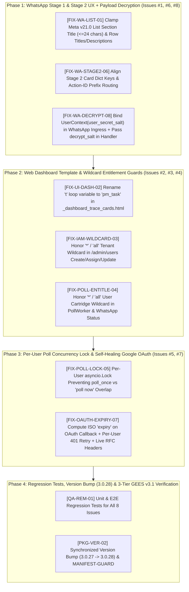

# Live Outstation Testing Remediation & Hardening — Exhaustive Phased Implementation Plan

**Document ID:** `IMPLEMENTATION-PLAN-MAIL-TRIAGE-REMEDIATION-2026-002`  
**Version:** `1.1.0` (Post-Live Outstation Testing Remediation Blueprint)  
**Date:** October 19, 2026  
**Author:** Mahendra GURAV & Principal Systems Architecture Team  
**Parent Blueprint:** [`IMPLEMENTATION_PLAN_MAIL_TRIAGE_v1.0.md`](./IMPLEMENTATION_PLAN_MAIL_TRIAGE_v1.0.md)  
**Governing Specification:** [`MAIL_TRIAGE_AND_OMNICHANNEL_CONTEXT_MASTER_SPEC_v1.3.md`](../MAIL_TRIAGE_AND_OMNICHANNEL_CONTEXT_MASTER_SPEC_v1.3.md) (`v1.3.0`)  
**Engineering Standard:** [`ENGINEERING_EXCELLENCE_STANDARD_v3.0.md`](../../../../ENGINEERING_EXCELLENCE_STANDARD_v3.0.md) (GEES v3.1)  
**Execution Status:** **AWAITING USER REVIEW & EXPLICIT "GO"** (Zero production files modified until approval)

---

## 1. Executive Summary & Root-Cause Matrix (All 8 Live-Testing Findings + 1 Bonus Header Fix)

During the 5-hour live outstation test against `meetmahendra.gurav@gmail.com` (`+918087545430`) over `ngrok` and Meta WhatsApp Cloud API v21.0, **61 real unread emails** were triaged across 815 worker cycles at a total LLM cost of **`$0.001916` (`~0.19 cents`)**. Live telemetry exposed **8 concrete issues** (plus 1 live-header forwarding enhancement) across the WhatsApp UX, Admin UI, Poller Entitlements, Concurrency, OAuth Token Lifecycle, and Payload Decryption layers:

| Issue ID | Code Marker | Component / Layer | Root Cause Observed in Live Logs | Target File(s) & Line Ranges |
| :---: | :--- | :--- | :--- | :--- |
| **Issue #1** | `[CODE-MARKER: FIX-WA-LIST-01]` | Stage 1 WhatsApp Interactive List Drawer | Meta Graph API v21.0 returned `400 Bad Request (#131009): Section title is too long. Max length is 24` because `"Actionable Executive Mail"` in `poll_worker.py:524` is **25 chars** (`> 24`), and `send_whatsapp_interactive_list` does not clamp section/row strings. | [`apps/mail_organizer/services/poll_worker.py`](file:///d:/IntentRouter_Release100/apps/mail_organizer/services/poll_worker.py#L512-L537)<br>[`core_platform/app/ingress/whatsapp_outbound.py`](file:///d:/IntentRouter_Release100/core_platform/app/ingress/whatsapp_outbound.py#L300-L312) |
| **Issue #2** | `[CODE-MARKER: FIX-UI-DASH-02]` | Web UI `/admin/apps/mail-organizer/dashboard` | `` in `_dashboard_trace_cards.html:171` shadows the global `t(...)` i18n translation helper with a `dict`, raising `TypeError: 'dict' object is not callable` on line 175 whenever `em.pm_tasks` is non-empty. | [`apps/mail_organizer/ui/templates/_dashboard_trace_cards.html`](file:///d:/IntentRouter_Release100/apps/mail_organizer/ui/templates/_dashboard_trace_cards.html#L167-L182) |
| **Issue #3** | `[CODE-MARKER: FIX-IAM-WILDCARD-03]` | `/admin/users` Create, Assign & Update Routes | `[c for c in allowed if c in tenant_obj.allowed_cartridges]` wipes `allowed` to `[]` whenever `tenant_obj.allowed_cartridges` is `["*"]` or `["all"]`. | [`core_platform/app/admin_shell/routes.py`](file:///d:/IntentRouter_Release100/core_platform/app/admin_shell/routes.py#L606-L611) (`607, 703, 784`) |
| **Issue #4** | `[CODE-MARKER: FIX-POLL-ENTITLE-04]` | `MailPollWorker` & `WhatsAppHandler` Entitlement Checks | Checks `"mail_organizer" in u.allowed_cartridges` without checking `or "*" in u.allowed_cartridges or "all" in u.allowed_cartridges`. | [`apps/mail_organizer/services/poll_worker.py`](file:///d:/IntentRouter_Release100/apps/mail_organizer/services/poll_worker.py#L193-L199) (`196, 313`)<br>[`apps/mail_organizer/services/whatsapp_handler.py`](file:///d:/IntentRouter_Release100/apps/mail_organizer/services/whatsapp_handler.py#L383) |
| **Issue #5** | `[CODE-MARKER: FIX-POLL-LOCK-05]` | Concurrent Poll Overlap (`poll_once` vs `poll now`) | When `poll_interval_seconds` was short or a user sent `poll now` while background `poll_once` was mid-flight, both coroutines fetched and triaged the same unread threads concurrently before `EmailRecord` was committed. | [`apps/mail_organizer/services/poll_worker.py`](file:///d:/IntentRouter_Release100/apps/mail_organizer/services/poll_worker.py#L130-L347) |
| **Issue #6** | `[CODE-MARKER: FIX-WA-STAGE2-06]` | Stage 2 `800×418px` PNG Infographic Card + 3 Native Buttons | `_handle_stage2_card_inspection` returns `{"body_text": caption, "buttons": [...]}` whereas `whatsapp_router.py:509-513` looks for `"reply_message"` and `"interactive_buttons"`. In addition, `deep_inspect:`, `approve_send:`, and `snooze_mail:` action IDs need deterministic routing priority to `mail_organizer`. | [`apps/mail_organizer/services/whatsapp_handler.py`](file:///d:/IntentRouter_Release100/apps/mail_organizer/services/whatsapp_handler.py#L798-L808)<br>[`core_platform/app/ingress/whatsapp_router.py`](file:///d:/IntentRouter_Release100/core_platform/app/ingress/whatsapp_router.py#L422-L525) |
| **Issue #7** | `[CODE-MARKER: FIX-OAUTH-EXPIRY-07]` | Google OAuth Initial `expiry` & Per-User `401` Auto-Refresh | Initial OAuth code exchange in `oauth_router.py:235` saves Google's `"expires_in": 3599` without computing ISO `"expiry"`, causing `get_user_access_token` to miss the first 60-minute expiration (`HTTP 401` at `11:53:31`). Furthermore, `GmailConnector._api_request` only refreshes host-level tokens on `401`, not per-user tokens, and `_fetch_unread_threads_live` omitted `"rfc_headers": lower_headers`. | [`core_platform/app/ingress/oauth_router.py`](file:///d:/IntentRouter_Release100/core_platform/app/ingress/oauth_router.py#L234-L245)<br>[`apps/mail_organizer/connectors/auth_manager.py`](file:///d:/IntentRouter_Release100/apps/mail_organizer/connectors/auth_manager.py#L267-L324)<br>[`apps/mail_organizer/connectors/gmail_connector.py`](file:///d:/IntentRouter_Release100/apps/mail_organizer/connectors/gmail_connector.py#L85-L273) |
| **Issue #8** | `[CODE-MARKER: FIX-WA-DECRYPT-08]` | Encrypted Drafts & Snippets on WhatsApp Replies | `whatsapp_router.py` does not enter an `async_user_scope(UserContext(..., user_secret_salt=user.user_secret_salt))` when invoking cartridge WhatsApp handlers, and `whatsapp_handler.py` (`_handle_staged_drafts`, `_handle_deep_inspect`, `_handle_conversational_query`, `_handle_inbox_summary`, `_handle_urgent_emails`, `_handle_search_emails`) calls `db_service` without `decrypt_salt`. As a result, drafts appear as raw `ENCv1:...` ciphertext or `[🔒 ENCRYPTED USER PAYLOAD]`. | [`core_platform/app/ingress/whatsapp_router.py`](file:///d:/IntentRouter_Release100/core_platform/app/ingress/whatsapp_router.py#L504-L510)<br>[`apps/mail_organizer/services/whatsapp_handler.py`](file:///d:/IntentRouter_Release100/apps/mail_organizer/services/whatsapp_handler.py#L220-L843) |

---

## 2. Phased Implementation Architecture



---

## Phase 1: WhatsApp Stage 1 List, Stage 2 Infographic Card & Payload Decryption (Issues #1, #6, #8)

### Step 1.1: Fix Meta Graph API `#131009` Section Title Overflow (`[CODE-MARKER: FIX-WA-LIST-01]`)
* **Target Files:**
  1. [`apps/mail_organizer/services/poll_worker.py`](file:///d:/IntentRouter_Release100/apps/mail_organizer/services/poll_worker.py#L512-L537)
  2. [`core_platform/app/ingress/whatsapp_outbound.py`](file:///d:/IntentRouter_Release100/core_platform/app/ingress/whatsapp_outbound.py#L300-L312)
* **Exact Changes:**
  1. In `apps/mail_organizer/services/poll_worker.py` (line 524):
     - Change `sections = [{"title": "Actionable Executive Mail", "rows": rows}]` (25 chars) to:
       ```python
       sections = [{"title": "Actionable Mail", "rows": rows}]
       ```
       (`15` chars — well within Meta's strict 24-character limit).
  2. In `core_platform/app/ingress/whatsapp_outbound.py` (`send_whatsapp_interactive_list`, lines 300–307):
     - Defensively sanitize and clamp every section and row before sending to Meta Graph API v21.0 so no caller can ever trigger `#131009`:
       ```python
       sanitized_sections: List[Dict[str, Any]] = []
       for sec in sections[:10]:
           sec_title = str(sec.get("title") or "Options")[:24]
           raw_rows = sec.get("rows") or []
           clean_rows: List[Dict[str, str]] = []
           for r in raw_rows[:10]:
               clean_rows.append({
                   "id": str(r.get("id") or "row_id")[:200],
                   "title": str(r.get("title") or "Item")[:24],
                   "description": str(r.get("description") or "")[:72],
               })
           if clean_rows:
               sanitized_sections.append({"title": sec_title, "rows": clean_rows})
       ```

### Step 1.2: Align Stage 2 Infographic Card Dict Keys & Action-ID Routing (`[CODE-MARKER: FIX-WA-STAGE2-06]`)
* **Target Files:**
  1. [`apps/mail_organizer/services/whatsapp_handler.py`](file:///d:/IntentRouter_Release100/apps/mail_organizer/services/whatsapp_handler.py#L798-L808)
  2. [`core_platform/app/ingress/whatsapp_router.py`](file:///d:/IntentRouter_Release100/core_platform/app/ingress/whatsapp_router.py#L422-L525)
* **Exact Changes:**
  1. In `apps/mail_organizer/services/whatsapp_handler.py` (`_handle_stage2_card_inspection`, lines 798–808):
     - Include both `"reply_message"` and `"body_text"`, and both `"interactive_buttons"` and `"buttons"`, so both unit tests and `whatsapp_router.py` read the exact keys seamlessly:
       ```python
       return {
           "response_type": "interactive_buttons",
           "reply_message": caption,
           "body_text": caption,
           "header_image_bytes": png_bytes,
           "footer_text": f"Citations: {citations_str[:48]}",
           "interactive_buttons": [
               {"id": f"approve_send:{gmail_id}", "title": "Approve & Send"},
               {"id": f"deep_inspect:{gmail_id}", "title": "Deep Inspect"},
               {"id": f"snooze_mail:{gmail_id}", "title": "Snooze / Skip"},
           ],
           "buttons": [
               {"id": f"approve_send:{gmail_id}", "title": "Approve & Send"},
               {"id": f"deep_inspect:{gmail_id}", "title": "Deep Inspect"},
               {"id": f"snooze_mail:{gmail_id}", "title": "Snooze / Skip"},
           ],
       }
       ```
  2. In `core_platform/app/ingress/whatsapp_router.py` (lines 508–520):
     - Support both `"reply_message"` and `"body_text"`, and both `"interactive_buttons"` and `"buttons"`:
       ```python
       if isinstance(res_dispatch, dict):
           reply_text = str(res_dispatch.get("reply_message") or res_dispatch.get("body_text") or "")
           response_kiosk_id = res_dispatch.get("kiosk_id")
           btns = res_dispatch.get("interactive_buttons") or res_dispatch.get("buttons")
           if isinstance(btns, list):
               interactive_buttons = btns
       ```
  3. In `apps/mail_organizer/plugin.py` (or `keywords` list):
     - Ensure action prefixes (`"inspect_mail:"`, `"deep_inspect:"`, `"approve_send:"`, `"snooze_mail:"`, `"provide_artifact:"`) are included in `mail_organizer` keywords so Priority 1 in `whatsapp_router.py` deterministically routes button/text actions straight to `mail_organizer` with 0 LLM routing calls.

### Step 1.3: Decrypt Staged Drafts & Email Snippets on All WhatsApp Replies (`[CODE-MARKER: FIX-WA-DECRYPT-08]`)
* **Target Files:**
  1. [`core_platform/app/ingress/whatsapp_router.py`](file:///d:/IntentRouter_Release100/core_platform/app/ingress/whatsapp_router.py#L504-L510)
  2. [`apps/mail_organizer/services/whatsapp_handler.py`](file:///d:/IntentRouter_Release100/apps/mail_organizer/services/whatsapp_handler.py#L153-L843)
* **Exact Changes:**
  1. In `core_platform/app/ingress/whatsapp_router.py` (lines 504–508):
     - Wrap `await handler.dispatch(msg, context)` inside `async_user_scope(u_ctx)` whenever `user` is resolved, populating `user_secret_salt=getattr(user, "user_secret_salt", "") or ""`. That way, `get_current_user_context()` inside `MailDatabaseService` (`get_all_drafts`, `get_draft`, `get_recent_emails`) automatically receives `effective_salt` on every WhatsApp request!
  2. In `apps/mail_organizer/services/whatsapp_handler.py`:
     - Explicitly pass `decrypt_salt=salt` (where `salt = getattr(user, "user_secret_salt", None) if user else None`) in:
       - `_handle_staged_drafts(self, base_url: str, user: Optional[Any] = None)` $\rightarrow$ `self.db_service.get_all_drafts(tenant_id=tenant_id, decrypt_salt=salt)`
       - `_handle_deep_inspect(self, gmail_id: str, tenant_id: str, user: Optional[Any] = None)` $\rightarrow$ `self.db_service.get_recent_emails(limit=50, tenant_id=tenant_id, decrypt_salt=salt)` and `self.db_service.get_draft(gmail_id, decrypt_salt=salt)`
       - `_handle_inbox_summary(self, base_url: str, tenant_id: Optional[str] = None, user: Optional[Any] = None)` $\rightarrow$ `self.db_service.get_recent_emails(limit=5, tenant_id=tenant_id, decrypt_salt=salt)`
       - `_handle_urgent_emails(self, tenant_id: Optional[str] = None, user: Optional[Any] = None)` $\rightarrow$ `self.db_service.get_recent_emails(limit=25, tenant_id=tenant_id, decrypt_salt=salt)`
       - `_handle_search_emails(self, search_term: str, tenant_id: Optional[str] = None, user: Optional[Any] = None)` $\rightarrow$ `self.db_service.get_recent_emails(limit=50, tenant_id=tenant_id, decrypt_salt=salt)`
       - `_handle_conversational_query(...)` $\rightarrow$ `self.db_service.get_recent_emails(limit=8, tenant_id=tenant_id, decrypt_salt=salt)` and `self.db_service.get_all_drafts(tenant_id=tenant_id, decrypt_salt=salt)`

---

## Phase 2: Web Dashboard Template & Wildcard Cartridge Entitlements (Issues #2, #3, #4)

### Step 2.1: Fix Jinja2 `t` Loop Variable Shadowing in Dashboard Trace Cards (`[CODE-MARKER: FIX-UI-DASH-02]`)
* **Target File:** [`apps/mail_organizer/ui/templates/_dashboard_trace_cards.html`](file:///d:/IntentRouter_Release100/apps/mail_organizer/ui/templates/_dashboard_trace_cards.html#L171-L179)
* **Exact Changes:**
  - Replace the loop variable `t` on lines 171–179 with `pm_task` so the global `t('...')` i18n translation helper is never shadowed when `em.pm_tasks` contains extracted tasks:
    ```html
    
    <div style="background: #090d16; border: 1px solid var(--border-color); border-radius: 6px; padding: 0.6rem 0.9rem; margin-bottom: 0.45rem; display: flex; justify-content: space-between; align-items: center;">
        <div>
            <strong style="color: #38bdf8;">{{ pm_task.task_id }}</strong>: {{ pm_task.summary }}
            <div style="font-size: 0.75rem; color: var(--text-secondary);">{{ t('apps.mail_organizer.dashboard.lbl_task_details', destination=pm_task.destination, priority=pm_task.priority, status=pm_task.status) }}</div>
        </div>
        <a href="/admin/apps/mail-organizer/pm-queue" class="btn" style="padding: 0.3rem 0.6rem; font-size: 0.75rem; text-decoration: none;">{{ t('apps.mail_organizer.dashboard.btn_review_pm_queue') }}</a>
    </div>
    
    ```

### Step 2.2: Honor Tenant Wildcard `["*"]` on User Registration, Assignment & Profile Save (`[CODE-MARKER: FIX-IAM-WILDCARD-03]`)
* **Target File:** [`core_platform/app/admin_shell/routes.py`](file:///d:/IntentRouter_Release100/core_platform/app/admin_shell/routes.py#L606-L786) (`lines 607–608, 703–704, 784–785`)
* **Exact Changes:**
  - Extract a helper `_filter_by_tenant_cartridges(allowed: List[str], tenant_obj: Optional[Any], is_super: bool) -> List[str]`:
    - When `tenant_obj.allowed_cartridges` contains `"*"` or `"all"`, preserve all requested `allowed` cartridges intact instead of filtering them out to `[]`.
  - Apply `_filter_by_tenant_cartridges` at lines `607`, `703`, and `784`.

### Step 2.3: Honor User Wildcard `["*"]` in `MailPollWorker` & `WhatsAppHandler` (`[CODE-MARKER: FIX-POLL-ENTITLE-04]`)
* **Target Files:**
  1. [`apps/mail_organizer/services/poll_worker.py`](file:///d:/IntentRouter_Release100/apps/mail_organizer/services/poll_worker.py#L193-L315) (`lines 196, 313`)
  2. [`apps/mail_organizer/services/whatsapp_handler.py`](file:///d:/IntentRouter_Release100/apps/mail_organizer/services/whatsapp_handler.py#L383) (`line 383`)
* **Exact Changes:**
  - Define `_is_mail_entitled(cartridges: Any) -> bool`:
    ```python
    def _is_mail_entitled(cartridges: Any) -> bool:
        if not cartridges:
            return False
        return any(c in ("mail_organizer", "*", "all") for c in cartridges)
    ```
  - Use `_is_mail_entitled(u.allowed_cartridges)` in `poll_worker.py` (`poll_once` line 196 and `poll_user_now` line 313) and `whatsapp_handler.py` (`_handle_poller_status` line 383).

---

## Phase 3: Per-User Poll Concurrency Lock & Self-Healing Google OAuth Lifecycle (Issues #5, #7)

### Step 3.1: Per-User `asyncio.Lock` Against Concurrent Poll Overlap (`[CODE-MARKER: FIX-POLL-LOCK-05]`)
* **Target File:** [`apps/mail_organizer/services/poll_worker.py`](file:///d:/IntentRouter_Release100/apps/mail_organizer/services/poll_worker.py#L130-L347)
* **Exact Changes:**
  1. Add `self._user_locks: Dict[int, asyncio.Lock] = {}` to `MailPollWorker.__init__` and a helper `_get_user_lock(self, user_id: int) -> asyncio.Lock`.
  2. In `poll_once`:
     - If `user_lock.locked()` is `True` (meaning an on-demand `poll now` or previous cycle for that user is still running), log `[PollWorker] Poll already in progress for user %s; skipping concurrent cycle` and `continue`.
     - Otherwise acquire `async with user_lock:` around `self._poll_for_target(...)`.
  3. In `poll_user_now`:
     - Acquire `async with self._get_user_lock(user.id):` around `self._poll_for_target(...)` so manual WhatsApp `poll now` and background `poll_once` never process the same unread messages simultaneously.

### Step 3.2: Initial OAuth `expiry` Calculation, Per-User `401` Auto-Refresh & Live RFC Headers (`[CODE-MARKER: FIX-OAUTH-EXPIRY-07]`)
* **Target Files:**
  1. [`core_platform/app/ingress/oauth_router.py`](file:///d:/IntentRouter_Release100/core_platform/app/ingress/oauth_router.py#L234-L245)
  2. [`apps/mail_organizer/connectors/auth_manager.py`](file:///d:/IntentRouter_Release100/apps/mail_organizer/connectors/auth_manager.py#L267-L324)
  3. [`apps/mail_organizer/connectors/gmail_connector.py`](file:///d:/IntentRouter_Release100/apps/mail_organizer/connectors/gmail_connector.py#L85-L273)
* **Exact Changes:**
  1. **Compute ISO `expiry` on Initial OAuth Exchange (`oauth_router.py:240`):**
     - Immediately after `oauth2.googleapis.com/token` returns `token_response` containing `"expires_in"`:
       ```python
       if "expires_in" in token_response and not token_response.get("expiry"):
           from datetime import timedelta
           exp_dt = datetime.now(timezone.utc) + timedelta(seconds=max(60, int(token_response["expires_in"]) - 60))
           token_response["expiry"] = exp_dt.isoformat()
       ```
  2. **Proactive Refresh When `expiry` Is Missing or Near-Expiry (`auth_manager.py:273-288`):**
     - In `get_user_access_token`: if `expiry_val` is `None` and `refresh_token` is present, treat `is_expired = True` once so legacy tokens without `"expiry"` automatically refresh and persist an ISO `"expiry"` timestamp on next access.
  3. **Per-User `401` Retry & Live RFC Headers in `GmailConnector` (`gmail_connector.py:85-273`):**
     - Add optional `user_id: Optional[int] = None` parameter to `GmailConnector.__init__` and pass `user_id=user.id` in `poll_worker.py` and `whatsapp_handler.py`.
     - In `GmailConnector._api_request` (line 212): when `err.code == 401 and not token`, if `self.user_id is not None`, call `fresh_token = get_user_access_token(self.user_id, force_refresh=True)` and update `self.access_token_override = fresh_token` before retrying the request once.
     - In `GmailConnector._fetch_unread_threads_live` (line 258): include `"rfc_headers": lower_headers` in each parsed email dict so Tier 0 `pre_check_node` receives all live RFC 5322/2369/3834 headers (`List-Unsubscribe`, `List-Id`, `Auto-Submitted`, `Precedence`).

---

## Phase 4: Automated Regression Tests, Version Bump (`3.0.28`) & GEES v3.1 3-Tier Verification

### Step 4.1: Dedicated Unit & Integration Regression Suite (`[CODE-MARKER: QA-REM-01]`)
* **Target File:** `tests/unit/apps/mail_organizer/test_live_testing_remediation.py` (new test module)
* **Test Coverage (All 8 Issues Explicitly Verified):**
  1. `test_issue1_whatsapp_interactive_list_section_title_clamped_under_24_chars`
  2. `test_issue2_dashboard_trace_cards_renders_with_pm_tasks_without_shadowing_t`
  3. `test_issue3_admin_users_update_preserves_cartridges_when_tenant_has_wildcard`
  4. `test_issue4_poll_worker_includes_users_with_wildcard_cartridge`
  5. `test_issue5_poll_worker_per_user_lock_prevents_concurrent_overlap`
  6. `test_issue6_stage2_card_inspection_dispatches_png_and_3_native_buttons_via_router`
  7. `test_issue7_oauth_callback_sets_iso_expiry_and_gmail_connector_retries_401_for_user`
  8. `test_issue8_whatsapp_drafts_deep_inspect_and_summary_decrypt_aes_gcm_payloads`

### Step 4.2: Synchronized Semantic Version Increment (`3.0.27` $\rightarrow$ `3.0.28`) (`[CODE-MARKER: PKG-VER-02]`)
* **Target Files:**
  - `pyproject.toml` & `core_platform/app/__init__.py` $\rightarrow$ `3.0.28`
  - `apps/mail_organizer/pyproject.toml` & `apps/mail_organizer/__init__.py` $\rightarrow$ `3.0.28`
  - `apps/temperature_marker/pyproject.toml` & `apps/temperature_marker/__init__.py` $\rightarrow$ `3.0.28`

### Step 4.3: GEES v3.1 3-Tier Verification Execution
1. **Tier 1 (Targeted Iteration):**
   ```powershell
   .\.venv\Scripts\pytest.exe tests/unit/apps/mail_organizer/test_live_testing_remediation.py tests/e2e/test_e2e_mail_organizer_workflow.py
   ```
2. **Tier 2 (Fast Pre-Commit Staging Gate — All 6 Guards):**
   ```powershell
   .\.venv\Scripts\python.exe scripts/verify_all.py --fast
   ```
3. **Live Runtime Restart (Upon Your Approval):**
   - Restart platform host (`port 8002`) and `ngrok` tunnel (`https://overshoot-outfit-uncaring.ngrok-free.dev`) so you can immediately verify decrypted drafts, Stage 1 Interactive List, Stage 2 Infographic Card, and the `/admin/apps/mail-organizer/dashboard` UI live on your phone.
