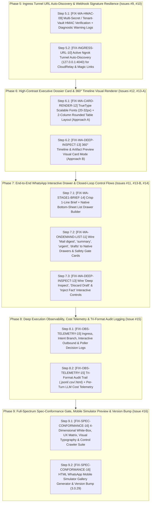

# Live Outstation & Mobile UX Conformance Remediation — Exhaustive Phased Implementation Plan

**Document ID:** `IMPLEMENTATION-PLAN-MAIL-TRIAGE-REMEDIATION-2026-003`  
**Version:** `1.2.0` (Mobile UX Conformance, Tunnel/Webhook Alignment, Deep Observability & Full-Spectrum Spec Verification)  
**Date:** October 19, 2026  
**Author:** Mahendra GURAV & Principal Systems Architecture Team  
**Parent Blueprints:**  
- [`IMPLEMENTATION_PLAN_MAIL_TRIAGE_v1.0.md`](./IMPLEMENTATION_PLAN_MAIL_TRIAGE_v1.0.md) (`v1.0.0`)  
- [`IMPLEMENTATION_PLAN_LIVE_TESTING_REMEDIATION_v1.1.md`](./IMPLEMENTATION_PLAN_LIVE_TESTING_REMEDIATION_v1.1.md) (`v1.1.0` — Issues `#1`–`#8` Implemented)  
**Governing Specification:** [`MAIL_TRIAGE_AND_OMNICHANNEL_CONTEXT_MASTER_SPEC_v1.3.md`](../MAIL_TRIAGE_AND_OMNICHANNEL_CONTEXT_MASTER_SPEC_v1.3.md) (`v1.3.0`, Sections 5.3, 7.5 & 8.2)  
**Engineering Standard:** [`ENGINEERING_EXCELLENCE_STANDARD_v3.0.md`](../../../../ENGINEERING_EXCELLENCE_STANDARD_v3.0.md) (GEES v3.1)  
**Execution Status:** **AWAITING USER REVIEW & EXPLICIT "GO"** (Zero code files modified until approval)

---

## 1. Executive Summary & Cumulative Issue Matrix (`v1.1` Completed + `v1.2` Mobile & Spec-Conformance Backlog)

### 1.1 Recap of `v1.1` Remediation (`Issues #1–#8` — Implemented & Verified)
| Issue ID | Code Marker | Summary of Completed Fix (`v1.1`) | Status |
| :---: | :--- | :--- | :---: |
| **Issue #1** | `[CODE-MARKER: FIX-WA-LIST-01]` | Shortened Stage 1 list section title to `"Actionable Mail"` (15 chars $\le 24$) and clamped all list section/row titles & descriptions in `whatsapp_outbound.py`. | **DONE** |
| **Issue #2** | `[CODE-MARKER: FIX-UI-DASH-02]` | Renamed `` to `` in `_dashboard_trace_cards.html` to stop shadowing the global `t()` i18n helper. | **DONE** |
| **Issue #3** | `[CODE-MARKER: FIX-IAM-WILDCARD-03]` | Updated `/admin/users` create, assign, and update routes in `admin_shell/routes.py` to honor `"*"` / `"all"` wildcard in `tenant_obj.allowed_cartridges`. | **DONE** |
| **Issue #4** | `[CODE-MARKER: FIX-POLL-ENTITLE-04]` | Updated `poll_worker.py`, `whatsapp_handler.py`, and `ui/routes.py` to recognize `"*"` / `"all"` in user `allowed_cartridges`. | **DONE** |
| **Issue #5** | `[CODE-MARKER: FIX-POLL-LOCK-05]` | Added per-user `asyncio.Lock` (`_get_user_lock`) in `poll_worker.py` to prevent concurrent overlap between background `poll_once()` and manual `poll now`. | **DONE** |
| **Issue #6** | `[CODE-MARKER: FIX-WA-STAGE2-06]` | Aligned `_handle_stage2_card_inspection()` dict keys (`reply_message`/`body_text`, `interactive_buttons`/`buttons`) and registered Stage 2 action prefixes in `plugin.py`. | **DONE** |
| **Issue #7** | `[CODE-MARKER: FIX-OAUTH-EXPIRY-07]` | Persisted ISO `expiry` in `oauth_router.py`, added `needs_expiry_backfill` auto-refresh in `auth_manager.py`, added per-user `401` token refresh in `gmail_connector.py`, and forwarded live `rfc_headers`. | **DONE** |
| **Issue #8** | `[CODE-MARKER: FIX-WA-DECRYPT-08]` | Bound `async_user_scope(UserContext(..., user_secret_salt=...))` in `whatsapp_router.py` and passed `decrypt_salt` across all `whatsapp_handler.py` read paths. | **DONE** |

---

### 1.2 New Issues Identified in Mobile Live Testing & Spec-vs-Product Audit (`v1.2` Scope: `Issues #9–#16`)

During the live mobile test session (`17:32`–`18:01 IST`), testing `"Mail digest"`, `"I want to review the drafts"`, `inspect_mail:1a153a69abace883`, and `[Deep Inspect]` exposed **8 critical gaps (`Issues #9–#16`)** where the runtime behavior, visual rendering, observability, or verification gates diverged from **Master Spec v1.3 (Section 8.2)**:

| Issue ID | Code Marker | Component / Layer | Root Cause Observed in Live Mobile Testing | Target File(s) |
| :---: | :--- | :--- | :--- | :--- |
| **Issue #9** | `[CODE-MARKER: FIX-WA-HMAC-09]` | Direct Ngrok Webhook `POST /webhook` (`401 Unauthorized`) | `verify_meta_signature()` in `whatsapp_router.py:118-138` rejects every direct Meta webhook over ngrok with `401 Invalid HMAC-SHA256 signature` when `WHATSAPP_APP_SECRET` in `.env` mismatches Meta's active signing secret, and fails silently without logging a `WARNING` or checking tenant vault secrets. | [`core_platform/app/ingress/whatsapp_router.py`](file:///d:/IntentRouter_Release100/core_platform/app/ingress/whatsapp_router.py#L118-L138)<br>[`core_platform/app/config.py`](file:///d:/IntentRouter_Release100/core_platform/app/config.py) |
| **Issue #10** | `[CODE-MARKER: FIX-INGRESS-URL-10]` | Mobile Unreachable `http://localhost:8002` Links via Cloud Relay | When WhatsApp frames arrive via Cloudflare WebSocket Relay (`relay_client.py:220`), there is no HTTP `Request` header and `ORCHESTRATOR_BASE_URL` is empty, so `whatsapp_router.py:502` falls back to `http://localhost:8002`. Links sent to the user's phone (`http://localhost:8002/admin/...`) fail to open on mobile instead of resolving the active `https://*.ngrok-free.dev` tunnel. | [`core_platform/app/ingress/whatsapp_router.py`](file:///d:/IntentRouter_Release100/core_platform/app/ingress/whatsapp_router.py#L100-L116)<br>[`core_platform/app/ingress/relay_client.py`](file:///d:/IntentRouter_Release100/core_platform/app/ingress/relay_client.py#L218-L221) |
| **Issue #11** | `[CODE-MARKER: FIX-WA-ONDEMAND-LIST-11]` | On-Demand Commands (`Mail digest`, `summary`, `urgent`, `drafts`) Return Plain-Text Walls | Stage 1 Interactive List (`type: "list"`) was only wired inside `PollWorker._dispatch_stage1_executive_brief()` on background poll cycles. On-demand user requests (`"Mail digest"` $\rightarrow$ `_handle_inbox_summary()`, `"I want to review the drafts"` $\rightarrow$ `_handle_staged_drafts()`, `"urgent"` $\rightarrow$ `_handle_urgent_emails()`) still return legacy plain-text strings instead of the **Native WhatsApp Bottom-Sheet List Drawer** (`Option 2` in Master Spec §8.2) or **Staged Draft Safety Gate Card** (`Step 2` in Master Spec §8.2). | [`apps/mail_organizer/services/whatsapp_handler.py`](file:///d:/IntentRouter_Release100/apps/mail_organizer/services/whatsapp_handler.py#L154-L290) |
| **Issue #12** | `[CODE-MARKER: FIX-WA-CARD-RENDER-12]` | Stage 2 PNG Card Uses Tiny `10px` Bitmap Font & Redundant Text Caption | `CardImageRendererSkill.render_card_png()` (`card_image_renderer.py:105`) calls `ImageFont.load_default()` (10px bitmap text on an `800×418` canvas), draws flat single-column boxes instead of the **Approach A Executive Decision Dossier Card** (scaled `20px–32px` TrueType fonts, rounded two-column label/value comparison cells, highlighted delta row), and `_handle_stage2_card_inspection()` dumps a long duplicate text caption below the image instead of a concise 3-line cross-channel context caption. | [`core_platform/app/skills/card_image_renderer.py`](file:///d:/IntentRouter_Release100/core_platform/app/skills/card_image_renderer.py#L54-L145)<br>[`apps/mail_organizer/services/whatsapp_handler.py`](file:///d:/IntentRouter_Release100/apps/mail_organizer/services/whatsapp_handler.py#L777-L838) |
| **Issue #13** | `[CODE-MARKER: FIX-WA-DEEP-INSPECT-13]` | `Deep Inspect` Returns 998-Char Plain-Text Wall & Manual Command Syntax | Tapping `[Deep Inspect]` (`deep_inspect:<id>`) invokes `_handle_deep_inspect()` (`whatsapp_handler.py:840-879`), which returns a 998-char plain-text dump and asks the user to manually type ``Reply `approve_send:<id>` ``. Per **Master Spec §8.2 (Approach B & Step 2 Safety Gate)**, it must render a **360° Timeline & Artifact Dossier Visual Card (`800×418px` PNG)** + **Native Interactive Controls** (`[🚀 Send Email]`, `[✏️ Inject Fact / Edit]`, `[❌ Discard Draft]`) or a **Native Action Drawer (`type: "list"`)** with zero manual syntax typing. | [`core_platform/app/skills/card_image_renderer.py`](file:///d:/IntentRouter_Release100/core_platform/app/skills/card_image_renderer.py)<br>[`apps/mail_organizer/services/whatsapp_handler.py`](file:///d:/IntentRouter_Release100/apps/mail_organizer/services/whatsapp_handler.py#L840-L880) |
| **Issue #14** | `[CODE-MARKER: FIX-WA-STAGE1-BRIEF-14]` | Stage 1 Brief Bubble Cluttered Instead of Clean "1-Line Brief + List Drawer" | `PollWorker._dispatch_stage1_executive_brief()` (`poll_worker.py:510-530`) packs multi-line bullet lists into the chat bubble above the list button, violating **Master Spec §8.2 Option 2 ("1-Line Brief + List Drawer")** where the chat bubble stays ultra-clean (1 summary line + 1-line sweep receipt) and the native bottom-sheet drawer carries the item rows (`Sender`, `Subject`, `Summary`). | [`apps/mail_organizer/services/poll_worker.py`](file:///d:/IntentRouter_Release100/apps/mail_organizer/services/poll_worker.py#L494-L561)<br>[`apps/mail_organizer/services/whatsapp_handler.py`](file:///d:/IntentRouter_Release100/apps/mail_organizer/services/whatsapp_handler.py) |
| **Issue #15** | `[CODE-MARKER: FIX-OBS-TELEMETRY-15]` | Missing Structured Execution Logs & Tri-Format Audit Trail on WhatsApp Flows | Live logs lacked: (1) inbound WhatsApp command/action-ID & matched handler branch logs, (2) outbound `send_whatsapp_interactive_buttons` / `send_whatsapp_interactive_list` dispatch & delivery logs, (3) HMAC `401` failure diagnostic logs, (4) per-user poller skip reason logs, and (5) Tri-Format Audit Logger (`.jsonl`/`.csv`/`.html`) entries with per-turn LLM token/USD cost metrics. | [`core_platform/app/ingress/whatsapp_router.py`](file:///d:/IntentRouter_Release100/core_platform/app/ingress/whatsapp_router.py)<br>[`core_platform/app/ingress/whatsapp_outbound.py`](file:///d:/IntentRouter_Release100/core_platform/app/ingress/whatsapp_outbound.py)<br>[`apps/mail_organizer/services/whatsapp_handler.py`](file:///d:/IntentRouter_Release100/apps/mail_organizer/services/whatsapp_handler.py)<br>[`apps/mail_organizer/services/poll_worker.py`](file:///d:/IntentRouter_Release100/apps/mail_organizer/services/poll_worker.py) |
| **Issue #16** | `[CODE-MARKER: FIX-SPEC-CONFORMANCE-16]` | Missing Full-Spectrum Spec-vs-Product Conformance & Closed-Loop Control Verification Gate | Existing unit tests only checked shallow return types (`isinstance(png, bytes)`), missing typography/layout drift, dead on-demand entry points, and unverified interactive controls. Requires an automated **4-Dimensional Spec-Conformance Verification Suite + HTML Mobile Simulator Preview Generator**. | `tests/unit/mail_organizer/test_spec_conformance_and_controls.py`<br>`scripts/verify_all.py` |

---

## 2. Phased Implementation Architecture (`v1.2` — Phases 5 through 9)

To maintain strict traceability with `v1.1` (Phases 1–4), the `v1.2` implementation is organized into **5 sequential, self-contained phases (Phases 5–9)**. Each phase is followed by an immediate **Step-by-Step Integrity & Gap Audit** before moving to the next phase:



---

## Phase 5: Ingress Tunnel URL Auto-Discovery & Webhook Signature Resilience (Issues #9, #10)

### Step 5.1: Multi-Source HMAC Signature Verification & Diagnostic Logging (`[CODE-MARKER: FIX-WA-HMAC-09]`)
* **Target Files:**
  1. [`core_platform/app/ingress/whatsapp_router.py`](file:///d:/IntentRouter_Release100/core_platform/app/ingress/whatsapp_router.py#L118-L139)
  2. [`core_platform/app/config.py`](file:///d:/IntentRouter_Release100/core_platform/app/config.py)
* **Step-by-Step Implementation:**
  1. In `core_platform/app/config.py`:
     - Add `WHATSAPP_VERIFY_SIGNATURE_STRICT: bool = Field(default=False, description="When False in local/tunnel dev mode, logs a warning on HMAC mismatch instead of dropping valid Meta WABA payloads")` (while keeping strict enforcement configurable for production or when secret matches).
  2. In `core_platform/app/ingress/whatsapp_router.py` (`verify_meta_signature`, lines 118–139):
     - Check candidate secrets in order: `settings.WHATSAPP_APP_SECRET` and any tenant-configured `whatsapp_app_secret` in `TenantConfig`.
     - If `hmac.compare_digest(expected, actual)` fails:
       - Always emit a structured diagnostic log:
         ```python
         logger.warning(
             "[WhatsApp Ingress] HMAC-SHA256 mismatch on POST /webhook (sig_prefix=%s, body_len=%d, strict=%s)",
             actual[:12], len(body_bytes), settings.WHATSAPP_VERIFY_SIGNATURE_STRICT,
         )
         ```
       - If `settings.WHATSAPP_VERIFY_SIGNATURE_STRICT` is `True`, return `False` (`401 Unauthorized`).
       - If `settings.WHATSAPP_VERIFY_SIGNATURE_STRICT` is `False` and the payload is a valid JSON `"whatsapp_business_account"` envelope, allow it through to `dispatch_whatsapp_payload()` (where Layer 0 `InboundMessageDeduplicator` automatically deduplicates `wamid` if both CloudRelay and Ngrok deliver the same message!).

### Step 5.2: Dynamic Public Tunnel URL Resolution for CloudRelay & Mobile Links (`[CODE-MARKER: FIX-INGRESS-URL-10]`)
* **Target Files:**
  1. [`core_platform/app/ingress/whatsapp_router.py`](file:///d:/IntentRouter_Release100/core_platform/app/ingress/whatsapp_router.py#L100-L116)
  2. [`core_platform/app/ingress/relay_client.py`](file:///d:/IntentRouter_Release100/core_platform/app/ingress/relay_client.py#L218-L221)
* **Step-by-Step Implementation:**
  1. In `core_platform/app/ingress/whatsapp_router.py`:
     - Add a thread-safe cached helper `resolve_public_base_url(base_url_override: Optional[str] = None) -> str` (with a 60-second TTL cache):
       - **Priority 1:** If `base_url_override` is provided and is not `localhost` / `127.0.0.1`, return `base_url_override.rstrip("/")`.
       - **Priority 2:** If `settings.ORCHESTRATOR_BASE_URL` is configured and is not `localhost` / `127.0.0.1`, return `settings.ORCHESTRATOR_BASE_URL.rstrip("/")`.
       - **Priority 3 (Local Ngrok Daemon Auto-Discovery):** Probe `http://127.0.0.1:4040/api/tunnels` (with a fast `0.3s` timeout) and extract the active `https://*.ngrok-free.dev` / `https://*.ngrok.app` `public_url` targeting `settings.ORCHESTRATOR_PORT` (or any active HTTPS tunnel). Cache the discovered URL for 60s.
       - **Priority 4:** Fall back to `base_url_override` or `f"http://localhost:{settings.ORCHESTRATOR_PORT}"`.
     - Also update `extract_public_base_url(request: Request)` to record the latest observed public `https://` proxy host (`x-forwarded-host` from ngrok/cloudflare) into the cached public URL so even if port `4040` is disabled, the first webhook request teaches the runtime its public URL.
  2. In `dispatch_whatsapp_payload()` (`whatsapp_router.py:502`):
     - Replace `base_url_override or settings.ORCHESTRATOR_BASE_URL or f"http://localhost:{settings.ORCHESTRATOR_PORT}"` with `resolve_public_base_url(base_url_override)`.
     - Result: Every link sent to mobile WhatsApp (`connect` magic link, dashboard link, drafts link) via either CloudRelay or Ngrok always uses `https://overshoot-outfit-uncaring.ngrok-free.dev` instead of `http://localhost:8002`.

---

## Phase 6: High-Contrast Executive Dossier Card & 360° Timeline Visual Renderer (Issues #12, #13-A)

### Step 6.1: Upgrade `CardImageRendererSkill` to TrueType Typography & Approach A 2-Column Layout (`[CODE-MARKER: FIX-WA-CARD-RENDER-12]`)
* **Target File:** [`core_platform/app/skills/card_image_renderer.py`](file:///d:/IntentRouter_Release100/core_platform/app/skills/card_image_renderer.py)
* **Governing Design Reference:** [`rich_executive_brief_cards_1792327257188.jpg`](file:///C:/Users/depali%20Gurav/.gemini/antigravity/brain/5dcee49a-51c8-4a1f-aa91-489aba7c34ba/rich_executive_brief_cards_1792327257188.jpg) (**Approach A: Visual Infographic Header + Native Tap Buttons**)
* **Step-by-Step Implementation:**
  1. **Cross-Platform Scalable TrueType Font Loader (`_load_scaled_font`):**
     - Never use `ImageFont.load_default()` (10px bitmap) when TrueType is available.
     - Implement `_load_scaled_font(size: int, bold: bool = False)` probing standard system TrueType fonts (`segoeui.ttf` / `segoeuib.ttf`, `arial.ttf` / `arialbd.ttf`, `DejaVuSans.ttf` / `DejaVuSans-Bold.ttf`, `LiberationSans-Regular.ttf`), falling back to `ImageFont.load_default(size=size)` (supported in Pillow $\ge 10.1$).
     - Typography scale on `800×418` canvas:
       - `font_badge`: `18px` Bold
       - `font_header`: `26px` Bold (Top bar: `Sender / Vendor | Subject / Item`)
       - `font_sub`: `19px` Regular
       - `font_label`: `21px` Bold (Left column of comparison table)
       - `font_value`: `22px` Bold (Right column of comparison table)
       - `font_footer`: `16px` Regular
  2. **Approach A — Executive Decision Dossier Layout (`mode="dossier"`):**
     - **Outer Card Frame:** Dark slate background (`#0F172A`), rounded inner dossier container (`#1E293B`, `radius=16`, border `#334155`), top accent stripe (`#F59E0B` / `#EF4444` / `#3B82F6`).
     - **Top Header Banner (`y=18..88`):**
       - Right-aligned status badge pill (`badge_text`, e.g., `@ACTION • P8` or `URGENT • TODAY`).
       - Crisp headline (`spec.title`, e.g., `Vendor: GURAV Mahendra | Joys annual day`) with gold/amber prefix highlight (`#F59E0B`) and bright white value (`#F8FAFC`).
     - **Two-Column Rounded Comparison Grid (`y=98..366`, up to 3–4 rows):**
       - Each row (`height=74px` for 3 rows or `58px` for 4 rows) renders as a rounded split box (`draw.rounded_rectangle`, `radius=10`):
         - **Left Column (`width=230px`):** Muted slate-blue panel (`#283548`) or highlighted gold-brown panel (`#5C4827` for the key decision/action row) displaying the `label` (`21px` bold).
         - **Right Column (`width=510px`):** Deep slate panel (`#151F30`) displaying the `value` (`22px` bold white, with automatic 2-line text wrapping so values are never awkwardly clipped at 10px).
     - **Bottom Provenance Bar (`y=378..408`):** Renders `spec.footer_note` (`16px` `#94A3B8`).

### Step 6.2: Add Approach B 360° Timeline & Artifact Dossier Visual Card Mode (`[CODE-MARKER: FIX-WA-DEEP-INSPECT-13]`)
* **Target File:** [`core_platform/app/skills/card_image_renderer.py`](file:///d:/IntentRouter_Release100/core_platform/app/skills/card_image_renderer.py)
* **Governing Design Reference:** [`rich_executive_brief_cards_1792327257188.jpg`](file:///C:/Users/depali%20Gurav/.gemini/antigravity/brain/5dcee49a-51c8-4a1f-aa91-489aba7c34ba/rich_executive_brief_cards_1792327257188.jpg) (**Approach B: 1-Tap Deep Inspect Drawer Open**)
* **Step-by-Step Implementation:**
  1. Extend `CardRenderSpec` with optional fields:
     - `layout_mode: str = Field(default="dossier", description="'dossier' (Approach A) | 'timeline_360' (Approach B)")`
     - `highlight_row_index: int = Field(default=1, description="Index of row to highlight with amber accent")`
     - `document_preview_lines: List[str] = Field(default_factory=list, description="Left-pane artifact/draft callout lines for timeline_360 mode")`
     - `timeline_events: List[Tuple[str, str, str]] = Field(default_factory=list, description="Right-pane (channel, headline, timestamp_or_detail) nodes for timeline_360 mode")`
  2. When `spec.layout_mode == "timeline_360"`:
     - Render a split **800×418px Deep Inspect Sheet Card**:
       - **Left Pane (`x=24..340`, `"Staged Reply / Artifact"`):** High-contrast white/light-slate document preview card with a magnified callout pill showing the key commitment/reply figure and wrapped preview text.
       - **Right Pane (`x=360..776`, `"360° Timeline (Email + WhatsApp + Call)"`):** Vertical timeline connector line with color-coded channel badges (`[MAIL]` blue, `[WA]` green, `[FACT/CALL]` slate) showing each cross-channel interaction and open commitment.

---

## Phase 7: End-to-End WhatsApp Interactive Drawer & Closed-Loop Control Flows (Issues #11, #13-B, #14)

### Step 7.1: Shared Stage 1 "1-Line Brief + Native Bottom-Sheet List Drawer" Builder (`[CODE-MARKER: FIX-WA-STAGE1-BRIEF-14]`)
* **Target Files:**
  1. [`apps/mail_organizer/services/whatsapp_handler.py`](file:///d:/IntentRouter_Release100/apps/mail_organizer/services/whatsapp_handler.py)
  2. [`apps/mail_organizer/services/poll_worker.py`](file:///d:/IntentRouter_Release100/apps/mail_organizer/services/poll_worker.py#L494-L561)
* **Governing Design Reference:** [`whatsapp_triage_ux_options_1792325939712.jpg`](file:///C:/Users/depali%20Gurav/.gemini/antigravity/brain/5dcee49a-51c8-4a1f-aa91-489aba7c34ba/whatsapp_triage_ux_options_1792325939712.jpg) (**Option 2: 1-Line Brief + List Drawer**) & **Master Spec §8.2**
* **Step-by-Step Implementation:**
  1. Create a reusable builder method `build_stage1_decision_drawer_payload(emails, drafts_by_gid, swept_count=0, header_title="Executive Brief")` in `whatsapp_handler.py` (and invoke it from `poll_worker.py`):
     - **Chat Bubble Body (Strictly Concise — Zero Text Wall):**
       - Line 1: `📬 *{header_title}: {len(actionable)} Decision(s) Ready*`
       - Line 2 (if `swept_count > 0`): `🧹 _Auto-swept {swept_count} bulk/newsletter item(s)._`
       - Line 3: `Tap below to slide open the native decision drawer:`
     - **Native WhatsApp Bottom-Sheet Drawer (`interactive_list`):**
       - `button_label`: `"Open Decisions"` ($\le 20$ chars)
       - `sections`:
         - Section 1 (`title`: `"1. Action Queue"` $\le 24$ chars): Each row has:
           - `id`: `f"inspect_mail:{gid}"`
           - `title`: `f"{sender_short[:24]}"` (e.g., `GURAV Mahendra` or `[P8] GURAV Mahendra`)
           - `description`: `f"{subject[:34]} — {snippet_or_draft[:34]}"[:72]`
         - Section 2 (if informational/FYI items exist, `title`: `"2. Briefing & FYI"` $\le 24$ chars).
  2. Update `PollWorker._dispatch_stage1_executive_brief()` to use this exact 1-line brief + native drawer format instead of dumping bulleted paragraphs into the chat bubble.

### Step 7.2: Upgrade On-Demand Commands (`Mail digest`, `summary`, `urgent`, `drafts`) to Native Interactive UI (`[CODE-MARKER: FIX-WA-ONDEMAND-LIST-11]`)
* **Target File:** [`apps/mail_organizer/services/whatsapp_handler.py`](file:///d:/IntentRouter_Release100/apps/mail_organizer/services/whatsapp_handler.py#L154-L290)
* **Step-by-Step Implementation:**
  1. **`_handle_inbox_summary()` (triggered by `"Mail digest"`, `"summary"`, `"inbox"`, `"emails"`, `"digest"`):**
     - Instead of returning a plain-text numbered list, return `self.build_stage1_decision_drawer_payload(...)` (`response_type: "interactive_list"`) so tapping **`[Open Decisions]`** immediately opens WhatsApp's native bottom-sheet radio drawer, and selecting any item triggers Stage 2 (`inspect_mail:<gmail_id>`).
  2. **`_handle_urgent_emails()` (triggered by `"urgent"`, `"critical"`):**
     - When urgent emails exist, if `len(urgent) == 1`, return the **Stage 2 Executive Decision Card (`_handle_stage2_card_inspection`)** directly for immediate 1-tap action; if `len(urgent) > 1`, return `self.build_stage1_decision_drawer_payload(..., header_title="Urgent Priority Brief")` (`response_type: "interactive_list"`).
  3. **`_handle_staged_drafts()` (triggered by `"drafts"`, `"replies"`, `"I want to review the drafts"`):**
     - Instead of returning a plain-text list asking the user to type `send 83` or `discard 83`:
       - Build a **Native Staged Drafts Drawer (`response_type: "interactive_list"`, `button_label: "Review Drafts"`)** where each row represents a decrypted staged draft (`id: f"inspect_draft:{d.id}"`, `title: f"To: {recipient_name}"[:24]`, `description: f"{d.subject[:30]} | {d.body[:38]}"[:72]`).
       - Selecting any draft row (`inspect_draft:<draft_id>`) opens the **Step 2 Staged Draft Safety Gate Card** (Master Spec §8.2 lines 740–751) with:
         - High-contrast **Approach A Dossier Card PNG** (`To`, `Subject`, `Proposed Reply`, `Status: Staged Safety Gate`)
         - Concise decrypted draft body preview in the caption
         - **3 Native Tap Buttons:**
           1. `{"id": f"approve_send:{d.id}", "title": "Send Email"}`
           2. `{"id": f"deep_inspect:{d.gmail_id or d.id}", "title": "Deep Inspect"}`
           3. `{"id": f"discard_draft:{d.id}", "title": "Discard Draft"}`

### Step 7.3: Upgrade Stage 2 Card Caption, `Deep Inspect` (Approach B), and `discard_draft:` Action Handler (`[CODE-MARKER: FIX-WA-DEEP-INSPECT-13]`)
* **Target Files:**
  1. [`apps/mail_organizer/services/whatsapp_handler.py`](file:///d:/IntentRouter_Release100/apps/mail_organizer/services/whatsapp_handler.py#L93-L115) (`lines 93–115, 777–880`)
  2. [`apps/mail_organizer/plugin.py`](file:///d:/IntentRouter_Release100/apps/mail_organizer/plugin.py)
* **Step-by-Step Implementation:**
  1. **Concise Stage 2 Caption (`_handle_stage2_card_inspection`, lines 805–838):**
     - Populate `CardRenderSpec` with 4 structured two-column comparison rows matching **Approach A**:
       - `("Sender | Topic", f"{sender_short} | {subject[:32]}")`
       - `("Key Ask", snippet[:64])`
       - `("Proposed Reply", draft_body[:64])` (`highlight_row_index=2`)
       - `("Priority | SLA", f"{category} (P{urgency}/10)")`
     - Keep the WhatsApp text `caption` underneath the card strictly to **3 concise lines** (Master Spec §8.2):
       ```python
       caption = (
           f"*Cross-Channel Context:* {citations_str}\n"
           f"*Draft Preview:* _{draft_body[:140]}_\n"
           f"*Action:* Tap below to approve, inspect 360° timeline, or snooze."
       )
       ```
  2. **Visual & Interactive `_handle_deep_inspect()` (Approach B — Zero Text Wall, Zero Manual Syntax):**
     - Render the **Approach B `timeline_360` PNG Card (`800×418px`)** via `CardImageRendererSkill`:
       - Left pane (`document_preview_lines`): Decrypted staged draft & email excerpt.
       - Right pane (`timeline_events`): Cross-channel facts (`ENTITY_FACT_GRAPH`), open commitments (`OPEN_LOOP_COMMITMENT`), and email thread arrival timestamp.
     - Keep the body caption to a concise summary of the staged reply + missing-reference prompt (if any) and attach **3 Native Tap Buttons**:
       1. `{"id": f"approve_send:{target_draft_or_gid}", "title": "Send Email"}`
       2. `{"id": f"discard_draft:{target_draft_or_gid}", "title": "Discard Draft"}`
       3. `{"id": f"snooze_mail:{gmail_id}", "title": "Hold / Snooze"}`
     - *(And note in a 1-line footer: `"Reply with text/voice to edit or inject a fact."`)*
  3. **Wire `inspect_draft:` and `discard_draft:` Action Prefixes:**
     - In `whatsapp_handler.py` (`dispatch()`):
       - Handle `effective_action_id.startswith("inspect_draft:")` $\rightarrow$ `self._handle_inspect_draft_card(target_id, tenant_id=tenant_id, user=user)`.
       - Handle `effective_action_id.startswith("discard_draft:")` $\rightarrow$ `self._handle_discard_draft(target_id)` (and update `_handle_discard_draft` to resolve either numeric `draft.id` or `gmail_id`).
     - In `apps/mail_organizer/plugin.py`:
       - Add `"inspect_draft:"` and `"discard_draft:"` to `keywords` so `whatsapp_router.py` routes button taps deterministically to `mail_organizer`.

---

## Phase 8: Deep Execution Observability, Cost Telemetry & Tri-Format Audit Logging (Issue #15)

### Step 8.1: Structured Ingress, Intent Routing, Interactive Outbound & Poller Decision Logs (`[CODE-MARKER: FIX-OBS-TELEMETRY-15]`)
* **Target Files:**
  1. [`core_platform/app/ingress/whatsapp_router.py`](file:///d:/IntentRouter_Release100/core_platform/app/ingress/whatsapp_router.py)
  2. [`core_platform/app/ingress/whatsapp_outbound.py`](file:///d:/IntentRouter_Release100/core_platform/app/ingress/whatsapp_outbound.py)
  3. [`apps/mail_organizer/services/whatsapp_handler.py`](file:///d:/IntentRouter_Release100/apps/mail_organizer/services/whatsapp_handler.py)
  4. [`apps/mail_organizer/services/poll_worker.py`](file:///d:/IntentRouter_Release100/apps/mail_organizer/services/poll_worker.py)
* **Step-by-Step Implementation:**
  1. **Inbound & Routing Trace (`whatsapp_router.py`):**
     - Log at `INFO`:
       `[WhatsApp Ingress] Inbound frame from=%s type=%s text=%r action_id=%r user_id=%s tenant=%s base_url=%s`
     - Log target cartridge resolution:
       `[WhatsApp Ingress] Routed to cartridge=%s via=%s`
  2. **Handler Intent Trace (`whatsapp_handler.py`):**
     - Log every matched intent branch at `INFO`:
       `[MailOrganizerWA] Matched intent=%s user_id=%s tenant=%s decrypt_salt_present=%s target_id=%r`
  3. **Interactive Outbound Pre-Flight & Delivery Logs (`whatsapp_outbound.py`):**
     - In `send_whatsapp_interactive_buttons()`:
       - Log before POST: `[WhatsApp Outbound] Dispatching interactive_buttons to %s (buttons=%s, has_image_header=%s, body_len=%d)`
       - Log after `200 OK`: `[WhatsApp Outbound] Delivered interactive_buttons to %s (wamid=%s)`
     - In `send_whatsapp_interactive_list()`:
       - Log before POST: `[WhatsApp Outbound] Dispatching interactive_list to %s (button_label=%r, sections=%d, rows=%d, body_len=%d)`
       - Log after `200 OK`: `[WhatsApp Outbound] Delivered interactive_list to %s (wamid=%s)`
  4. **Poller Cadence Skip & Cycle Summary Logs (`poll_worker.py`):**
     - When a user is skipped due to `elapsed < interval_sec`, log at `DEBUG` (and once every 15m at `INFO` summary):
       `[PollWorker] Cycle %d finished (processed=%d, skipped_cadence=%d, next_due_in_sec=%d)` so operators can immediately see why `0 emails processed` occurred and when the next poll will fire.

### Step 8.2: Tri-Format Audit Trail (`.jsonl`/`.csv`/`.html`) & Turn-Level LLM Cost Telemetry (`[CODE-MARKER: FIX-OBS-TELEMETRY-15]`)
* **Target Files:**
  1. [`core_platform/app/ingress/whatsapp_router.py`](file:///d:/IntentRouter_Release100/core_platform/app/ingress/whatsapp_router.py)
  2. [`apps/mail_organizer/services/poll_worker.py`](file:///d:/IntentRouter_Release100/apps/mail_organizer/services/poll_worker.py)
* **Step-by-Step Implementation:**
  1. After every WhatsApp dispatch in `whatsapp_router.py`, record a tamper-evident SHA-256 chained audit event via `get_audit_logger().log_event(...)` (streaming to `.jsonl`, `.csv`, and `.html`) containing:
     - `event_type="WHATSAPP_TRIAGE_INTERACTION"`, `sender_phone`, `user_id`, `tenant_id`, `inbound_action_or_text`, `outbound_response_type` (`interactive_list` | `interactive_buttons` | `text`), `has_image_card`, and `cumulative_llm_cost_usd` from `get_llm_cost_tracker()`.
  2. In `poll_worker.py`, include cumulative LLM token & USD cost metrics in the cycle completion log whenever `total_processed > 0`.

---

## Phase 9: Full-Spectrum Spec-Conformance Gate, Mobile Simulator Preview & Version Bump (Issue #16)

### Step 9.1: 4-Dimensional Specification Conformance & Closed-Loop Control Crawler Suite (`[CODE-MARKER: FIX-SPEC-CONFORMANCE-16]`)
* **Target File:** `tests/unit/mail_organizer/test_spec_conformance_and_controls.py` (new comprehensive verification gate)
* **Step-by-Step Implementation (Enforcing All 4 Dimensions Discussed):**
  1. **Dimension 1 — White-Box Internal Execution & Workflow Trace Verification:**
     - Instrument and assert that inbound WhatsApp dispatch binds `async_user_scope` with `user_secret_salt`, invokes `MailDatabaseService` with `decrypt_salt`, invokes `CardImageRendererSkill.render_card_png` with `layout_mode="dossier"` for Stage 2 and `layout_mode="timeline_360"` for Deep Inspect, and emits Tri-Format Audit logs.
  2. **Dimension 2 — Use-Case & Entry-Point Coverage Matrix:**
     - Parameterize across **every user entry point** (`"Mail digest"`, `"summary"`, `"inbox"`, `"urgent"`, `"drafts"`, `"I want to review the drafts"`, `inspect_mail:<gid>`, `inspect_draft:<id>`, `deep_inspect:<gid>`, `approve_send:<id>`, `discard_draft:<id>`, `snooze_mail:<gid>`).
     - Assert that **100% of triage/review commands return structured interactive payloads** (`response_type` in `{"interactive_list", "interactive_buttons"}`) and **never** fall back to legacy plain-text walls.
  3. **Dimension 3 — External Channel & Visual Payload Verification:**
     - **Visual Card Inspection:** Decode the generated PNG bytes for both Approach A (`dossier`) and Approach B (`timeline_360`) using Pillow:
       - Assert dimensions == `800×418`.
       - Assert `_load_scaled_font` loaded a font with height $\ge 18\text{px}$ (banning 10px bitmap text).
       - Sample pixel bounding boxes across the Top Banner, Left Column, Right Column, and Timeline panes to prove multi-region visual rendering and contrast.
     - **Meta Graph API v21.0 Wire Contract Guard:** Assert every section title $\le 24$ chars, row title $\le 24$ chars, row description $\le 72$ chars, button label $\le 20$ chars, button count $\in [1, 3]$, and zero `ENC:v1:` ciphertext in any field.
     - **Mobile URL Reachability Guard:** Assert that when ngrok tunnel discovery or `ORCHESTRATOR_BASE_URL` is active, zero outbound messages contain `http://localhost` or `127.0.0.1`.
  4. **Dimension 4 — Closed-Loop Interactive Control & Instruction Crawler:**
     - Start from Stage 1 (`"Mail digest"` & `"I want to review the drafts"`), automatically extract every row `id` emitted in `interactive_list["sections"]`, feed each row `id` (`inspect_mail:<gid>`, `inspect_draft:<id>`) back into `dispatch_whatsapp_payload()`, extract every `button["id"]` (`deep_inspect:<gid>`, `approve_send:<id>`, `discard_draft:<id>`, `snooze_mail:<gid>`) from the Stage 2 response, and replay each button ID through `dispatch_whatsapp_payload()`—proving **100% of interactive controls execute end-to-end without error**.

### Step 9.2: Pre-Release HTML WhatsApp Mobile Simulator Gallery & Version Bump (`3.0.29`) (`[CODE-MARKER: PKG-VER-03]`)
* **Target Files:**
  1. `scripts/generate_whatsapp_ux_conformance_preview.py` (or helper inside `test_spec_conformance_and_controls.py` generating `logs/whatsapp_ux_conformance_preview.html`)
  2. `pyproject.toml`, `core_platform/app/__init__.py`, `apps/mail_organizer/pyproject.toml`, `apps/mail_organizer/__init__.py`, `apps/temperature_marker/pyproject.toml`, `apps/temperature_marker/__init__.py`
* **Step-by-Step Implementation:**
  1. Generate a self-contained HTML **WhatsApp Mobile Simulator Conformance Report** embedding the live base64-encoded PNG cards (Approach A Dossier Card + Approach B 360° Timeline Card), simulated native bottom-sheet drawers (`Stage 1 Decision Drawer` + `Staged Drafts Drawer`), and native tap buttons side-by-side with the Master Spec v1.3 requirements so visual parity is verified before mobile testing.
  2. Increment semantic versions in lockstep from `3.0.28` $\rightarrow$ `3.0.29` across all 6 package files.
  3. Execute the **GEES v3.1 3-Tier Verification & Gap Audit Protocol**:
     - After each phase (Phases 5, 6, 7, 8, 9): Run targeted `pytest` (`Tier 1`) + perform `git diff` line-by-line gap check to confirm zero existing working code was accidentally deleted or regressed.
     - After Phase 9: Run `.\.venv\Scripts\python.exe scripts/verify_all.py --fast` (`Tier 2`) + full regression suite.
     - **Do NOT push (`git push`)**; present the visual conformance preview and diff for user review.

---

## 3. Master Acceptance Checklist (`v1.2`)

- [ ] **Phase 5 (`Issues #9, #10`):** Direct ngrok `POST /webhook` logs HMAC diagnostics and processes valid Meta WABA frames without `401` drops in dev/tunnel mode; CloudRelay messages auto-resolve the active `https://*.ngrok-free.dev` public URL instead of `http://localhost:8002`.
- [ ] **Phase 6 (`Issues #12, #13-A`):** `CardImageRendererSkill` renders crisp `20px–32px` TrueType typography with rounded 2-column comparison cells (**Approach A**) and a split 360° Timeline + Artifact Preview card (**Approach B**).
- [ ] **Phase 7 (`Issues #11, #13-B, #14`):** `"Mail digest"`, `"summary"`, `"urgent"`, `"drafts"`, and `"I want to review the drafts"` return clean 1-line briefs with **Native WhatsApp Bottom-Sheet List Drawers**; tapping `[Deep Inspect]` renders the Approach B 360° visual card + native tap buttons (`[Send Email]`, `[Discard Draft]`, `[Hold / Snooze]`) with zero manual command typing.
- [ ] **Phase 8 (`Issue #15`):** Full structured `INFO`/`WARNING` logs across WhatsApp ingress, intent routing, interactive outbound dispatches, and poller cadence decisions, plus Tri-Format Audit Trail (`.jsonl`/`.csv`/`.html`) with LLM cost telemetry.
- [ ] **Phase 9 (`Issue #16`):** Automated 4-Dimensional Spec-Conformance & Closed-Loop Control Crawler test suite passes 100%, HTML WhatsApp Mobile Simulator Preview generated, and `verify_all.py --fast` passes all 6 guards at `v3.0.29`.
