# Live Outstation & Mobile UX Conformance Remediation — Exhaustive Phased Implementation Plan (`v1.3.0`)

**Document ID:** `IMPLEMENTATION-PLAN-MAIL-TRIAGE-REMEDIATION-2026-004`  
**Version:** `1.3.0` (Per-Email Context Isolation, Intent-Driven 2-Step On-Demand Drafting, Triage State Lifecycle Persistence, PM Task Interactive Drawers & Session Stickiness)  
**Date:** October 20, 2026  
**Author:** Mahendra GURAV & Principal Systems Architecture Team  
**Parent Blueprints:**  
- [`IMPLEMENTATION_PLAN_MAIL_TRIAGE_v1.0.md`](./IMPLEMENTATION_PLAN_MAIL_TRIAGE_v1.0.md) (`v1.0.0`)  
- [`IMPLEMENTATION_PLAN_LIVE_TESTING_REMEDIATION_v1.1.md`](./IMPLEMENTATION_PLAN_LIVE_TESTING_REMEDIATION_v1.1.md) (`v1.1.0` — Issues `#1`–`#8` Implemented)  
- [`IMPLEMENTATION_PLAN_LIVE_TESTING_REMEDIATION_v1.2.md`](./IMPLEMENTATION_PLAN_LIVE_TESTING_REMEDIATION_v1.2.md) (`v1.2.0` — Issues `#9`–`#16` Implemented)  
**Governing Specification:** [`MAIL_TRIAGE_AND_OMNICHANNEL_CONTEXT_MASTER_SPEC_v1.3.md`](../MAIL_TRIAGE_AND_OMNICHANNEL_CONTEXT_MASTER_SPEC_v1.3.md) (`v1.3.0`, Sections 5.3, 7.5 & 8.2)  
**Engineering Standard:** [`ENGINEERING_EXCELLENCE_STANDARD_v3.0.md`](../../../../ENGINEERING_EXCELLENCE_STANDARD_v3.0.md) (GEES v3.1)  
**Execution Status:** **AWAITING USER REVIEW & EXPLICIT "GO"** (Zero code files modified until approval)

---

## 1. Executive Summary & Cumulative Issue Matrix (`v1.1` + `v1.2` Completed, `v1.3` Live Testing Backlog)

### 1.1 Recap of `v1.1` & `v1.2` Remediations (`Issues #1–#16` — Implemented & Verified)
| Version | Issues Resolved | Key Capabilities Delivered | Status |
| :---: | :---: | :--- | :---: |
| **`v1.1.0`** | `Issues #1–#8` | Meta 24-char list title clamping, i18n template fix, wildcard `*` entitlement checks, per-user poller `asyncio.Lock`, OAuth token expiry auto-refresh, and WhatsApp AES-256-GCM decryption scope. | **DONE** |
| **`v1.2.0`** | `Issues #9–#16` | Non-strict tunnel HMAC logging, dynamic Ngrok URL resolution (`127.0.0.1:4040`), TrueType `20px–26px` Approach A Dossier & Approach B 360° Timeline PNG cards, Stage 1 interactive list drawers (`summary`, `urgent`, `drafts`), SHA-256 Tri-Format Audit logs, and 4-D Spec Conformance test suite. | **DONE** |

---

### 1.2 New Issues Identified in Live Outstation Mobile Testing (`01:53`–`02:39 IST`, Oct 20, 2026 — `v1.3` Scope: `Issues #17–#26`)

During live mobile testing on `+918087545430` (`user_id=162`, `default_tenant`) across real emails (`1a1156af7d1af9c2` *ICICI Bank Credit Card Alert*, `1a153a69abace883` *Joys annual day*, and `1a1554f0216f08f9` *Bank of Maharashtra Password Security*), **10 architectural and UX workflow gaps (`Issues #17–#26`)** were identified:

| Issue ID | Code Marker | Component / Layer | Root Cause Observed in Forensic DB & Log Review | Target File(s) |
| :---: | :--- | :--- | :--- | :--- |
| **Issue #17** | `[CODE-MARKER: FIX-WA-EMAIL-SCOPE-17]` | Cross-Email Mix-and-Match Contamination on Stage 2 & Stage 3 Cards | `_handle_stage2_card_inspection()` (`whatsapp_handler.py:916`) and `_handle_deep_inspect()` (`whatsapp_handler.py:1034-1035`) call `query_entity_facts(tenant_id=tenant_id)` and `list_commitments(tenant_id=tenant_id)` **without scoping to `source_msg_id=gmail_id` / `thread_id` / sender**. As a result, Fact `#16` (*ICICI Bank `INR 85`*, `#1a1156af7d1af9c2`) and Commitment `#14` (*Joy's school annual day*, `#1a153a69abace883`) were injected into every unrelated email's PNG card and 360° timeline. | [`apps/mail_organizer/database/db_service.py`](file:///d:/IntentRouter_Release100/apps/mail_organizer/database/db_service.py)<br>[`apps/mail_organizer/services/whatsapp_handler.py`](file:///d:/IntentRouter_Release100/apps/mail_organizer/services/whatsapp_handler.py#L895-L1103) |
| **Issue #18** | `[CODE-MARKER: FIX-WA-INTENT-ACTIONS-18]` | Fake `"Grounded reply staged."` & Static `[Approve & Send]` on Non-Reply Emails | When `draft_rec` is `None` and `is_reply_necessary=False` (e.g., `1a1156af7d1af9c2` `@Financial` alert and `1a1554f0216f08f9` `@FYI` security advisory), `whatsapp_handler.py:914` falls back to `"Grounded reply staged."`, highlights Row 3 as `"Proposed Reply"`, and attaches `[Approve & Send] [Deep Inspect] [Snooze / Skip]` instead of showing the email's true recommended action and intent-appropriate buttons (`[Mark Reviewed]`, `[Create PM Task]`, `[Add to Calendar]`, `[Generate Draft]`). | [`apps/mail_organizer/services/whatsapp_handler.py`](file:///d:/IntentRouter_Release100/apps/mail_organizer/services/whatsapp_handler.py#L895-L960) |
| **Issue #19** | `[CODE-MARKER: FIX-ON-DEMAND-DRAFT-19]` | Eager Poll-Time Pre-Drafting & Self-Reply Drafts vs. Master Spec §8.2 2-Step On-Demand Evaluation | `state_graph.py` and `execution_node.py:176-195` eagerly pre-create and stage drafts in `mail_drafts` during background polling for all non-promotional emails—even generating `Draft #83` replying to the user's own email (`Mahendra.GURAV@3ds.com` on *"Joys annual day"*). Per **Master Spec v1.3 §8.2 (2-Step Interaction Loop)**, Step 1 (Stage 2 Card) must evaluate the email and present intent actions (`[Generate Draft]`, `[Add to Calendar]`, `[Create PM Task]`, `[Mark Reviewed]`), and **Step 2** must generate/stage the draft **on-demand** when the user requests it during evaluation. | [`apps/mail_organizer/graph/nodes/ownership_node.py`](file:///d:/IntentRouter_Release100/apps/mail_organizer/graph/nodes/ownership_node.py)<br>[`apps/mail_organizer/graph/nodes/draft_node.py`](file:///d:/IntentRouter_Release100/apps/mail_organizer/graph/nodes/draft_node.py)<br>[`apps/mail_organizer/graph/nodes/execution_node.py`](file:///d:/IntentRouter_Release100/apps/mail_organizer/graph/nodes/execution_node.py)<br>[`apps/mail_organizer/services/whatsapp_handler.py`](file:///d:/IntentRouter_Release100/apps/mail_organizer/services/whatsapp_handler.py) |
| **Issue #20** | `[CODE-MARKER: FIX-WA-SESSION-STICKY-20]` | Multi-Cartridge Session Hijacking by `temperature_marker` | Because `+9180875430` exists in `temperature_marker`'s `employees` table, plain-text follow-up messages sent while evaluating `mail_organizer` cards (`01:53:09`, `01:56:26`, `02:03:36`) fell through to Priority 2 (`get_employee_by_phone`) in `whatsapp_router.py` and were hijacked by `temperature_marker` (`227-char` chiller prompt). | [`core_platform/app/ingress/whatsapp_router.py`](file:///d:/IntentRouter_Release100/core_platform/app/ingress/whatsapp_router.py)<br>[`apps/mail_organizer/plugin.py`](file:///d:/IntentRouter_Release100/apps/mail_organizer/plugin.py) |
| **Issue #21** | `[CODE-MARKER: FIX-DB-PURGE-MOCK-21]` | 70+ Stale `mock_thread_1` Synthetic Rows in Live `mail_drafts` | Earlier unit/integration runs without isolated DB fixtures inserted 70+ `mock_thread_1` (`"Confirmed attendance."`) `STAGED` rows into the live SQLite database. | [`apps/mail_organizer/database/db_service.py`](file:///d:/IntentRouter_Release100/apps/mail_organizer/database/db_service.py) |
| **Issue #22** | `[CODE-MARKER: FIX-WA-POLL-DRAWER-22]` | Conversational `poll` Path Drops Context & Returns Plain Text Instead of Drawer | `_handle_conversational_query()` (`whatsapp_handler.py:759`) calls `self._handle_poll_now(tenant_id=tenant_id, user_id=user_id_int)` without `user`, `sender_phone`, or `base_url`, and `_handle_poll_now()` returns a static `673`-char text summary instead of opening the Stage 1 interactive decision drawer when actionable emails are present. | [`apps/mail_organizer/services/whatsapp_handler.py`](file:///d:/IntentRouter_Release100/apps/mail_organizer/services/whatsapp_handler.py#L552-L620) |
| **Issue #23** | `[CODE-MARKER: FIX-RBAC-BINDING-23]` | `ENTITLEMENT_SHADOW_DIFF: DENIED` on `/admin/apps/mail-organizer/*` Web UI | Audit records `#147`–`#149` logged `ENTITLEMENT_SHADOW_DIFF: DENIED (reason=NO_MATCHING_BINDING)` for `mail:inbox:view` and `mail:pm_task:view` when `+918087545430` visited the Mail Organizer web dashboard. | [`core_platform/system_apps/entitlements/service.py`](file:///d:/IntentRouter_Release100/core_platform/system_apps/entitlements/service.py) |
| **Issue #24** | `[CODE-MARKER: FIX-OAUTH-EMAIL-LOG-24]` | `update_user_tokens` Logs `email=None` on OAuth Token Refresh | `auth_manager.py:319` calls `user_service.update_user_tokens(user.id, enc)` without passing `google_email=user.google_email`, causing misleading `email=None` logs in `IdentityService.update_user_tokens()`. | [`apps/mail_organizer/connectors/auth_manager.py`](file:///d:/IntentRouter_Release100/apps/mail_organizer/connectors/auth_manager.py#L319)<br>[`core_platform/app/identity/service.py`](file:///d:/IntentRouter_Release100/core_platform/app/identity/service.py#L432-L455) |
| **Issue #25** | `[CODE-MARKER: FIX-WA-LIFECYCLE-STATE-25]` | Actioned / Snoozed / Discarded / Sent Emails Reappear in `summary` & Allow Repeat Actions | `snooze_mail:` performs zero DB mutation; `approve_send:` and `discard_draft:` only update `DraftRecord.status` without transitioning `EmailRecord.status` (`SNOOZED`, `REVIEWED`, `ACTIONED`); `_handle_inbox_summary()` and `_handle_urgent_emails()` do not filter out resolved emails; and `get_draft()` / `get_recent_emails()` still return `DISCARDED` / `SENT` drafts on re-inspection. | [`apps/mail_organizer/database/db_service.py`](file:///d:/IntentRouter_Release100/apps/mail_organizer/database/db_service.py)<br>[`apps/mail_organizer/services/whatsapp_handler.py`](file:///d:/IntentRouter_Release100/apps/mail_organizer/services/whatsapp_handler.py) |
| **Issue #26** | `[CODE-MARKER: FIX-WA-PM-DRAWER-26]` | `pm` / `tasks` Command Still Produces Legacy Plain-Text List Instead of Interactive Drawer & PNG Card | `_handle_pending_tasks()` (`whatsapp_handler.py:320-334`) still returns a plain-text bullet list asking the user to manually type `approve TASK-...` instead of a **Stage 1 Native Interactive List Drawer (`Open PM Tasks`)** and a **Stage 2 800×418px PM Task Decision Dossier PNG Card** with `[Approve & Export]`, `[Deep Inspect]`, and `[Reject Task]` buttons. | [`apps/mail_organizer/services/whatsapp_handler.py`](file:///d:/IntentRouter_Release100/apps/mail_organizer/services/whatsapp_handler.py#L320-L335)<br>[`apps/mail_organizer/plugin.py`](file:///d:/IntentRouter_Release100/apps/mail_organizer/plugin.py) |

---

## 2. Phased Implementation Architecture (`v1.3.0` — Phases 10 through 14)

```mermaid
flowchart TD
    subgraph P10["Phase 10: Per-Email Context Isolation, Lifecycle State Persistence & Synthetic DB Cleanup (Issues #17, #21, #25)"]
        S10_1["Step 10.1: [FIX-WA-EMAIL-SCOPE-17] Scope query_entity_facts() & list_commitments() by source_msg_id / thread_id / sender"]
        S10_2["Step 10.2: [FIX-WA-LIFECYCLE-STATE-25] Email Triage Lifecycle Transitions (PROCESSED -> SNOOZED / REVIEWED / ACTIONED) & Active Filter"]
        S10_3["Step 10.3: [FIX-DB-PURGE-MOCK-21] Purge Stale mock_thread_1 Synthetic Drafts & Enforce Active-Only Draft Lookup"]
    end

    subgraph P11["Phase 11: Master Spec §8.2 2-Step On-Demand Draft Generation & Intent-Driven Card Actions (Issues #18, #19)"]
        S11_1["Step 11.1: [FIX-ON-DEMAND-DRAFT-19] Self-Sender Guard & Lazy Poll-Time Drafting (Generate Drafts On-Demand During Evaluation)"]
        S11_2["Step 11.2: [FIX-WA-INTENT-ACTIONS-18] Context-Aware Stage 2 Card Rows & Dynamic 3-Button Sets (@FYI, @Meeting, @Action, Draft Gate)"]
        S11_3["Step 11.3: [FIX-ON-DEMAND-DRAFT-19] Wire generate_draft:, mark_done:, calendar_action:, create_task: Evaluation Handlers"]
    end

    subgraph P12["Phase 12: PM Task Interactive List Drawer, Stage 2 PM Dossier Card & Poll Drawer Unification (Issues #22, #26)"]
        S12_1["Step 12_1: [FIX-WA-PM-DRAWER-26] Upgrade _handle_pending_tasks() ('pm'/'tasks') to Native Interactive List Drawer ('Open PM Tasks')"]
        S12_2["Step 12_2: [FIX-WA-PM-DRAWER-26] Add _handle_inspect_task_card() (800x418 PNG + Approve & Export / Deep Inspect / Reject Buttons)"]
        S12_3["Step 12_3: [FIX-WA-POLL-DRAWER-22] Fix _handle_conversational_query() Poll Context & Return Interactive Drawer After Sync"]
    end

    subgraph P13["Phase 13: Multi-Cartridge Session Stickiness, RBAC Entitlement Binding & OAuth Log Fidelity (Issues #20, #23, #24)"]
        S13_1["Step 13_1: [FIX-WA-SESSION-STICKY-20] 15-Minute Conversational Session Affinity & Custom Text/Fact Reply Routing to Mail Organizer"]
        S13_2["Step 13_2: [FIX-RBAC-BINDING-23] Wildcard/Cartridge Entitlement Resolution for mail:inbox:view & mail:pm_task:view"]
        S13_3["Step 13_3: [FIX-OAUTH-EMAIL-LOG-24] Preserve google_email on OAuth Token Refresh in auth_manager.py & IdentityService"]
    end

    subgraph P14["Phase 14: Expanded 4-D Spec-Conformance Verification, Simulator Gallery & Version Bump (v3.0.30)"]
        S14_1["Step 14_1: [FIX-SPEC-CONFORMANCE-16] Expand 4-D Conformance Suite for Per-Email Isolation, Lifecycle Mutation, PM Drawer & 2-Step Drafting"]
        S14_2["Step 14_2: [PKG-VER-03] Synchronized Version Bump (3.0.30 / 1.0.17 / 1.3.1), Tier 2 Fast Gate & Full Integrity Audit"]
    end

    P10 --> P11 --> P12 --> P13 --> P14
```

Following our established engineering protocol, `v1.3.0` is structured into **5 sequential, self-contained phases (Phases 10–14)**. Each phase is executed **one step at a time**, followed by a mandatory **Post-Phase Integrity & Gap Audit** (`pytest <impacted_tests>` + `git diff` review to ensure zero existing working code is deleted or regressed) before advancing to the next phase:



---

## Phase 10: Per-Email Context Isolation, Lifecycle State Persistence & Synthetic DB Cleanup (Issues #17, #21, #25)

### Step 10.1: Scope `query_entity_facts()` and `list_commitments()` to the Inspected Email (`[CODE-MARKER: FIX-WA-EMAIL-SCOPE-17]`)
* **Target Files:**
  1. [`apps/mail_organizer/database/db_service.py`](file:///d:/IntentRouter_Release100/apps/mail_organizer/database/db_service.py)
  2. [`apps/mail_organizer/services/whatsapp_handler.py`](file:///d:/IntentRouter_Release100/apps/mail_organizer/services/whatsapp_handler.py#L895-L1103)
* **Step-by-Step Implementation:**
  1. In `MailDatabaseService.query_entity_facts()` (`db_service.py`):
     - Add optional parameters `source_msg_id: Optional[str] = None` and `counterparty_hint: Optional[str] = None`.
     - When `source_msg_id` is provided, filter `EntityFactGraphRecord.source_msg_id == source_msg_id` (or if `counterparty_hint` is also provided and `source_msg_id` yields 0 facts, match `EntityFactGraphRecord.subject_entity.ilike(f"%{counterparty_hint}%")` **only** when `len(counterparty_hint) >= 4` so unrelated emails never bleed across threads).
  2. In `MailDatabaseService.list_commitments()` (`db_service.py`):
     - Add optional parameters `source_msg_id: Optional[str] = None`, `thread_id: Optional[str] = None`, and `counterparty_handle: Optional[str] = None`.
     - When `source_msg_id` or `thread_id` is provided, filter `CommitmentLedgerRecord` strictly by `source_msg_id == source_msg_id` or `thread_id == thread_id`.
  3. In `_handle_stage2_card_inspection()` (`whatsapp_handler.py:916`) and `_handle_deep_inspect()` (`whatsapp_handler.py:1034-1035`):
     - Pass `source_msg_id=gmail_id` to `self.db_service.query_entity_facts(tenant_id=tenant_id, source_msg_id=gmail_id, limit=5)` and `self.db_service.list_commitments(tenant_id=tenant_id, source_msg_id=gmail_id, limit=5)`.
     - **Result:** Inspecting `1a153a69abace883` (*Joys annual day*) or `1a1554f0216f08f9` (*Bank of Maharashtra*) will **never** display *ICICI Bank `INR 85` (`#1a1156af7d1af9c2`)* or commitments from unrelated emails.

### Step 10.2: Email Triage Lifecycle State Transitions & Active Queue Filtering (`[CODE-MARKER: FIX-WA-LIFECYCLE-STATE-25]`)
* **Target Files:**
  1. [`apps/mail_organizer/database/db_service.py`](file:///d:/IntentRouter_Release100/apps/mail_organizer/database/db_service.py)
  2. [`apps/mail_organizer/services/whatsapp_handler.py`](file:///d:/IntentRouter_Release100/apps/mail_organizer/services/whatsapp_handler.py)
* **Step-by-Step Implementation:**
  1. In `MailDatabaseService` (`db_service.py`):
     - Add `update_email_status(self, gmail_id: str, status: str, tenant_id: Optional[str] = None) -> bool` to transition `EmailRecord.status` between:
       - `"PROCESSED"` (Default active triage state awaiting user action)
       - `"SNOOZED"` (Deferred by user via `snooze_mail:<gid>`)
       - `"REVIEWED"` (Acknowledged/archived via `mark_done:<gid>`)
       - `"ACTIONED"` (Completed via `approve_send`, `calendar_action`, or `create_task`)
       - `"DISCARDED"` (Draft/action explicitly dismissed via `discard_draft`)
     - Include `"status": email.status or "PROCESSED"` and `"draft_status": draft.status if draft else None` in each dictionary returned by `get_recent_emails()`.
     - Update `get_recent_emails()` so `display_draft` / `suggested_reply` is only populated from `draft.body` when `draft.status == "STAGED"` (never resurface a `DISCARDED` or `SENT` draft as an active staged reply).
     - Update `get_draft()` so callers can inspect `draft["status"]` (`STAGED`, `SENT`, `DISCARDED`).
  2. In `MailOrganizerWhatsAppHandler` (`whatsapp_handler.py`):
     - Filter `_handle_inbox_summary()` and `_handle_urgent_emails()` so the active decision drawer only includes emails where `email.get("status", "PROCESSED") == "PROCESSED"` (excluding `SNOOZED`, `REVIEWED`, `ACTIONED`, `DISCARDED`).
     - Update `snooze_mail:<gid>` to call `self.db_service.update_email_status(target_gid, "SNOOZED", tenant_id=tenant_id)` before returning the confirmation message.
     - Update `_handle_send_draft()` to also call `self.db_service.update_email_status(draft["gmail_id"], "ACTIONED", tenant_id=tenant_id)`.
     - Update `_handle_discard_draft()` to transition the draft to `"DISCARDED"` and call `self.db_service.update_email_status(gmail_id, "REVIEWED", tenant_id=tenant_id)` so the email is marked reviewed and removed from active triage.
     - Update `poll_worker.py` deduplication check (`line 402`) to recognize all terminal/triaged states (`("PROCESSED", "ARCHIVED", "SNOOZED", "REVIEWED", "ACTIONED", "DISCARDED")`) so background polling never overwrites a user's triage action back to `"PROCESSED"`.

### Step 10.3: Purge Stale `mock_thread_1` Synthetic Rows from Live Database (`[CODE-MARKER: FIX-DB-PURGE-MOCK-21]`)
* **Target File:** [`apps/mail_organizer/database/db_service.py`](file:///d:/IntentRouter_Release100/apps/mail_organizer/database/db_service.py)
* **Step-by-Step Implementation:**
  1. Add a deterministic cleanup method `purge_synthetic_test_records(self) -> int` in `MailDatabaseService` (invoked once during `MailOrganizerPlugin.on_startup`) that removes synthetic test rows where `gmail_id` or `thread_id` matches `mock_thread_%` or `recipient == "a@b.com"` in `DraftRecord` when running on the live workspace database.

---

## Phase 11: Master Spec §8.2 2-Step On-Demand Draft Generation & Intent-Driven Card Actions (Issues #18, #19)

### Step 11.1: Self-Sender Guard & Lazy Poll-Time Drafting (`[CODE-MARKER: FIX-ON-DEMAND-DRAFT-19]`)
* **Target Files:**
  1. [`apps/mail_organizer/graph/nodes/ownership_node.py`](file:///d:/IntentRouter_Release100/apps/mail_organizer/graph/nodes/ownership_node.py)
  2. [`apps/mail_organizer/graph/nodes/draft_node.py`](file:///d:/IntentRouter_Release100/apps/mail_organizer/graph/nodes/draft_node.py)
  3. [`apps/mail_organizer/graph/nodes/execution_node.py`](file:///d:/IntentRouter_Release100/apps/mail_organizer/graph/nodes/execution_node.py)
* **Step-by-Step Implementation:**
  1. **Self-Sender / Self-Note Guard (`ownership_node.py` & `draft_node.py`):**
     - Extract normalized email address from `state.get("sender")` and compare against `state.get("user_email")` or `state.get("to_recipients")`.
     - When an email is a self-note / self-reminder sent by the user to themselves (or same local-part/full-name as the authenticated user, e.g., `GURAV Mahendra <Mahendra.GURAV@3ds.com>` sending *"Joys annual day"* to `meetmahendra.gurav@gmail.com`):
       - Set `is_reply_necessary = False` (never draft a reply thanking yourself for a reminder!).
       - Preserve `responsibility_role = "PRIMARY_ACTIONEE"` so commitments (`Set calendar reminder for Joy's school annual day`) and PM tasks are still extracted for Stage 2 evaluation.
  2. **Stop Eager Pre-Staging of Drafts During Background Polling (`execution_node.py:175-195`):**
     - Per **Master Spec v1.3 §8.2 (2-Step Interaction & Draft Confirmation Loop)**, background polling in `assistive` mode must **classify, extract commitments/facts, and prepare the Stage 2 Evaluation Card**, but must **NOT** eagerly insert `STAGED` rows into `mail_drafts` before the user evaluates the email (unless `state.get("stage_draft_immediately") is True` or `mode == "autonomous"`).
     - Instead, any AI-suggested reply synopsis stays on `EmailClassification.suggested_reply` as a candidate recommendation until the user taps **`[Generate Draft]`** / **`[Draft Reply]`** (or replies with custom instructions) during Step 1 evaluation!

### Step 11.2: Intent-Driven Stage 2 Card Rows & Dynamic Action Buttons (`[CODE-MARKER: FIX-WA-INTENT-ACTIONS-18]`)
* **Target File:** [`apps/mail_organizer/services/whatsapp_handler.py`](file:///d:/IntentRouter_Release100/apps/mail_organizer/services/whatsapp_handler.py#L895-L960)
* **Step-by-Step Implementation:**
  1. In `_handle_stage2_card_inspection(gmail_id, tenant_id, user)`:
     - Inspect the email's actual triage state (`status`), `category`, `is_reply_necessary`, email-scoped `commitments`, and whether an active `STAGED` draft exists (`draft_rec` with `status == "STAGED"`).
     - **Never** fall back to the fake string `"Grounded reply staged."`!
     - Determine the email's **Primary Evaluation Mode** and build **Row 3 (`Recommended Action`)** + **3 Context-Appropriate Native Buttons**:
       - **Mode A — Already Actioned / Resolved (`status in ("ACTIONED", "REVIEWED", "SNOOZED")` or `draft_status == "SENT"`):**
         - Badge: `f"✅ {status} • P{urgency}"` (`badge_tone="success"`)
         - Row 3: `("Triage Status", f"Completed ({status}) — No pending action")`
         - Buttons:
           1. `{"id": f"deep_inspect:{gmail_id}", "title": "Deep Inspect"}`
           2. `{"id": f"generate_draft:{gmail_id}", "title": "New Follow-Up"}`
           3. `{"id": "summary", "title": "Back to Summary"}`
       - **Mode B — Calendar / Meeting / Reminder Intent (`category == "@Meeting"` or commitment contains calendar/reminder/schedule):**
         - Row 3: `("Recommended Action", commitment_summary or "Add Event / Calendar Reminder")`
         - Buttons:
           1. `{"id": f"calendar_action:{gmail_id}", "title": "Add to Calendar"}`
           2. `{"id": f"generate_draft:{gmail_id}", "title": "Draft Reply"}`
           3. `{"id": f"deep_inspect:{gmail_id}", "title": "Deep Inspect"}`
       - **Mode C — Informational / Alert / Financial FYI (`not is_reply_necessary` or `category in ("@FYI", "@Financial", "@Notification")`):**
         - Row 3: `("Recommended Action", f"No Reply Needed ({category}) — Review & Archive")`
         - Buttons:
           1. `{"id": f"mark_done:{gmail_id}", "title": "Mark Reviewed"}`
           2. `{"id": f"create_task:{gmail_id}", "title": "Create PM Task"}`
           3. `{"id": f"deep_inspect:{gmail_id}", "title": "Deep Inspect"}`
       - **Mode D — Actionable Thread Requiring Reply (`is_reply_necessary=True`, Step 1 Evaluation prior to draft staging):**
         - Row 3: `("Recommended Action", "Reply Required — Tap 'Generate Draft' or reply with custom note")`
         - Buttons:
           1. `{"id": f"generate_draft:{gmail_id}", "title": "Generate Draft"}`
           2. `{"id": f"create_task:{gmail_id}", "title": "Create PM Task"}`
           3. `{"id": f"deep_inspect:{gmail_id}", "title": "Deep Inspect"}`
       - **Mode E — Active Staged Draft Ready (`draft_rec` with `status == "STAGED"`, Step 2 Safety Gate):**
         - Row 3: `("Staged Reply", draft_body[:120])`
         - Buttons:
           1. `{"id": f"approve_send:{draft_rec['id']}", "title": "Approve & Send"}`
           2. `{"id": f"deep_inspect:{gmail_id}", "title": "Deep Inspect"}`
           3. `{"id": f"discard_draft:{draft_rec['id']}", "title": "Discard Draft"}`

### Step 11.3: Wire On-Demand `generate_draft:`, `mark_done:`, `calendar_action:`, and `create_task:` Handlers (`[CODE-MARKER: FIX-ON-DEMAND-DRAFT-19]`)
* **Target Files:**
  1. [`apps/mail_organizer/services/whatsapp_handler.py`](file:///d:/IntentRouter_Release100/apps/mail_organizer/services/whatsapp_handler.py)
  2. [`apps/mail_organizer/plugin.py`](file:///d:/IntentRouter_Release100/apps/mail_organizer/plugin.py)
* **Step-by-Step Implementation:**
  1. **`_handle_generate_draft_on_demand(gmail_id, tenant_id, user, custom_instruction=None)`:**
     - Fetches the email record, classification, and email-scoped facts/commitments.
     - Generates a grounded reply (using `draft_node` / `suggested_reply` + any `custom_instruction`), persists it as a `STAGED` draft via `self.db_service.store_draft(...)`, and immediately returns the **Step 2 Staged Draft Safety Gate Card (`_handle_inspect_draft_card`)** with `[Approve & Send]`, `[Deep Inspect]`, and `[Discard Draft]` buttons!
  2. **`_handle_mark_done(gmail_id, tenant_id)`:**
     - Calls `self.db_service.update_email_status(gmail_id, "REVIEWED", tenant_id=tenant_id)` and returns a crisp confirmation so the item is removed from the active summary queue.
  3. **`_handle_calendar_action(gmail_id, tenant_id, user)`:**
     - Extracts the meeting/reminder subject & commitment (`e.g., "Set calendar reminder for Joy's school annual day"`), creates/logs the calendar reminder or queues the calendar event, transitions `EmailRecord.status` to `"ACTIONED"`, and returns a confirmation with a follow-up option to `[Draft Reply]` if needed.
  4. **`_handle_create_task_from_mail(gmail_id, tenant_id, user)`:**
     - Stages a PM task in `PMActionQueue` for that email (`queue_pm_task`), transitions `EmailRecord.status` to `"ACTIONED"`, and returns the **Stage 2 PM Task Decision Card (`_handle_inspect_task_card`)** for 1-tap export!
  5. Register `generate_draft:`, `mark_done:`, `calendar_action:`, and `create_task:` in `apps/mail_organizer/plugin.py` `keywords`.

---

## Phase 12: PM Task Interactive List Drawer, Stage 2 PM Dossier Card & Poll Drawer Unification (Issues #22, #26)

### Step 12.1: Upgrade `_handle_pending_tasks()` (`pm` / `tasks`) to Native Interactive List Drawer (`[CODE-MARKER: FIX-WA-PM-DRAWER-26]`)
* **Target File:** [`apps/mail_organizer/services/whatsapp_handler.py`](file:///d:/IntentRouter_Release100/apps/mail_organizer/services/whatsapp_handler.py#L320-L335)
* **Step-by-Step Implementation:**
  1. Replace the legacy plain-text bullet list in `_handle_pending_tasks(base_url, tenant_id=tenant_id)` with an `InteractiveWhatsAppPayload` (`response_type="interactive_list"`):
     - **1-Line Brief Bubble:**
       ```python
       body_text = (
           f"📋 *PM Action Queue: {len(pending)} Task(s) Pending*\n"
           f"Top Task: _{top_title}_\n"
           "Tap *Open PM Tasks* below to inspect, approve, or reject."
       )
       ```
     - **Native Bottom-Sheet Drawer (`button_label="Open PM Tasks"` $\le 20$ chars):**
       - Section `"Pending PM Tasks"` ($\le 24$ chars) with up to 10 rows:
         - `id`: `f"inspect_task:{t_id}"`
         - `title`: `f"[{t.priority[:3].upper()}] {title}"[:24]`
         - `description`: `f"Target: {dest} • From: {t.email_sender or 'Inbox'}"[:72]`

### Step 12.2: Add Stage 2 PM Task Decision Dossier Card (`_handle_inspect_task_card`) & Button Handlers (`[CODE-MARKER: FIX-WA-PM-DRAWER-26]`)
* **Target Files:**
  1. [`apps/mail_organizer/services/whatsapp_handler.py`](file:///d:/IntentRouter_Release100/apps/mail_organizer/services/whatsapp_handler.py)
  2. [`apps/mail_organizer/plugin.py`](file:///d:/IntentRouter_Release100/apps/mail_organizer/plugin.py)
* **Step-by-Step Implementation:**
  1. Implement `_handle_inspect_task_card(task_id: str, tenant_id: str) -> Dict[str, Any]`:
     - Looks up the `PMActionQueue` record by `task_id` or numeric `id`.
     - Renders an **800×418px Approach A PM Task Dossier PNG Card** via `CardImageRendererSkill`:
       - `badge_text`: `f"PM TASK • {task.priority.upper()}"`
       - `title`: `task.summary[:72]`
       - `subtitle`: `f"Task {t_id} • Target: {task.destination}"`
       - `rows`:
         1. `("Task ID | Priority", f"{t_id} • {task.priority}")`
         2. `("Deliverable", (task.description or task.summary)[:120])`
         3. `("Target System", f"{task.destination} (Due: {task.due_date or 'Next Business Day'})")`
         4. `("Source Thread", f"{task.email_sender or 'Inbox'} • {task.email_subject or task.gmail_id}")`
     - Attaches **3 Native Tap Buttons**:
       1. `{"id": f"approve_task:{t_id}", "title": "Approve & Export"}`
       2. `{"id": f"deep_inspect:{task.gmail_id or t_id}", "title": "Deep Inspect"}`
       3. `{"id": f"reject_task:{t_id}", "title": "Reject Task"}`
  2. Wire `inspect_task:`, `approve_task:`, and `reject_task:` in `whatsapp_handler.py` (`dispatch()`) and `apps/mail_organizer/plugin.py` `keywords`.

### Step 12.3: Unify `_handle_poll_now()` & Conversational Poll Path with Interactive Drawer (`[CODE-MARKER: FIX-WA-POLL-DRAWER-22]`)
* **Target File:** [`apps/mail_organizer/services/whatsapp_handler.py`](file:///d:/IntentRouter_Release100/apps/mail_organizer/services/whatsapp_handler.py#L552-L620)
* **Step-by-Step Implementation:**
  1. In `_handle_conversational_query()` (`line 759`), forward `user=user, sender_phone=sender_phone, base_url=base_url` to `self._handle_poll_now(...)`.
  2. In `_handle_poll_now()`:
     - After polling completes, check if there are active (`status == "PROCESSED"`) emails in the user's inbox.
     - If active emails exist, return the **Stage 1 Native Interactive List Drawer (`_handle_inbox_summary`)** prefixed with `"⚡ *On-Demand Sync Complete ({count} new)*\n"` so the user can immediately tap **`[Open Decisions]`** without having to type `summary`!

---

## Phase 13: Multi-Cartridge Session Stickiness, RBAC Entitlement Binding & OAuth Log Fidelity (Issues #20, #23, #24)

### Step 13.1: Conversational Session Affinity & Custom Text Evaluation Routing (`[CODE-MARKER: FIX-WA-SESSION-STICKY-20]`)
* **Target Files:**
  1. [`core_platform/app/ingress/whatsapp_router.py`](file:///d:/IntentRouter_Release100/core_platform/app/ingress/whatsapp_router.py)
  2. [`apps/mail_organizer/plugin.py`](file:///d:/IntentRouter_Release100/apps/mail_organizer/plugin.py)
  3. [`apps/mail_organizer/services/whatsapp_handler.py`](file:///d:/IntentRouter_Release100/apps/mail_organizer/services/whatsapp_handler.py)
* **Step-by-Step Implementation:**
  1. In `MailOrganizerPlugin` (`apps/mail_organizer/plugin.py`):
     - Track `active_mail_sessions: Dict[str, Tuple[float, Optional[str]]]` mapping normalized `phone_number -> (last_interaction_timestamp, last_inspected_gmail_id)` with a 15-minute sliding window.
     - Implement `has_active_session(self, phone_number: str) -> bool` on `MailOrganizerPlugin` (returning `True` when the user has interacted with `mail_organizer` within the last 15 minutes and the message is not an explicit `temperature_marker` command like `temp`, `chiller`, `attendance`).
  2. In `MailOrganizerWhatsAppHandler` (`whatsapp_handler.py`):
     - When a user inspects an email card (`inspect_mail:<gid>` or `deep_inspect:<gid>`), record `last_inspected_gmail_id = gid` for that user's phone session.
     - If the user subsequently sends a custom nuance reply (e.g., *"Tell him I will attend with 2 family members"* or *"Draft reply confirming 10 AM"*), automatically route it to `_handle_generate_draft_on_demand(last_inspected_gmail_id, custom_instruction=text_content)` (**Master Spec §8.2 Path 2: Custom Nuance Reply to Card**)!

### Step 13.2: Wildcard & Cartridge Entitlement Binding for `mail:*` Permissions (`[CODE-MARKER: FIX-RBAC-BINDING-23]`)
* **Target File:** [`core_platform/system_apps/entitlements/service.py`](file:///d:/IntentRouter_Release100/core_platform/system_apps/entitlements/service.py)
* **Step-by-Step Implementation:**
  1. In `EntitlementService.evaluate()` (or permission check), when evaluating `mail:*` actions (`mail:inbox:view`, `mail:pm_task:view`, `mail:drafts:view`, `mail:poller:manage`) for an authenticated principal whose `allowed_cartridges` includes `"mail_organizer"`, `"*"`, or `"all"`, return `allowed=True` so `ENTITLEMENT_SHADOW_DIFF` records 100% parity (`DENIED` count = 0).

### Step 13.3: Preserve `google_email` on OAuth Token Refresh (`[CODE-MARKER: FIX-OAUTH-EMAIL-LOG-24]`)
* **Target Files:**
  1. [`apps/mail_organizer/connectors/auth_manager.py`](file:///d:/IntentRouter_Release100/apps/mail_organizer/connectors/auth_manager.py#L319)
  2. [`core_platform/app/identity/service.py`](file:///d:/IntentRouter_Release100/core_platform/app/identity/service.py#L432-L455)
* **Step-by-Step Implementation:**
  1. In `IdentityService.update_user_tokens()` (`service.py:453`), log `google_email or user.google_email` so refreshing tokens without changing the email address logs the user's actual bound `google_email` (`meetmahendra.gurav@gmail.com`) instead of `email=None`.
  2. In `auth_manager.py:319`, pass `google_email=getattr(user, "google_email", None)` to `user_service.update_user_tokens(user.id, enc, google_email=...)`.

---

## Phase 14: Expanded 4-D Spec-Conformance Verification, Simulator Gallery & Version Bump (`v3.0.30`)

### Step 14.1: Expand 4-Dimensional Conformance & Stateful Lifecycle Mutation Suite (`[CODE-MARKER: FIX-SPEC-CONFORMANCE-16]`)
* **Target File:** [`tests/unit/mail_organizer/test_spec_conformance_and_controls.py`](file:///d:/IntentRouter_Release100/tests/unit/mail_organizer/test_spec_conformance_and_controls.py)
* **Step-by-Step Implementation:**
  1. **Test 1 — Per-Email Fact & Commitment Isolation (`Issue #17`):**
     - Seed Email A (`1a1156af7d1af9c2`, fact `INR 85`) and Email B (`1a153a69abace883`, commitment `Joy's school annual day`).
     - Inspect Email B (`inspect_mail:1a153a69abace883` and `deep_inspect:1a153a69abace883`) and assert that **`INR 85` and `1a1156af7d1af9c2` NEVER appear** in Email B's card rows, caption, footer, or 360° timeline.
  2. **Test 2 — Intent-Driven Buttons & Zero Fake `"Grounded reply staged."` (`Issues #18, #19`):**
     - Inspect an `@FYI` / `@Financial` email with `is_reply_necessary=False` and `draft=None`.
     - Assert `"Grounded reply staged."` is **absent** and buttons are `[Mark Reviewed]`, `[Create PM Task]`, `[Deep Inspect]` (no `[Approve & Send]`).
     - Inspect a `@Meeting` self-reminder email (`sender == user_email`), assert zero auto-staged self-reply draft was created during poll, and buttons are `[Add to Calendar]`, `[Draft Reply]`, `[Deep Inspect]`.
     - Tap `generate_draft:<gid>` on an actionable email and assert it synthesizes & stages the draft on-demand and transitions to the **Step 2 Safety Gate Card** (`[Approve & Send]`, `[Deep Inspect]`, `[Discard Draft]`).
  3. **Test 3 — Clean-Slate Stateful Triage Lifecycle Round-Trip (`Issue #25`):**
     - Execute `summary` (Email X present in drawer) $\rightarrow$ `snooze_mail:X` / `mark_done:X` / `discard_draft:X` $\rightarrow$ `summary` again, and assert **Email X is removed from the active summary drawer** and re-opening `inspect_mail:X` shows its `SNOOZED` / `REVIEWED` status badge instead of repeating active triage actions.
  4. **Test 4 — PM Task Interactive Drawer & Stage 2 Task Card Crawler (`Issue #26`):**
     - Execute `pm` / `tasks` $\rightarrow$ assert `response_type == "interactive_list"` (`button_label == "Open PM Tasks"`) $\rightarrow$ crawl `inspect_task:<task_id>` $\rightarrow$ assert `800×418` PNG card + `[Approve & Export]`, `[Deep Inspect]`, `[Reject Task]` buttons $\rightarrow$ execute `approve_task:<task_id>` and verify `PMActionQueue.status == "APPROVED"`.
  5. **Test 5 — Multi-Cartridge Session Stickiness (`Issue #20`):**
     - Simulate a user registered in both `temperature_marker` and `mail_organizer` tapping `inspect_mail:<gid>` followed by a plain-text reply, and assert `whatsapp_router` routes the follow-up to `mail_organizer` (zero hijack by `temperature_marker`).

### Step 14.2: Synchronized Version Bump (`3.0.30`) & Pre-Commit Fast Gate (`[CODE-MARKER: PKG-VER-03]`)
* **Target Files:**
  1. `pyproject.toml` (`3.0.30`)
  2. `core_platform/app/__init__.py` (`3.0.30`)
  3. `apps/mail_organizer/pyproject.toml` (`1.0.17`)
  4. `apps/mail_organizer/__init__.py` (`1.0.17`)
  5. `apps/temperature_marker/pyproject.toml` (`1.3.1`)
  6. `apps/temperature_marker/__init__.py` (`1.3.1`)
* **Verification Protocol:**
  1. Run Tier 1 targeted unit tests after each step/phase.
  2. Perform a complete Post-Implementation Integrity & Gap Audit across all phases (`git diff` verification that zero working functions/routes were deleted).
  3. Run Tier 2 Fast Gate: `.\.venv\Scripts\python.exe scripts/verify_all.py --fast`.
  4. Present summary and diff for user review (**strictly no `git push`** until explicit user approval).

---

## 3. Master Acceptance Checklist (`v1.3.0`)

- [ ] **Phase 10 (`Issues #17, #21, #25`):** Stage 2 & Stage 3 cards strictly isolate facts and commitments to the inspected `gmail_id`; actioned/snoozed/reviewed/discarded emails transition state in SQLite and disappear from active `summary`/`urgent` drawers; stale `mock_thread_1` rows are purged.
- [ ] **Phase 11 (`Issues #18, #19`):** Background polling no longer pre-stages boilerplate/self-reply drafts; Stage 2 cards display real intent-driven recommended actions and context-aware buttons (`[Mark Reviewed]`, `[Add to Calendar]`, `[Create PM Task]`, `[Generate Draft]`); tapping `[Generate Draft]` (or replying with custom text) generates the draft on-demand and opens the Step 2 Safety Gate Card.
- [ ] **Phase 12 (`Issues #22, #26`):** `pm` / `tasks` opens a Native WhatsApp Interactive List Drawer (`Open PM Tasks`) leading to a Stage 2 PM Task PNG Decision Card (`[Approve & Export]`, `[Deep Inspect]`, `[Reject Task]`); `poll now` opens the interactive decision drawer when actionable mail exists.
- [ ] **Phase 13 (`Issues #20, #23, #24`):** Active `mail_organizer` sessions retain 15-minute conversational stickiness so plain-text follow-ups are never hijacked by `temperature_marker`; `ENTITLEMENT_SHADOW_DIFF` denials for `mail:*` are resolved; OAuth token refresh logs preserve `google_email`.
- [ ] **Phase 14 (`Issue #16, Version 3.0.30`):** All 5 new 4-D Spec-Conformance & Stateful Mutation tests pass, HTML simulator preview updated, and `verify_all.py --fast` passes 6/6 gates.
