# Next-Generation Mail Triage & Omnichannel Context Engine — Exhaustive Phased Implementation Plan

**Document ID:** `IMPLEMENTATION-PLAN-MAIL-TRIAGE-2026-001`  
**Version:** `1.0.0` (Initial Exhaustive Phased Blueprint with Code Markers)  
**Date:** October 19, 2026  
**Author:** Mahendra GURAV & Principal Systems Architecture Team  
**Governing Specification:** [`MAIL_TRIAGE_AND_OMNICHANNEL_CONTEXT_MASTER_SPEC_v1.3.md`](../MAIL_TRIAGE_AND_OMNICHANNEL_CONTEXT_MASTER_SPEC_v1.3.md) (`v1.3.0`)  
**Engineering Standard:** [`ENGINEERING_EXCELLENCE_STANDARD_v3.0.md`](../../../../ENGINEERING_EXCELLENCE_STANDARD_v3.0.md) (GEES v3.1)  
**Target Branch:** `intent-router`  
**Execution Status:** **AWAITING USER REVIEW & EXPLICIT "GO"** (Zero production files modified until approval)

---

## Document Control & Revision History

| Version | Date | Author | Summary of Changes |
| :--- | :--- | :--- | :--- |
| **`1.0.0`** | 2026-10-19 | Mahendra GURAV | Initial exhaustive 7-phase step-by-step implementation blueprint translating `MAIL_TRIAGE_AND_OMNICHANNEL_CONTEXT_MASTER_SPEC_v1.3.md` into concrete file edits, exact line-range `[CODE-MARKER]` anchors, SQLAlchemy 2.0 / Pydantic schemas, and GEES v3.1 3-Tier verification gates. |

---

## 0. Architectural Self-Check & Live Codebase Alignment Report

Per your explicit instruction (*"If you differ yourself during planning process, do let me know"*), we conducted a line-by-line inspection of the live `core_platform/` and `apps/mail_organizer/` files prior to writing this plan. Below are the **4 concrete codebase nuances** discovered during inspection and how this plan accounts for them cleanly:

1. **Exact Module Paths in `core_platform/` (Zero New Redundant Files Needed):**
   - In our high-level Q&A summary, we referred conceptually to `jev_client.py`, `channels/whatsapp.py`, and `ingress/whatsapp_webhook.py`.
   - Live inspection confirmed these exact responsibilities already reside in:
     - [`core_platform/app/llm/typesafe_provider.py`](file:///d:/IntentRouter_Release100/core_platform/app/llm/typesafe_provider.py) (`TypeSafeProvider`, lines 39–276) & [`core_platform/app/llm/gateway.py`](file:///d:/IntentRouter_Release100/core_platform/app/llm/gateway.py) (`LLMGateway`, lines 81–530).
     - [`core_platform/app/ingress/whatsapp_outbound.py`](file:///d:/IntentRouter_Release100/core_platform/app/ingress/whatsapp_outbound.py) (`send_whatsapp_message`, lines 75–144).
     - [`core_platform/app/ingress/whatsapp_router.py`](file:///d:/IntentRouter_Release100/core_platform/app/ingress/whatsapp_router.py) (`dispatch_whatsapp_payload`, lines 210–518).
   - **Resolution:** We extend those exact existing files in-place (`[CODE-MARKER: CP-JEV-01]`, `[CODE-MARKER: CP-WA-01]`, `[CODE-MARKER: CP-WA-02]`) and add one stateless skill file [`core_platform/app/skills/card_image_renderer.py`](file:///d:/IntentRouter_Release100/core_platform/app/skills/card_image_renderer.py) (`[CODE-MARKER: CP-SKILL-01]`). Total `core_platform/` touch remains `<5%` (~250 LOC) with **zero domain pollution**.
2. **Legacy Body/Subject Keyword Arrays Found in Existing `pre_check_node.py` and `classify_node.py`:**
   - Live inspection of [`apps/mail_organizer/graph/nodes/pre_check_node.py`](file:///d:/IntentRouter_Release100/apps/mail_organizer/graph/nodes/pre_check_node.py#L40-L68) and [`apps/mail_organizer/graph/nodes/classify_node.py`](file:///d:/IntentRouter_Release100/apps/mail_organizer/graph/nodes/classify_node.py#L87-L118) revealed legacy hardcoded keyword lists (`["urgent", "escalation", "critical", "sev1", "outage", "hazard"]`, `"50% off"`, `"i am currently out of the office"`) that currently short-circuit LLM evaluation in Tier 0.
   - **Resolution:** In **Phase 3 (`[CODE-MARKER: MO-TIER0-01]` & `[CODE-MARKER: MO-TIER1-01]`)**, we explicitly remove these legacy keyword/body-substring scans so Tier 0 strictly executes `<40 LOC` of RFC 5322/2369/3834 header checks + exact `CONTACT_ENTITY` DB lookups (`REV-17`), delegating all semantic triage and vocative promotion to Tier 1 Jev.
3. **Existing `poll_worker.py` Bypasses Multi-Tenant WABA Vault on Proactive Push:**
   - Live inspection of [`apps/mail_organizer/services/poll_worker.py`](file:///d:/IntentRouter_Release100/apps/mail_organizer/services/poll_worker.py#L457-L506) (`_dispatch_urgent_whatsapp_push`) showed it currently instantiates a raw `httpx.AsyncClient` using global `settings.WHATSAPP_ACCESS_TOKEN` rather than calling `core_platform/app/ingress/whatsapp_outbound.py` (which resolves tenant-isolated BYOK WABA tokens via `DevOpsKeyVault`).
   - **Resolution:** In **Phase 5 (`[CODE-MARKER: MO-WA-01]`)**, refactoring `_dispatch_urgent_whatsapp_push` to route through the enhanced `whatsapp_outbound.py` simultaneously upgrades the UX to the **2-Stage Executive Brief** and fixes multi-tenant BYOK WhatsApp token resolution.
4. **Preserving 100% Backward Compatibility for Existing GEES v3.1 E2E Journeys:**
   - Existing E2E tests (`test_e2e_mail_organizer_workflow.py` and `test_e2e_cross_cartridge_synergy.py`) query `EmailRecord`, `EmailClassification`, and `PMActionQueue` directly and test clean-slate tenants before a custom role template is selected.
   - **Resolution:** In **Phase 2 (`[CODE-MARKER: MO-DB-01]`)**, we preserve all existing table names and column signatures on `EmailRecord`, `EmailClassification`, and `PMActionQueue` (adding new nullable/defaulted columns and new neuro-symbolic tables alongside them), and seed a default `Executive / General` taxonomy fallback when `UserActiveCategory` is empty on a clean-slate boot.

---

## 1. Master Code Marker Index (`[CODE-MARKER]`)

Every implementation step in this blueprint carries a unique `[CODE-MARKER: <ID>]` tag. During coding, these markers map 1-to-1 to exact files, classes, functions, and line ranges:

| Code Marker ID | Phase | Target File Path | Target Class / Function & Line Range | Action Type |
| :--- | :---: | :--- | :--- | :--- |
| **`[CODE-MARKER: CP-JEV-01]`** | Phase 1 | [`core_platform/app/llm/base.py`](file:///d:/IntentRouter_Release100/core_platform/app/llm/base.py#L28-L79) | `DecisionResult`, `MultiQuestionDecisionResult`, `BaseDecisionProvider.classify_multi` | Extend Interface |
| **`[CODE-MARKER: CP-JEV-02]`** | Phase 1 | [`core_platform/app/llm/typesafe_provider.py`](file:///d:/IntentRouter_Release100/core_platform/app/llm/typesafe_provider.py#L39-L198) | `TwoLanePriorityLimiter`, `TypeSafeProvider.classify`, `TypeSafeProvider.classify_multi` | In-Place Upgrade |
| **`[CODE-MARKER: CP-JEV-03]`** | Phase 1 | [`core_platform/app/llm/gateway.py`](file:///d:/IntentRouter_Release100/core_platform/app/llm/gateway.py#L412-L522) | `LLMGateway.classify`, `LLMGateway.classify_multi` (with `priority_lane="HIGH"\|"LOW"`) | In-Place Upgrade |
| **`[CODE-MARKER: CP-WA-01]`** | Phase 1 | [`core_platform/app/ingress/whatsapp_outbound.py`](file:///d:/IntentRouter_Release100/core_platform/app/ingress/whatsapp_outbound.py#L75-L144) | `upload_whatsapp_media`, `send_whatsapp_interactive_buttons`, `send_whatsapp_interactive_list`, `send_whatsapp_template` | Extend Module |
| **`[CODE-MARKER: CP-WA-02]`** | Phase 1 | [`core_platform/app/ingress/whatsapp_router.py`](file:///d:/IntentRouter_Release100/core_platform/app/ingress/whatsapp_router.py#L321-L518) | `extract_interactive_reply`, `dispatch_whatsapp_payload` (rich dict return dispatch) | In-Place Upgrade |
| **`[CODE-MARKER: CP-SKILL-01]`** | Phase 1 | `core_platform/app/skills/card_image_renderer.py` & [`registry.py`](file:///d:/IntentRouter_Release100/core_platform/app/skills/registry.py) | `CardImageRendererSkill` (`BaseSkill` subclass rendering 800x418px PNG header cards) | New Skill File |
| **`[CODE-MARKER: MO-DB-01]`** | Phase 2 | [`apps/mail_organizer/database/models.py`](file:///d:/IntentRouter_Release100/apps/mail_organizer/database/models.py#L34-L189) | `ContactEntity`, `ContactChannelAlias`, `RoleTaxonomyTemplate`, `UserActiveCategory`, `CommitmentLedger`, `EntityFactGraph`, `MissingArtifactRequest`, `ConsentAuditLog` | Extend Models |
| **`[CODE-MARKER: MO-DB-02]`** | Phase 2 | [`apps/mail_organizer/database/db_service.py`](file:///d:/IntentRouter_Release100/apps/mail_organizer/database/db_service.py#L78-L137) | `MailDatabaseService._init_fts5_and_semantic_tables`, `search_hybrid_context` | Extend Service |
| **`[CODE-MARKER: MO-DB-03]`** | Phase 2 | [`apps/mail_organizer/database/db_service.py`](file:///d:/IntentRouter_Release100/apps/mail_organizer/database/db_service.py#L250-L909) | `resolve_contact_alias_3layer`, `promote_learned_salutation`, `get_active_user_taxonomy`, `upsert_commitment`, `upsert_entity_fact` | Extend Service |
| **`[CODE-MARKER: MO-STATE-01]`** | Phase 3 | [`apps/mail_organizer/graph/state.py`](file:///d:/IntentRouter_Release100/apps/mail_organizer/graph/state.py#L26-L86) | `MailOrganizerState` (add neuro-symbolic, speech-act, salutation, and HITL fields) | Extend TypedDict |
| **`[CODE-MARKER: MO-TIER0-01]`** | Phase 3 | [`apps/mail_organizer/graph/nodes/pre_check_node.py`](file:///d:/IntentRouter_Release100/apps/mail_organizer/graph/nodes/pre_check_node.py#L30-L93) & [`ownership_node.py`](file:///d:/IntentRouter_Release100/apps/mail_organizer/graph/nodes/ownership_node.py#L30-L81) | `pre_check_node` (`<40 LOC` pure RFC headers + `ContactEntity` VIP check) & `ownership_node` (4-state header baseline) | Refactor Nodes |
| **`[CODE-MARKER: MO-TIER1-01]`** | Phase 3 | [`apps/mail_organizer/graph/nodes/classify_node.py`](file:///d:/IntentRouter_Release100/apps/mail_organizer/graph/nodes/classify_node.py#L35-L299) | `classify_node` (Tier 1 Jev Multi-Head `/systemone` call, Coarse-to-Fine routing, Vocative Promotion, Salutation Mining) | Refactor Node |
| **`[CODE-MARKER: MO-COMMIT-01]`** | Phase 3 | [`apps/mail_organizer/graph/nodes/pm_extract_node.py`](file:///d:/IntentRouter_Release100/apps/mail_organizer/graph/nodes/pm_extract_node.py#L36-L164) | `pm_extract_node` (Bidirectional `CommitmentLedger` extraction: `OWED_BY_ME` & `OWED_TO_ME` + `EntityFactGraph` triples) | Refactor Node |
| **`[CODE-MARKER: MO-TIER2-01]`** | Phase 4 | `apps/mail_organizer/graph/nodes/context_assembler_node.py` & `missing_ref_gate_node.py` | `context_assembler_node` (Stage A Hybrid Retrieval) & `missing_ref_gate_node` (Stage B Missing-Artifact Gate) | New Graph Nodes |
| **`[CODE-MARKER: MO-TIER2-02]`** | Phase 4 | [`apps/mail_organizer/graph/nodes/draft_node.py`](file:///d:/IntentRouter_Release100/apps/mail_organizer/graph/nodes/draft_node.py#L31-L135) | `draft_node` (Stage C Citation-Grounded Draft + Stage D Self-Critique Hallucination Clamp) | Refactor Node |
| **`[CODE-MARKER: MO-GRAPH-01]`** | Phase 4 | [`apps/mail_organizer/graph/state_graph.py`](file:///d:/IntentRouter_Release100/apps/mail_organizer/graph/state_graph.py#L45-L142) & [`execution_node.py`](file:///d:/IntentRouter_Release100/apps/mail_organizer/graph/nodes/execution_node.py#L35-L211) | `MailOrganizerWorkflow._build_graph` & `execution_node` (Wire Stage A–D & HITL pause) | In-Place Upgrade |
| **`[CODE-MARKER: MO-WA-01]`** | Phase 5 | [`apps/mail_organizer/services/poll_worker.py`](file:///d:/IntentRouter_Release100/apps/mail_organizer/services/poll_worker.py#L446-L506) | `MailPollWorker._dispatch_urgent_whatsapp_push` (24h window check + Utility Template + Stage 1 List Drawer) | Refactor Method |
| **`[CODE-MARKER: MO-WA-02]`** | Phase 5 | [`apps/mail_organizer/services/whatsapp_handler.py`](file:///d:/IntentRouter_Release100/apps/mail_organizer/services/whatsapp_handler.py#L50-L728) | `MailOrganizerWhatsAppHandler.dispatch` (Stage 2 Infographic Card + 3 Native Buttons + Deep Inspect + Artifact Upload) | In-Place Upgrade |
| **`[CODE-MARKER: MO-UI-01]`** | Phase 6 | [`apps/mail_organizer/ui/routes.py`](file:///d:/IntentRouter_Release100/apps/mail_organizer/ui/routes.py#L98-L909) & `templates/` | Role-Adaptive Taxonomy routes, Commitment Ledger view, Contact Alias quarantine approval | Extend Routes/UI |
| **`[CODE-MARKER: MO-OMNI-01]`** | Phase 6 | [`apps/mail_organizer/mcp/tools.py`](file:///d:/IntentRouter_Release100/apps/mail_organizer/mcp/tools.py#L30-L161) & `services/omnichannel_ingestor.py` | `OmnichannelTranscriptIngestor` (Verbal promise capture + CIPA/GDPR/DPDP `ConsentAuditLog`) & MCP tools | New Service + Extend MCP |
| **`[CODE-MARKER: PKG-VER-01]`** | Phase 7 | `pyproject.toml`, `apps/*/pyproject.toml`, `*/__init__.py` | Synchronized semantic version bump (`3.0.27`) & `MANIFEST-GUARD` asset declarations | Version Parity |
| **`[CODE-MARKER: QA-E2E-01]`** | Phase 7 | `tests/e2e/` & `apps/mail_organizer/benchmarks/run_live_benchmark.py` | 6 Mandatory GEES v3.1 E2E Journeys + Live Benchmark (`M1`–`M5` metrics validation) | Verification Suite |

---

## 2. High-Level Execution Topology

```mermaid
flowchart TD
    subgraph P1["Phase 1: Core Platform (<5% Touch, Zero Domain Logic)"]
        CP1["[CP-JEV-01..03] 2-Lane Priority Semaphore + Multi-Question /systemone"]
        CP2["[CP-WA-01..02] Meta v21.0 Interactive Buttons, List Drawers, Media Upload & Templates"]
        CP3["[CP-SKILL-01] Stateless CardImageRendererSkill (800x418px PNG)"]
    end

    subgraph P2["Phase 2: Hybrid Neuro-Symbolic Data Layer (apps/mail_organizer/database)"]
        DB1["[MO-DB-01] 8 New SQLAlchemy 2.0 Models (ContactEntity, Alias, Taxonomy, Commitment, FactGraph)"]
        DB2["[MO-DB-02] SQLite FTS5 Virtual Table + Semantic Chunk Index"]
        DB3["[MO-DB-03] 3-Layer Alias Resolver + Learned Salutation Promotion"]
    end

    subgraph P3["Phase 3: Tier 0 & Tier 1 Jev Pipeline (apps/mail_organizer/graph)"]
        G1["[MO-TIER0-01] Strip Legacy Regexes; <40 LOC RFC Header Gate + 4-State Ownership"]
        G2["[MO-TIER1-01] Tier 1 Jev Multi-Head Triage + Dynamic Vocative Promotion"]
        G3["[MO-COMMIT-01] Bidirectional Commitment Ledger (OWED_BY_ME / OWED_TO_ME)"]
    end

    subgraph P4["Phase 4: Tier 2 4-Stage Gemini Synthesis & HITL Gate"]
        T2A["[MO-TIER2-01] Stage A Hybrid Context Assembler + Stage B Missing-Reference HITL Gate"]
        T2B["[MO-TIER2-02] Stage C Citation-Grounded Draft + Stage D Self-Critique Guardrail"]
        T2C["[MO-GRAPH-01] LangGraph Conditional Wiring & Execution Node Persistence"]
    end

    subgraph P5["Phase 5: Two-Stage WhatsApp Executive Brief UX"]
        WA1["[MO-WA-01] Stage 1 Scannable Digest + Native List Drawer + 24h Utility Template"]
        WA2["[MO-WA-02] Stage 2 Rich Infographic Header Card + 3 Native Action Buttons + Deep Inspect"]
    end

    subgraph P6_P7["Phase 6 & 7: Admin UI, Omnichannel Consent, E2E & Live Benchmarks"]
        UI1["[MO-UI-01 & MO-OMNI-01] Role Taxonomy UI, Alias Quarantine & Verbal Promise Ingestor"]
        QA1["[PKG-VER-01 & QA-E2E-01] Version Parity (3.0.27), 6 E2E Journeys & M1-M5 Live Benchmarks"]
    end

    P1 --> P2 --> P3 --> P4 --> P5 --> P6_P7
```



---

## Phase 1: Core Platform Infrastructure (`core_platform/` — <5% Touch, Zero Domain Logic)

> **Objective:** Equip `core_platform/` with generic, domain-agnostic primitives required by `v1.3.0`:
> 1. A **Two-Lane Priority Semaphore** and **Multi-Question `/systemone` Batching** in the System 1 decision engine (`TypeSafeProvider` / `LLMGateway`) so background mail polling never delays real-time `temperature_marker` kiosk scans or interactive WhatsApp user commands.
> 2. Native **Meta WhatsApp Cloud API v21.0 Interactive Messages** (`button`, `list`, `media` upload, and `template`) in `whatsapp_outbound.py` and `whatsapp_router.py`.
> 3. A stateless **`CardImageRendererSkill`** in `core_platform/app/skills/` that renders any generic key-value dictionary into a crisp `800x418px` PNG infographic card.

### Step 1.1: System 1 Multi-Question Contract & Priority Lane (`[CODE-MARKER: CP-JEV-01]`)
* **Target File:** [`core_platform/app/llm/base.py`](file:///d:/IntentRouter_Release100/core_platform/app/llm/base.py#L28-L79)
* **Exact Changes:**
  1. Add `QuestionSpec(BaseModel)` and `MultiQuestionDecisionResult(BaseModel)` right after `DecisionResult` (line 38):
     ```python
     class QuestionSpec(BaseModel):
         """Specification for a single schema-constrained question in a multi-question System 1 call."""
         question_id: str = Field(description="Unique key for this question (e.g. 'category', 'speech_act')")
         instructions: str = Field(description="Evaluation instructions for this specific dimension")
         choices: Dict[str, str] = Field(description="Mapping of choice_key -> choice_description")


     class MultiQuestionDecisionResult(BaseModel):
         """Structured result from a multi-question System 1 (/systemone) evaluation."""
         answers: Dict[str, DecisionResult] = Field(default_factory=dict)
         latency_ms: float = Field(default=0.0)
     ```
  2. Add an optional default-implemented `classify_multi(...)` method on `BaseDecisionProvider` (lines 66–79) accepting `text: str`, `questions: List[QuestionSpec]`, `priority_lane: str = "HIGH"`, and `model: Optional[str] = None` so any `BaseDecisionProvider` can evaluate multiple orthogonal classification heads in a single HTTP round-trip.

### Step 1.2: Two-Lane Priority Semaphore & Multi-Question `/systemone` in `TypeSafeProvider` (`[CODE-MARKER: CP-JEV-02]`)
* **Target File:** [`core_platform/app/llm/typesafe_provider.py`](file:///d:/IntentRouter_Release100/core_platform/app/llm/typesafe_provider.py#L39-L198)
* **Exact Changes:**
  1. Implement `TwoLanePriorityLimiter` in `typesafe_provider.py`:
     - **High-Priority Lane (`priority_lane="HIGH"`):** Zero artificial delay; acquires semaphore immediately and increments `_active_high_priority_count`. Used by `temperature_marker` kiosk scans, `SemanticRouter` intent routing, and live interactive WhatsApp commands.
     - **Low-Priority Lane (`priority_lane="LOW"`):** Used by background `mail_organizer` polling workers. Yields via `asyncio.sleep(0.05)` whenever `_active_high_priority_count > 0` and enforces a configurable token-bucket pacing limit (default max `2` concurrent background requests) so background email sync never saturates Jev or triggers HTTP 429s.
  2. Implement `TypeSafeProvider.classify_multi(self, text: str, questions: List[QuestionSpec], *, priority_lane: str = "HIGH", model: Optional[str] = None) -> Optional[MultiQuestionDecisionResult]`:
     - Constructs a single `/systemone` payload with `"questions": {q.question_id: {"type": "choice", "instructions": q.instructions, "criteria": q.choices} for q in questions}`.
     - Parses `data.get("answers", {})` into `Dict[str, DecisionResult]`, recording exact calibrated confidence per question head in a single network call (~60–110ms total).

### Step 1.3: Expose `classify_multi` & `priority_lane` on `LLMGateway` (`[CODE-MARKER: CP-JEV-03]`)
* **Target File:** [`core_platform/app/llm/gateway.py`](file:///d:/IntentRouter_Release100/core_platform/app/llm/gateway.py#L412-L522)
* **Exact Changes:**
  1. Add `priority_lane: str = "HIGH"` keyword parameter to `LLMGateway.classify(...)` (line 423) and pass it through to `provider.classify(...)`.
  2. Add `LLMGateway.classify_multi(...)` right after `classify(...)` (line 522):
     - Dispatches to `provider.classify_multi(...)` when `isinstance(provider, BaseDecisionProvider)` and `provider.is_available()`.
     - Automatically falls back to a single structured JSON `self.generate(task="text_generation", ...)` call if System 1 is unreachable, returning a populated `MultiQuestionDecisionResult` and logging telemetry to `get_llm_cost_tracker()`.

### Step 1.4: Meta Cloud API v21.0 Interactive Payloads, Media Upload & Template Dispatch (`[CODE-MARKER: CP-WA-01]`)
* **Target File:** [`core_platform/app/ingress/whatsapp_outbound.py`](file:///d:/IntentRouter_Release100/core_platform/app/ingress/whatsapp_outbound.py#L75-L144)
* **Exact Changes:**
  Add 4 generic, domain-agnostic helper functions alongside `send_whatsapp_message` (preserving `send_whatsapp_message` 100% unchanged for existing callers):
  1. `upload_whatsapp_media(image_bytes: bytes, mime_type: str = "image/png", tenant_id: Optional[str] = None) -> Optional[str]`:
     - Uploads binary PNG/JPEG bytes to `POST https://graph.facebook.com/v21.0/{waba_phone_id}/media` (`messaging_product="whatsapp"`) and returns the Meta `media_id`.
  2. `send_whatsapp_interactive_buttons(to_phone: str, body_text: str, buttons: List[Dict[str, str]], *, header_media_id: Optional[str] = None, header_text: Optional[str] = None, footer_text: Optional[str] = None, tenant_id: Optional[str] = None) -> Optional[str]`:
     - Sends a native Meta `type: "interactive"` message with `interactive.type = "button"` (up to 3 native quick-reply buttons, each `<= 20` chars, plus optional `header: {"type": "image", "image": {"id": header_media_id}}`).
  3. `send_whatsapp_interactive_list(to_phone: str, body_text: str, button_label: str, sections: List[Dict[str, Any]], *, header_text: Optional[str] = None, footer_text: Optional[str] = None, tenant_id: Optional[str] = None) -> Optional[str]`:
     - Sends a native Meta `type: "interactive"` message with `interactive.type = "list"` (up to 10 selectable rows in a bottom-sheet drawer).
  4. `send_whatsapp_template(to_phone: str, template_name: str, language_code: str = "en_US", components: Optional[List[Dict[str, Any]]] = None, tenant_id: Optional[str] = None) -> Optional[str]`:
     - Sends a pre-approved Meta Utility Template (`type: "template"`) when a proactive alert fires outside the 24-hour Customer Care Service Window.

### Step 1.5: Interactive Webhook Reply Normalization & Rich Outbound Dispatch (`[CODE-MARKER: CP-WA-02]`)
* **Target File:** [`core_platform/app/ingress/whatsapp_router.py`](file:///d:/IntentRouter_Release100/core_platform/app/ingress/whatsapp_router.py#L321-L518)
* **Exact Changes:**
  1. At lines 321–330 of `whatsapp_router.py`, add extraction for `msg.get("type") == "interactive"`:
     - When `interactive.type == "button_reply"`, extract `interactive["button_reply"]["id"]` and `interactive["button_reply"]["title"]`.
     - When `interactive.type == "list_reply"`, extract `interactive["list_reply"]["id"]` and `interactive["list_reply"]["title"]`.
     - Populate `context["interactive_reply_id"]` and `context["interactive_reply_title"]`, and set `text_content = interactive_reply_id` if `text_content` is empty so existing keyword/command routers work seamlessly.
  2. At lines 485–511 of `whatsapp_router.py`, allow `res_dispatch` (returned by `handler.dispatch(msg, context)`) to optionally include:
     - `"interactive_buttons"`: list of button dicts + optional `"header_image_bytes"` (which automatically uploads via `upload_whatsapp_media` and dispatches via `send_whatsapp_interactive_buttons`, falling back to `send_whatsapp_message` if media/interactive fails).
     - `"interactive_list"`: dict with `"button_label"` and `"sections"` (dispatches via `send_whatsapp_interactive_list`).

### Step 1.6: Universal Stateless `CardImageRendererSkill` (`[CODE-MARKER: CP-SKILL-01]`)
* **Target Files:**
  - New file: `core_platform/app/skills/card_image_renderer.py`
  - Existing registry: [`core_platform/app/skills/registry.py`](file:///d:/IntentRouter_Release100/core_platform/app/skills/registry.py) & [`core_platform/app/skills/__init__.py`](file:///d:/IntentRouter_Release100/core_platform/app/skills/__init__.py)
* **Exact Changes:**
  1. Create `CardImageRendererSkill(BaseSkill)` inheriting from [`BaseSkill`](file:///d:/IntentRouter_Release100/core_platform/app/skills/base.py#L30):
     - Pure stateless PIL (`Pillow`) image synthesis skill with **zero domain concepts**.
     - Accepts a generic `CardRenderSpec(BaseModel)`:
       - `badge_text: str` (e.g., `"URGENT • P1"`), `badge_tone: str` (`"danger" | "warning" | "info" | "success"`), `title: str`, `subtitle: str`, `rows: List[Tuple[str, str]]` (up to 4 key-value pairs), `footer_note: Optional[str] = None`.
     - Renders an `800x418px` dark-slate/high-contrast enterprise infographic card into in-memory PNG `bytes` in `< 25ms` with zero temporary disk files.

### Phase 1 Verification Gate (Tier 1 Instant Test)
```powershell
pytest tests/unit/core_platform/test_jev_priority_and_multi.py tests/unit/core_platform/test_whatsapp_interactive_and_card_skill.py
```

---

## Phase 2: Hybrid Neuro-Symbolic Data Architecture & Entity Graph (`apps/mail_organizer/database/`)

> **Objective:** Implement the Hybrid Neuro-Symbolic Storage Architecture (`v1.3.0` Section 5.1–5.5):
> 1. 8 new SQLAlchemy 2.0 declarative models (`ContactEntity`, `ContactChannelAlias`, `RoleTaxonomyTemplate`, `UserActiveCategory`, `CommitmentLedger`, `EntityFactGraph`, `MissingArtifactRequest`, `ConsentAuditLog`) + non-breaking column additions to `EmailRecord` and `EmailClassification`.
> 2. SQLite `FTS5` virtual table (`mail_fts_index`) and semantic chunk table (`mail_semantic_chunks`) for hybrid retrieval.
> 3. The **3-Layer Alias & Salutation Resolution Engine** (`Exact Match` $\rightarrow$ `Scoped Fuzzy + Learned Salutation` $\rightarrow$ `Provisional Quarantine`).

### Step 2.1: Declarative Neuro-Symbolic Models (`[CODE-MARKER: MO-DB-01]`)
* **Target File:** [`apps/mail_organizer/database/models.py`](file:///d:/IntentRouter_Release100/apps/mail_organizer/database/models.py#L34-L189)
* **Exact Changes:**
  1. Add optional backward-compatible columns to `EmailRecord` (lines 34–55) and `EmailClassification` (lines 57–78):
     - On `EmailRecord`: `rfc_headers_json: Mapped[str] = mapped_column(Text, default="{}")`, `resolved_contact_id: Mapped[Optional[int]] = mapped_column(Integer, nullable=True, index=True)`.
     - On `EmailClassification`: `speech_act: Mapped[str] = mapped_column(String(64), default="INFORM")`, `salutation_extracted: Mapped[Optional[str]] = mapped_column(String(128), nullable=True)`, `was_promoted_from_cc: Mapped[bool] = mapped_column(Boolean, default=False)`.
  2. Append the 8 new SQLAlchemy 2.0 `Mapped[T]` models to `apps/mail_organizer/database/models.py`:
     - **`ContactEntity` (`mail_contact_entities`):** `id`, `tenant_id`, `user_id`, `canonical_name`, `organization`, `org_relationship` (`DIRECT_MANAGER`, `SKIP_LEVEL_EXEC`, `DIRECT_REPORT`, `INTERNAL_PEER`, `EXTERNAL_CLIENT`, `EXTERNAL_VENDOR`, `UNKNOWN`), `vip_override` (`bool`), `learned_salutations_json` (`Text`, JSON array of greetings used by the mailbox owner), `provisional_salutations_json` (`Text`), `created_at`.
     - **`ContactChannelAlias` (`mail_contact_channel_aliases`):** `id`, `tenant_id`, `contact_id` (`ForeignKey("mail_contact_entities.id")`), `channel_type` (`EMAIL`, `WHATSAPP`, `VOICE_CALL`, `MEETING_TRANSCRIPT`, `SLACK_TEAMS`), `raw_identifier` (indexed, e.g., `r.pawar@client.com`, `+9198...`), `display_name_seen`, `resolution_confidence` (`Float`), `resolution_status` (`VERIFIED`, `PROVISIONAL_QUARANTINE`), `created_at`.
     - **`RoleTaxonomyTemplate` (`mail_role_taxonomy_templates`):** `id`, `tenant_id`, `role_key` (`SWE_IC`, `ENG_MANAGER`, `PROCUREMENT_FINANCE`, `EXECUTIVE_FOUNDER`, `SALES_ACCOUNT`), `role_display_name`, `categories_json` (JSON list of `{category_name, parent_domain, description, default_urgency}`).
     - **`UserActiveCategory` (`mail_user_active_categories`):** `id`, `tenant_id`, `user_id`, `category_name` (e.g., `@Urgent`, `@ClientEscalation`, `@CodeReview`, `@InvoicePO`), `parent_domain` (`URGENT_ACTION`, `WORK_DELIVERABLE`, `SCHEDULING`, `FINANCE_ADMIN`, `WAITING_TRACKING`, `LOW_PRIORITY_NOISE`), `description`, `is_active` (`bool`), `created_at`.
     - **`CommitmentLedger` (`mail_commitment_ledger`):** `id`, `tenant_id`, `user_id`, `commitment_uid` (unique), `source_channel` (`EMAIL`, `WHATSAPP`, `MEETING_TRANSCRIPT`, `VOICE_CALL`), `source_msg_id`, `thread_id`, `direction` (`OWED_BY_ME` | `OWED_TO_ME`), `speech_act` (`REQUEST`, `COMMIT_PROMISE`, `PROPOSE`, `DECLINE`, `DELIVER`), `counterparty_contact_id`, `counterparty_handle`, `deliverable_summary`, `raw_deadline_text`, `resolved_due_at` (`DateTime(timezone=True)`), `status` (`OPEN`, `WAITING_ON_OTHER`, `FULFILLED`, `OVERDUE`, `CANCELLED`), `created_at`, `updated_at`.
     - **`EntityFactGraph` (`mail_entity_fact_graph`):** `id`, `tenant_id`, `user_id`, `subject_entity` (indexed, e.g., `PO-8841`, `Project-Aurora`, `Client-Apex`), `predicate` (e.g., `LATEST_AMOUNT`, `STATUS`, `APPROVER`, `DEADLINE`), `object_value`, `source_channel`, `source_msg_id`, `observed_at`, `is_superseded` (`bool`, default `False`), `superseded_by_id` (`Optional[int]`).
     - **`MissingArtifactRequest` (`mail_missing_artifact_requests`):** `id`, `tenant_id`, `user_id`, `gmail_id`, `thread_id`, `artifact_type` (`MISSING_ATTACHMENT`, `UNRESOLVED_REFERENCE`, `BROKEN_LINK`), `artifact_description`, `status` (`WAITING_FOR_USER_ARTIFACT`, `RESOLVED`, `BYPASSED`), `resolved_content_summary`, `created_at`.
     - **`ConsentAuditLog` (`mail_consent_audit_logs`):** `id`, `tenant_id`, `user_id`, `session_id`, `channel_type` (`VOICE_CALL`, `MEETING_TRANSCRIPT`, `WHATSAPP`), `jurisdiction_policy` (`ALL_PARTY_CIPA`, `GDPR_EU`, `DPDP_INDIA`, `ONE_PARTY`), `participants_json`, `all_parties_consented` (`bool`), `consent_proof_hash` (SHA-256), `recorded_at`.

### Step 2.2: Hybrid SQLite `FTS5` & Semantic Chunk Index (`[CODE-MARKER: MO-DB-02]`)
* **Target File:** [`apps/mail_organizer/database/db_service.py`](file:///d:/IntentRouter_Release100/apps/mail_organizer/database/db_service.py#L78-L137)
* **Exact Changes:**
  1. In `MailDatabaseService.__init__` and `create_tables` (lines 92–121), invoke `self._init_fts5_and_semantic_tables()`:
     - When the dialect is SQLite, execute `CREATE VIRTUAL TABLE IF NOT EXISTS mail_fts_index USING fts5(tenant_id UNINDEXED, user_id UNINDEXED, source_channel UNINDEXED, msg_id UNINDEXED, entity_tags, subject, body_clean)` inside a safe `with self.engine.begin() as conn:` block (with graceful fallback to standard SQL `ILIKE` if a host SQLite build lacks FTS5).
     - Create `mail_semantic_chunks` table (`id`, `tenant_id`, `user_id`, `source_channel`, `msg_id`, `chunk_text`, `embedding_json`, `created_at`) for cross-channel context retrieval in Tier 2 Stage A.
  2. Implement `MailDatabaseService.search_hybrid_context(self, tenant_id: str, user_id: Optional[int], query_terms: List[str], entities: List[str], limit: int = 8) -> Dict[str, Any]`:
     - Executes deterministic symbolic lookup on `EntityFactGraph` (`is_superseded == False`) + `CommitmentLedger` (`status.in_(["OPEN", "WAITING_ON_OTHER"])`) + `FTS5` lexical match on `mail_fts_index` + recent `EmailRecord` thread turns, returning a unified structured `HybridContextBundle`.

### Step 2.3: 3-Layer Alias Resolution, Salutation Promotion & Role Taxonomy Seeding (`[CODE-MARKER: MO-DB-03]`)
* **Target File:** [`apps/mail_organizer/database/db_service.py`](file:///d:/IntentRouter_Release100/apps/mail_organizer/database/db_service.py#L250-L909)
* **Exact Changes:**
  1. Implement `resolve_contact_alias_3layer(self, tenant_id: str, user_id: Optional[int], channel_type: str, raw_identifier: str, display_name: str = "") -> Dict[str, Any]`:
     - **Layer 1 (`confidence = 1.0`):** Exact match on `ContactChannelAlias.raw_identifier` (normalized email or E.164 phone).
     - **Layer 2 (`confidence = 0.85–0.94`):** Scoped organization-domain + normalized token similarity (`difflib.SequenceMatcher` / Jaro-Winkler $\ge 0.88$) against `ContactEntity.canonical_name` and `learned_salutations_json` within the same company domain.
     - **Layer 3 (`confidence < 0.85`):** Never auto-merges; creates a `ContactChannelAlias` with `resolution_status="PROVISIONAL_QUARANTINE"` so the user can confirm in 1 tap.
  2. Implement `record_observed_salutation(self, tenant_id: str, contact_id: int, salutation: str, is_outbound_from_user: bool) -> None`:
     - If `is_outbound_from_user=True`, appends `salutation` directly to `ContactEntity.learned_salutations_json` (`VERIFIED_SELF_SALUTATION`).
     - If `is_outbound_from_user=False` (used by a colleague on the thread), records in `provisional_salutations_json` and promotes to `learned_salutations_json` only after $\ge 2$ distinct trusted senders use it or the user approves a draft containing it (`REV-03`).
  3. Implement `seed_default_role_taxonomies(self, tenant_id: str)` and `get_active_user_taxonomy(self, tenant_id: str, user_id: Optional[int]) -> List[Dict[str, Any]]`:
     - Seeds the 5 canonical role templates from `v1.3.0` Section 3.3 (`SWE_IC`, `ENG_MANAGER`, `PROCUREMENT_FINANCE`, `EXECUTIVE_FOUNDER`, `SALES_ACCOUNT`).
     - Returns the user's active categories (or the 7 backward-compatible default categories `@Urgent`, `@Action`, `@Meeting`, `@WaitingOn`, `@Financial`, `@ProjectTask`, `@Promotions` if no custom role has been selected yet).

### Phase 2 Verification Gate (Tier 1 Instant Test)
```powershell
pytest tests/unit/mail_organizer/test_neuro_symbolic_db.py
```

---

## Phase 3: Tier 0 Structural Filter & Tier 1 Jev Multi-Head Triage Pipeline (`apps/mail_organizer/graph/`)

> **Objective:** Refactor the LangGraph triage nodes in `apps/mail_organizer/graph/` to enforce `v1.3.0` Section 3 & Section 4:
> 1. Strip all legacy body/subject keyword arrays and regexes from Tier 0 (`REV-17`).
> 2. Upgrade Tier 1 (`classify_node.py`) to use Jev Multi-Question `/systemone` (`[CODE-MARKER: CP-JEV-03]`) with `priority_lane="LOW"` for background polling and `priority_lane="HIGH"` for interactive simulation/commands, including **Dynamic Vocative Promotion** (`CO_ACTIONEE` / `OBSERVER_CC` $\rightarrow$ `PRIMARY_ACTIONEE`) and **Coarse-to-Fine Taxonomy Routing** when active categories $> 15$.
> 3. Upgrade `pm_extract_node.py` to populate the bidirectional `CommitmentLedger` (`OWED_BY_ME` vs. `OWED_TO_ME`) and `EntityFactGraph`.

### Step 3.1: Extend `MailOrganizerState` Schema (`[CODE-MARKER: MO-STATE-01]`)
* **Target File:** [`apps/mail_organizer/graph/state.py`](file:///d:/IntentRouter_Release100/apps/mail_organizer/graph/state.py#L26-L86)
* **Exact Changes:**
  Add strongly-typed fields to `MailOrganizerState` (preserving all existing keys for 100% backward compatibility):
  - `priority_lane: str` (`"HIGH"` | `"LOW"`)
  - `resolved_contact_id: Optional[int]`
  - `sender_org_relationship: str`
  - `header_recipient_role: str` (`"PRIMARY_ACTIONEE"` | `"CO_ACTIONEE"` | `"OBSERVER_CC"` | `"MAILING_LIST"`)
  - `was_promoted_from_cc: bool`
  - `salutation_extracted: Optional[str]`
  - `speech_act: str` (`"REQUEST"` | `"COMMIT_PROMISE"` | `"PROPOSE"` | `"DECLINE"` | `"INFORM"`)
  - `commitment_direction: str` (`"OWED_BY_ME"` | `"OWED_TO_ME"` | `"NONE"`)
  - `extracted_deadline_raw: Optional[str]`
  - `resolved_deadline_iso: Optional[str]`
  - `hybrid_context_bundle: Dict[str, Any]`
  - `missing_artifacts: List[Dict[str, Any]]`
  - `requires_artifact_clarification: bool`
  - `draft_citations: List[str]`
  - `self_critique_passed: bool`
  - `infographic_card_spec: Optional[Dict[str, Any]]`

### Step 3.2: Pure Structural Tier 0 Gate (`<40 LOC`) & 4-State Header Baseline (`[CODE-MARKER: MO-TIER0-01]`)
* **Target Files:**
  - [`apps/mail_organizer/graph/nodes/pre_check_node.py`](file:///d:/IntentRouter_Release100/apps/mail_organizer/graph/nodes/pre_check_node.py#L30-L93)
  - [`apps/mail_organizer/graph/nodes/ownership_node.py`](file:///d:/IntentRouter_Release100/apps/mail_organizer/graph/nodes/ownership_node.py#L30-L81)
* **Exact Changes:**
  1. **In `pre_check_node.py`:**
     - **DELETE** `critical_keywords = ["urgent", "escalation", ...]` (line 40), `auto_reply_subjects` (line 56), and the body phrase scan (`"i am currently out of the office"`, lines 61–68).
     - Keep strictly `<40 LOC` of deterministic RFC 5322 / RFC 2369 / RFC 3834 header checks:
       - `is_no_reply`: `Auto-Submitted` header present (`!= "no"`), `List-Unsubscribe` header present, or `Precedence: bulk|list|junk` / `noreply@` envelope address.
       - `is_auto_reply`: `Auto-Submitted: auto-replied` or `X-Autoreply: yes` RFC header.
       - `is_calendar_ics`: `Content-Type: text/calendar` header present.
       - `is_vip`: Exact lookup against `ContactEntity` (`vip_override == True` or `org_relationship in ("DIRECT_MANAGER", "SKIP_LEVEL_EXEC", "EXTERNAL_CLIENT")`) + `vip_senders` DB rule table.
  2. **In `ownership_node.py`:**
     - Compute the 4-state structural header baseline (`header_recipient_role`):
       - `"PRIMARY_ACTIONEE"`: User is the sole address in `To:`.
       - `"CO_ACTIONEE"`: User is in `To:` alongside $\ge 1$ other recipients.
       - `"OBSERVER_CC"`: User is in `Cc:`.
       - `"MAILING_LIST"`: `List-Id` header present or user in neither `To:` nor `Cc:`.
     - Set `state["header_recipient_role"] = role` and initial `state["responsibility_role"] = role`.

### Step 3.3: Tier 1 Jev Multi-Head Triage, Vocative Promotion & Salutation Mining (`[CODE-MARKER: MO-TIER1-01]`)
* **Target File:** [`apps/mail_organizer/graph/nodes/classify_node.py`](file:///d:/IntentRouter_Release100/apps/mail_organizer/graph/nodes/classify_node.py#L35-L299)
* **Exact Changes:**
  1. Remove the legacy body keyword checks (`"50% off"`, `"40% off"`, etc. at line 109).
  2. Load the user's active taxonomy via `db_service.get_active_user_taxonomy(tenant_id, user_id)` and the user's known aliases/salutations from `ContactEntity` (`user_name`, `learned_salutations`).
  3. **Multi-Question Jev `/systemone` Execution:**
     - Build 4 orthogonal `QuestionSpec` heads for a single `gateway.classify_multi(...)` call:
       - `q_category`: Evaluates the user's active role categories (if active categories $\le 15$, evaluates all directly in 1 call; if $> 15$, evaluates the 6 parent domains first and drills into the winning domain's child categories).
       - `q_speech_act`: `{"REQUEST": "Direct ask or deliverable request", "COMMIT_PROMISE": "Sender promising a deliverable by a deadline", "PROPOSE": "Meeting or schedule proposal", "DECLINE": "Rejection or blocker", "INFORM": "Pure informational update or OOO"}`.
       - `q_vocative_ownership`: Evaluates whether the email body explicitly addresses or assigns work to the user (`{"ADDRESSED_TO_USER": "Body directly greets, names, or assigns action to the user", "ADDRESSED_TO_OTHERS": "Body assigns action to another recipient", "GENERAL_BROADCAST": "No specific individual targeted"}`).
       - `q_urgency_band`: `{"CRITICAL_P1": "Immediate blocker/outage/VIP escalation (9-10)", "HIGH_P2": "Time-sensitive deliverable (7-8)", "NORMAL_P3": "Standard work item (4-6)", "LOW_P4": "FYI, newsletter, or automated notification (1-3)"}`.
  4. **Dynamic Vocative Promotion (`REV-02`):**
     - If `state["header_recipient_role"] in ("CO_ACTIONEE", "OBSERVER_CC")` and `q_vocative_ownership == "ADDRESSED_TO_USER"` (or the body explicitly contains `@<user_alias>` / `"Hi <user_alias>"`), promote `state["responsibility_role"] = "PRIMARY_ACTIONEE"` and set `state["was_promoted_from_cc"] = True`.
     - Conversely, if `state["header_recipient_role"] == "CO_ACTIONEE"` and `q_vocative_ownership == "ADDRESSED_TO_OTHERS"`, demote `state["responsibility_role"] = "OBSERVER_ONLY"` so no false-positive draft or task is generated for the user.
  5. **Salutation Extraction (`REV-03`):**
     - Extract the opening greeting token (e.g., `"Hi Mahi,"`, `"Dear Mahendra,"`) and persist via `db_service.record_observed_salutation(...)`.

### Step 3.4: Bidirectional Commitment Ledger & Entity Fact Graph Extraction (`[CODE-MARKER: MO-COMMIT-01]`)
* **Target File:** [`apps/mail_organizer/graph/nodes/pm_extract_node.py`](file:///d:/IntentRouter_Release100/apps/mail_organizer/graph/nodes/pm_extract_node.py#L36-L164)
* **Exact Changes:**
  1. Expand `ExtractedTaskItem` to include:
     - `direction: str` (`"OWED_BY_ME"` | `"OWED_TO_ME"`)
     - `speech_act: str` (`"REQUEST"` | `"COMMIT_PROMISE"`)
     - `entity_facts: List[Dict[str, str]]` (structured `(subject_entity, predicate, object_value)` triples, e.g. `("PO-8841", "AMOUNT", "$42,500")`).
  2. When the user is `PRIMARY_ACTIONEE` and `speech_act == "REQUEST"`, create an `OWED_BY_ME` commitment (`@ActionRequired`).
  3. When a counterparty promises a deliverable (`speech_act == "COMMIT_PROMISE"` or outbound user request), create an `OWED_TO_ME` commitment (`@WaitingOn`) with a resolved UTC deadline (`resolved_due_at`) so the poller can alert on overdue dependencies.
  4. Persist extracted `entity_facts` into `EntityFactGraph` via `db_service.upsert_entity_fact(...)`, automatically marking older conflicting facts for the same `(subject_entity, predicate)` as `is_superseded=True`.

### Phase 3 Verification Gate (Tier 1 Instant Test)
```powershell
pytest tests/unit/mail_organizer/test_tier0_tier1_pipeline.py tests/unit/mail_organizer/test_mail_organizer.py
```

---

## Phase 4: Tier 2 4-Stage Gemini Deep Synthesis & Missing-Reference HITL Pause (`apps/mail_organizer/graph/nodes/`)

> **Objective:** Implement the 4-Stage Tier 2 Gemini Pipeline (`v1.3.0` Section 4.4, `REV-07`):
> - **Stage A (`context_assembler_node.py`):** Hybrid Neuro-Symbolic Retrieval (`EntityFactGraph` + `FTS5` + Semantic Chunks + Calendar Free/Busy).
> - **Stage B (`missing_ref_gate_node.py`):** Missing-Reference & Unattached Document Detector (pauses auto-drafting and sets `WAITING_FOR_USER_ARTIFACT` when an email references a missing attachment or unknown external figure).
> - **Stage C & D (`draft_node.py`):** Grounded Executive Brief & Draft Synthesis with Inline Citations + Self-Critique Hallucination Clamp.

### Step 4.1: Stage A Context Assembler & Stage B Missing-Reference HITL Gate (`[CODE-MARKER: MO-TIER2-01]`)
* **Target Files:**
  - New file: `apps/mail_organizer/graph/nodes/context_assembler_node.py`
  - New file: `apps/mail_organizer/graph/nodes/missing_ref_gate_node.py`
* **Exact Changes:**
  1. **`context_assembler_node(state: MailOrganizerState, db_service: MailDatabaseService)`:**
     - Skips heavy retrieval for `@Promotions` / `@FYI` / `OBSERVER_ONLY`.
     - Extracts candidate entity tokens (`PO-*`, `INV-*`, project names, sender contact ID) and calls `db_service.search_hybrid_context(...)`.
     - Populates `state["hybrid_context_bundle"]` with verified `EntityFactGraph` triples, open `CommitmentLedger` items with the counterparty, thread turns, and learned salutation for the recipient.
  2. **`missing_ref_gate_node(state: MailOrganizerState, db_service: MailDatabaseService)`:**
     - Inspects the email body and `hybrid_context_bundle` for 3 deterministic/semantic missing-context conditions (`REV-07`):
       1. **Phantom Attachment:** Body states *"please find attached"*, *"see attached PDF/sheet"*, or *"attached invoice"*, but `state.get("attachments")` is empty.
       2. **Unresolved Fact Reference:** Sender asks to confirm a specific number/document (e.g., *"Can you approve the revised quote from yesterday's call?"*) that has zero matching entries in `EntityFactGraph` or `mail_fts_index`.
     - When triggered:
       - Records a `MissingArtifactRequest` row in SQLite (`status="WAITING_FOR_USER_ARTIFACT"`).
       - Sets `state["requires_artifact_clarification"] = True` and populates `state["missing_artifacts"]` so the WhatsApp Executive Brief prompts the user to upload/forward the missing file or type the figure instead of hallucinating a draft.

### Step 4.2: Stage C Citation-Grounded Drafting & Stage D Self-Critique Guardrail (`[CODE-MARKER: MO-TIER2-02]`)
* **Target File:** [`apps/mail_organizer/graph/nodes/draft_node.py`](file:///d:/IntentRouter_Release100/apps/mail_organizer/graph/nodes/draft_node.py#L31-L135)
* **Exact Changes:**
  1. If `state.get("requires_artifact_clarification")` is `True`, skip speculative reply generation and instead synthesize a structured **Clarification Needed Summary** explaining which attachment/fact is missing.
  2. **Personalized Salutation Injection:** Use the recipient's verified salutation from `ContactEntity.learned_salutations_json` (e.g., `"Hi Raj,"` instead of generic `"Dear Rajesh Pawar,"`).
  3. **Stage C (Citation-Grounded Prompt) + Stage D (Self-Critique Schema):**
     - Require the JSON response from `gateway.generate(task="text_generation", temperature=0.1, ...)` to return:
       ```json
       {
         "draft": "...",
         "citations": ["Fact: PO-8841 = $42,500 (email msg_102)", "Calendar: Free Tue 14:00-16:00 IST"],
         "unverified_claims_detected": false,
         "infographic_summary": {
           "from_persona": "Rajesh Pawar (VP Eng • Apex)",
           "ask_summary": "Approve PO-8841 ($42,500) for Q4 cluster",
           "deadline_sla": "Today 17:00 IST (2h left)",
           "ai_recommendation": "Stage approval reply (matches Fact Graph)"
         }
       }
       ```
     - **Stage D Clamp:** If `unverified_claims_detected` is `True` or any numeric currency/date in `draft` does not appear in the input email, calendar availability, or `hybrid_context_bundle`, automatically strip the unverified sentence or divert `safety_override = True` (`NEEDS_REVIEW`).
     - Populate `state["infographic_card_spec"]` for Stage 2 WhatsApp rendering.

### Step 4.3: Re-Wire `MailOrganizerWorkflow` & `execution_node` (`[CODE-MARKER: MO-GRAPH-01]`)
* **Target Files:**
  - [`apps/mail_organizer/graph/state_graph.py`](file:///d:/IntentRouter_Release100/apps/mail_organizer/graph/state_graph.py#L45-L142)
  - [`apps/mail_organizer/graph/nodes/execution_node.py`](file:///d:/IntentRouter_Release100/apps/mail_organizer/graph/nodes/execution_node.py#L35-L211)
* **Exact Changes:**
  1. In `state_graph.py`, register `context_assembler` and `missing_ref_gate` between `guardrail` / `calendar` and `draft`:
     - `guardrail` $\rightarrow$ (if `@Promotions` or `OBSERVER_ONLY`) $\rightarrow$ `action_planner` $\rightarrow$ `execution`.
     - `guardrail` $\rightarrow$ (if actionable) $\rightarrow$ `context_assembler` $\rightarrow$ `missing_ref_gate` $\rightarrow$ (`calendar` if scheduling else `draft`) $\rightarrow$ `pm_extract` $\rightarrow$ `action_planner` $\rightarrow$ `execution`.
  2. In `execution_node.py`, persist `speech_act`, `salutation_extracted`, `was_promoted_from_cc`, `CommitmentLedger` rows, `EntityFactGraph` triples, and `MissingArtifactRequest` rows inside `db_service`.

### Phase 4 Verification Gate (Tier 1 Instant Test)
```powershell
pytest tests/unit/mail_organizer/test_tier2_gemini_synthesis.py
```

---

## Phase 5: Two-Stage WhatsApp Executive Brief UX & Interactive Command Loop (`apps/mail_organizer/services/`)

> **Objective:** Replace the legacy plain-text wall on WhatsApp (`v1.3.0` Section 6.5, `REV-12` & `REV-14`) with the **Two-Stage Interactive Executive Brief**:
> - **Stage 1 (Batch Digest):** Ultra-scannable 1-line-per-item summary + Native WhatsApp Interactive List Drawer (`[ 📋 Select Item to Inspect ]`) + Meta 24h Window Utility Template fallback.
> - **Stage 2 (Focused Single-Item Card):** `800x418px` Visual Infographic Header Image (rendered via `CardImageRendererSkill`) + 3 Native Action Buttons (`[ ✅ Approve & Send ]`, `[ ✏️ Edit / Voice Note ]`, `[ 🔍 Full Context & Why ]`) + 1-Tap Deep Inspect Drawer.

### Step 5.1: Upgrade Proactive Poller Push with 24h Utility Template & Stage 1 List Drawer (`[CODE-MARKER: MO-WA-01]`)
* **Target File:** [`apps/mail_organizer/services/poll_worker.py`](file:///d:/IntentRouter_Release100/apps/mail_organizer/services/poll_worker.py#L446-L506)
* **Exact Changes:**
  1. Set `initial_state["priority_lane"] = "LOW"` in `_poll_for_target` (line 380) so background polling always uses the Low-Priority Jev lane.
  2. Refactor `_dispatch_urgent_whatsapp_push` (lines 457–506):
     - Check `user.is_within_24h_window()`.
     - **Outside 24h Window:** Call `send_whatsapp_template(to_phone=user.phone_number, template_name="executive_urgent_mail_alert_v1", components=[...], tenant_id=user.tenant_id)` from `core_platform.app.ingress.whatsapp_outbound` so urgent alerts never silently drop when the session window has expired (`REV-12`).
     - **Inside 24h Window:** Dispatch the **Stage 1 Scannable Digest + Native List Drawer** via `send_whatsapp_interactive_list(...)` where each urgent/actionable email is a selectable row (`id=f"inspect_mail:{gmail_id}"`, `title=subject[:24]`, `description=f"{category} • {sender[:30]}"`).

### Step 5.2: Stage 2 Rich Visual Infographic Card, 3 Native Tap Buttons & Deep Inspect (`[CODE-MARKER: MO-WA-02]`)
* **Target File:** [`apps/mail_organizer/services/whatsapp_handler.py`](file:///d:/IntentRouter_Release100/apps/mail_organizer/services/whatsapp_handler.py#L50-L728)
* **Exact Changes:**
  1. Add interactive ID routing at the top of `MailOrganizerWhatsAppHandler.dispatch` (line 84):
     - **`inspect_mail:<gmail_id>`** (tapped from the Stage 1 List Drawer):
       - Invokes `CardImageRendererSkill` (`[CODE-MARKER: CP-SKILL-01]`) to render the `800x418px` PNG Infographic Header (`FROM`, `THE ASK`, `DEADLINE / SLA`, `VERIFIED FACTS`, `AI DRAFT STATUS`).
       - Returns a rich dispatch dictionary with `"header_image_bytes": png_bytes` and `"interactive_buttons"`:
         - If `status == "WAITING_FOR_USER_ARTIFACT"`:
           1. `{"id": f"provide_artifact:{gmail_id}", "title": "📎 Upload/Reply Fact"}`
           2. `{"id": f"bypass_artifact:{gmail_id}", "title": "✍️ Draft Anyway"}`
           3. `{"id": f"deep_inspect:{gmail_id}", "title": "🔍 Full Context"}`
         - Otherwise (normal staged draft):
           1. `{"id": f"approve_send:{draft_id}", "title": "✅ Approve & Send"}`
           2. `{"id": f"edit_draft:{draft_id}", "title": "✏️ Edit / Voice"}`
           3. `{"id": f"deep_inspect:{gmail_id}", "title": "🔍 Full Context"}`
     - **`approve_send:<draft_id>`**: Immediately executes `_handle_send_draft(draft_id, user)`, marks any linked commitment as `FULFILLED`, and promotes the draft's greeting to `learned_salutations_json`.
     - **`deep_inspect:<gmail_id>`**: Sends the **Approach B Deep Inspect Drawer** showing the full verbatim email snippet, the exact `EntityFactGraph` triples cited, Jev/Gemini confidence scores, and the full draft text.
     - **`provide_artifact:<gmail_id>`**: Places the user's WhatsApp session into artifact-capture mode so the next document, image, or text reply resolves the `MissingArtifactRequest` and re-triggers Stage C draft synthesis.
  2. Upgrade `_handle_inbox_summary` (line 199) and `_handle_urgent_emails` (line 530) so that when called interactively on WhatsApp, they return the concise **Stage 1 Scannable 1-Line Digest** + `interactive_list` drawer payloads (while still including the human-readable text body for backward compatibility with existing tests).

### Phase 5 Verification Gate (Tier 1 Instant Test)
```powershell
pytest tests/unit/mail_organizer/test_whatsapp_executive_ux.py tests/unit/mail_organizer/test_whatsapp_agentic_poller.py
```

---

## Phase 6: Admin Web Shell UI, Role Taxonomy Manager & Omnichannel Ingestion (`apps/mail_organizer/ui/` & `mcp/`)

> **Objective:** Expose the new `v1.3.0` capabilities in the Admin Web Shell UI and MCP server (`v1.3.0` Sections 3.3, 5.4, 6.2–6.4):
> 1. Role-Adaptive Taxonomy selector & custom category manager in the Admin UI.
> 2. Bidirectional Commitment Ledger (`@ActionRequired` vs. `@WaitingOn`) and Contact Alias Quarantine review in the Admin UI.
> 3. Omnichannel Transcript & Verbal Promise Ingestor (`WhatsApp`, `Google Meet / Zoom`, `Voice Call`) with mandatory CIPA / GDPR / India DPDP two-party consent verification (`ConsentAuditLog`).

### Step 6.1: Admin Web Shell Routes & Templates (`[CODE-MARKER: MO-UI-01]`)
* **Target Files:**
  - [`apps/mail_organizer/ui/routes.py`](file:///d:/IntentRouter_Release100/apps/mail_organizer/ui/routes.py#L98-L909)
  - [`apps/mail_organizer/ui/templates/dashboard.html`](file:///d:/IntentRouter_Release100/apps/mail_organizer/ui/templates/dashboard.html)
  - [`apps/mail_organizer/ui/templates/rules.html`](file:///d:/IntentRouter_Release100/apps/mail_organizer/ui/templates/rules.html)
* **Exact Changes:**
  1. Add clean-slate round-trip POST endpoints in `apps/mail_organizer/ui/routes.py`:
     - `POST /admin/apps/mail-organizer/taxonomy/select-role`: Applies one of the 5 role templates (`SWE_IC`, `ENG_MANAGER`, `PROCUREMENT_FINANCE`, `EXECUTIVE_FOUNDER`, `SALES_ACCOUNT`) or adds a custom `UserActiveCategory` row for the tenant/user.
     - `POST /admin/apps/mail-organizer/contacts/aliases/{alias_id}/resolve`: Approves or rejects a quarantined `ContactChannelAlias` (`PROVISIONAL_QUARANTINE` $\rightarrow$ `VERIFIED`).
     - `POST /admin/apps/mail-organizer/commitments/{commitment_uid}/status`: Marks an `OWED_BY_ME` or `OWED_TO_ME` commitment as `FULFILLED` or `CANCELLED`.
  2. Update `dashboard.html` and `rules.html` with actionable `<form action="...">` controls, required inputs, and submit buttons (satisfying GEES v3.1 Actionable DOM Invariants).

### Step 6.2: Omnichannel Verbal Promise Ingestor & CIPA/GDPR/DPDP Consent Gate (`[CODE-MARKER: MO-OMNI-01]`)
* **Target Files:**
  - New file: `apps/mail_organizer/services/omnichannel_ingestor.py`
  - [`apps/mail_organizer/mcp/tools.py`](file:///d:/IntentRouter_Release100/apps/mail_organizer/mcp/tools.py#L30-L161)
* **Exact Changes:**
  1. Create `OmnichannelTranscriptIngestor` in `apps/mail_organizer/services/omnichannel_ingestor.py`:
     - **Layer 0 Privacy & Wiretapping Gate (`REV-13`):** Before processing any `VOICE_CALL` or `MEETING_TRANSCRIPT` payload, validates `all_parties_consented == True` and records an immutable SHA-256 `ConsentAuditLog` entry. If consent is missing under `ALL_PARTY_CIPA` / `GDPR_EU` / `DPDP_INDIA`, rejects audio/transcript ingestion immediately (`PermissionError`) and logs a compliance block event.
     - **Outbound & Inbound Verbal Promise Extraction (`REV-15`):** Scans consented meeting/call transcripts and WhatsApp chat turns using Tier 1 Jev (`q_speech_act`) + Tier 2 structured extraction to capture both:
       - **Outbound User Promises (`OWED_BY_ME`):** e.g., *"I'll send you the revised architecture deck by tomorrow evening"* $\rightarrow$ creates a `CommitmentLedger` item and optionally stages a proactive artifact-delivery email draft.
       - **Inbound Counterparty Promises (`OWED_TO_ME`):** e.g., *"We'll share the signed MSA by Friday"* $\rightarrow$ creates a `@WaitingOn` tracker item and updates `EntityFactGraph`.
  2. Expose `mail_ingest_omnichannel_transcript` and `mail_query_entity_fact_graph` in `apps/mail_organizer/mcp/tools.py`.

### Phase 6 Verification Gate (Tier 1 Instant Test)
```powershell
pytest tests/unit/mail_organizer/test_ui_and_omnichannel.py
```

---

## Phase 7: Packaging Manifests, Version Parity, 6 Mandatory E2E Journeys & Live Benchmark (`M1`–`M5`)

> **Objective:** Satisfy all GEES v3.1 release, packaging, E2E, and live benchmark gates (`v1.3.0` Section 7):
> 1. Synchronize semantic versions (`3.0.27`) across all `pyproject.toml` and `__init__.py` files (`Rule 11`).
> 2. Verify all **6 Mandatory End-to-End Persona & Cartridge Journeys** + new clean-slate round-trip mutation tests.
> 3. Upgrade `apps/mail_organizer/benchmarks/run_live_benchmark.py` and `benchmark_catalog.json` to evaluate `M1`–`M5` (`100.0%` Hard Safety Pass Rate and `>= 80.0%` Overall Functional Pass Rate).

### Step 7.1: Semantic Version Parity & Packaging Integrity (`[CODE-MARKER: PKG-VER-01]`)
* **Target Files:**
  - `pyproject.toml` & `core_platform/__init__.py`
  - `apps/mail_organizer/pyproject.toml` & `apps/mail_organizer/__init__.py`
  - `apps/temperature_marker/pyproject.toml` & `apps/temperature_marker/__init__.py`
* **Exact Changes:**
  - Increment version from `3.0.26` to `3.0.27` across all 6 files in strict lockstep.
  - Verify `MANIFEST-GUARD` (`tests/unit/core_platform/test_packaging_manifest_integrity.py` and `test_version_bump_guard.py`).

### Step 7.2: 6 Mandatory E2E Journeys & Live Benchmark (`M1`–`M5`) (`[CODE-MARKER: QA-E2E-01]`)
* **Target Files:**
  - `apps/mail_organizer/benchmarks/benchmark_catalog.json`
  - `apps/mail_organizer/benchmarks/run_live_benchmark.py`
  - `tests/e2e/test_e2e_mail_organizer_workflow.py`
* **Exact Changes:**
  1. Expand `benchmark_catalog.json` and `run_live_benchmark.py` to compute the 5 `v1.3.0` Section 7.2 metrics:
     - **`M1` (Ownership Precision):** Verifies `CO_ACTIONEE` / `OBSERVER_CC` promotion when directly named in body (`>= 92.0%`) and `< 3.0%` false-positive action rate on pure CC threads.
     - **`M2` (Salutation & Alias Fidelity):** Verifies 100% preservation of verified salutations (`"Hi Mahi"`) and zero unverified auto-merges (`0.0%` false alias merge).
     - **`M3` (Hallucination & Missing-Artifact Gate):** Verifies `100.0%` interception of phantom attachments / unverified figures into `WAITING_FOR_USER_ARTIFACT`.
     - **`M4` (Commitment Ledger Recall):** Verifies `>= 90.0%` extraction recall across `OWED_BY_ME` and `OWED_TO_ME` commitments across email and consented transcripts.
     - **`M5` (Latency & Token Budget):** Verifies Tier 0 `< 5ms`, Tier 1 Jev multi-head `< 120ms`, and Two-Lane Priority preemption (`0ms` added queuing delay on High-Priority lane).
  2. Execute the **Inviolable 3-Tier Verification Regime**:
     - **Tier 1 (Targeted Unit + E2E Suite):**
       ```powershell
       pytest tests/unit/core_platform/ tests/unit/mail_organizer/ tests/e2e/
       ```
     - **Tier 2 (Fast Pre-Commit Gate — AST, `mypy --strict`, Manifest Guard, Zero-Secret Guard):**
       ```powershell
       python scripts/verify_all.py --fast
       ```
     - **Tier 3 (Full Quality Gate — Asynchronous Background Verification after User "Go" for Push):**
       ```powershell
       python scripts/verify_all.py --quality-gate
       ```

---

## 3. Summary Checklist for User Review

1. **Zero Cartridge Sprawl:** Cartridge count remains **2** (`temperature_marker` and `mail_organizer`).
2. **Minimal Core Footprint:** `core_platform/` changes are strictly generic (`TwoLanePriorityLimiter` + `classify_multi`, Meta v21.0 Interactive/Template helpers, and stateless `CardImageRendererSkill`), with **zero domain pollution**.
3. **Zero Impact on `temperature_marker`:** Only the standard lockstep `__version__` bump (`3.0.27`), while gaining High-Priority Jev preemption protection.
4. **32 Traceable `[CODE-MARKER]` Anchors:** Every file, class, and line range is mapped before a single line of production code is edited.

> **Awaiting Your Explicit "Go":** Please review this implementation plan (`v1.0.0`). Once you give your **"go"**, we will execute Phases 1 through 7 systematically following the `[CODE-MARKER]` anchors and 3-Tier verification gates.
